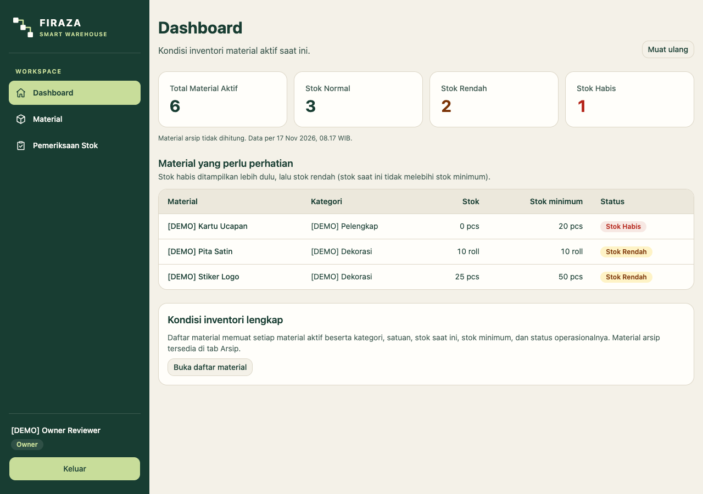
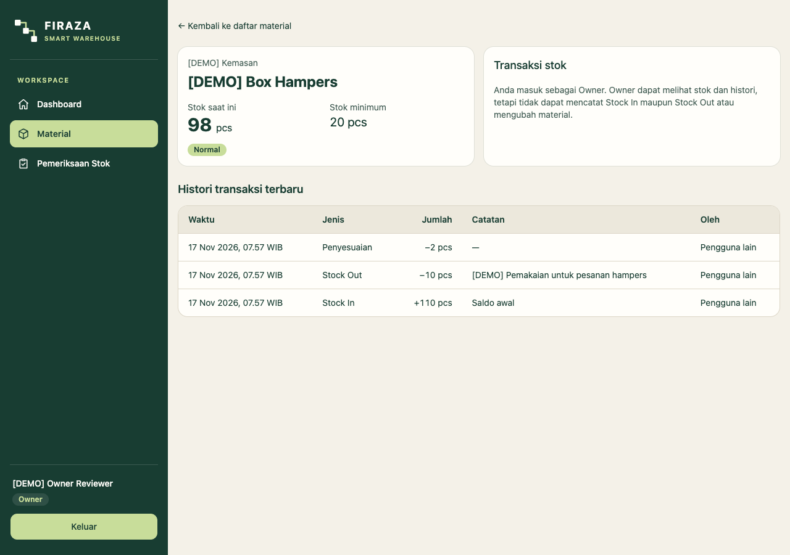

# Smart Warehouse Firaza

> **Status (17 November 2026):** Web MVP capstone Dicoding Bootcamp Batch 15, learning path Full-Stack Web Developer, tipe individu, ID proyek **B26B15J014**. Source aplikasi yang diuji dan di-deploy untuk demo reviewer adalah commit `7f8d88c` (termasuk UI Concept C). Demo berjalan di **https://firaza-reviewer.vercel.app** dengan database terpisah berisi data sintetis.

Smart Warehouse Firaza adalah aplikasi web untuk membantu usaha hampers dan personalized gift Firaza mengelola persediaan material pendukung fulfillment. Aplikasi ini mencakup:

- memantau kondisi stok;
- mengelola data material;
- mencatat Stock In dan Stock Out;
- menjalankan Pemeriksaan Stok;
- menelusuri histori transaksi.

Ada dua peran: **Staff Warehouse** mencatat dan mengelola data, sedangkan **Owner** memantau tanpa dapat mengubah data.

## Demo untuk reviewer

| Hal | Keterangan |
|---|---|
| Alamat | https://firaza-reviewer.vercel.app |
| Akun | Satu akun Owner dan satu akun Staff Warehouse. Email dan password diserahkan terpisah melalui proses submission, tidak dicantumkan di README maupun repositori. Tidak ada registrasi publik. |
| Data | Data sintetis berlabel `[DEMO]` (data awal) dan `[QA-REVIEWER]` (data pengujian), bukan data bisnis. |
| Perubahan | Perubahan yang dibuat reviewer tersimpan dan tidak di-reset otomatis. Angka stok, jumlah material, dan jumlah sesi dapat berbeda dari kondisi awal. |
| Riwayat | Transaksi tidak dapat dihapus dari aplikasi. Koreksi stok dilakukan lewat Pemeriksaan Stok. |

Deployment privat Owner terpisah dari demo ini dan tidak dibuka untuk reviewer. Demo tidak memakai database deployment tersebut.

## Tangkapan layar demo

Gambar berikut berasal dari smoke test reviewer pada **17 November 2026**, menggunakan data sintetis. Dashboard menunjukkan kondisi awal run, sebelum material `[QA-REVIEWER]` ditambahkan. Angka pada demo dapat berubah saat reviewer menggunakannya.

### Dashboard Owner



### Detail material dan histori



Owner melihat stok dan histori tanpa kontrol untuk mengubah data. Pedoman penggunaan PDF untuk Owner dan Staff disertakan melalui submission capstone. Password akun demo diserahkan melalui informasi akses submission.

## Fitur

| Fitur | Keterangan |
|---|---|
| Login dan logout | Lewat REST API aplikasi dengan Supabase Auth. Sesi disimpan di cookie `HttpOnly`. Akun disiapkan pengelola. |
| Pembagian peran | `STAFF_WAREHOUSE` mengelola material, mencatat Stock In dan Stock Out, dan menjalankan Pemeriksaan Stok. `OWNER` hanya membaca. Peran dibaca dari database dan ditegakkan di API serta di database. |
| Dashboard | Empat ringkasan material aktif: total, stok normal, stok rendah, dan stok habis. Juga ada tabel material yang perlu perhatian (stok habis, lalu stok rendah). Material arsip tidak dihitung. |
| Daftar dan detail material | Nama, kategori, satuan, stok saat ini, stok minimum, dan status stok (Normal, Stok Rendah, Stok Habis), dengan tab material aktif dan arsip. |
| Manajemen material | Tambah dan ubah (nama, kategori, satuan, stok minimum); arsip dan aktifkan kembali dengan alasan; hapus permanen hanya untuk material tanpa riwayat. Satuan terkunci setelah ada transaksi atau item Pemeriksaan Stok. Stok tidak dapat diubah dari form material. |
| Kategori | Hanya dibaca. Kategori disiapkan pengelola sistem. |
| Stock In dan Stock Out | Jumlah berupa bilangan bulat positif dengan catatan opsional. Stock Out ditolak bila stok tidak mencukupi. Stok awal dicatat sebagai Stock In dengan catatan "Saldo awal". |
| Pemeriksaan Stok | Lihat bagian [Pemeriksaan Stok](#pemeriksaan-stok). |
| Histori | Transaksi terbaru dan riwayat arsip per material. Pelaku ditampilkan sebagai "Anda" atau "Pengguna lain". |
| Anti transaksi ganda | Stock In, Stock Out, dan pembuatan sesi Pemeriksaan Stok memakai `Idempotency-Key`. Pengiriman ulang dengan key dan data yang sama tidak mencatat ulang. Finalisasi dan pembatalan ditolak bila sesi sudah tidak berlangsung. |

**Pemantauan inventori** tersedia melalui Dashboard dan daftar Material. Aplikasi tidak menyediakan ekspor atau laporan terpisah.

**Belum tersedia:** koreksi transaksi (`REVERSAL`), ekspor dan laporan terpisah, pencarian dan filter, histori transaksi global, pengelolaan kategori dan akun dari aplikasi, serta fitur AI.

### Pemeriksaan Stok

Antarmuka memakai istilah **Pemeriksaan Stok** untuk proses yang di source code, route, API, dan database bernama Stock Opname (`stock_opname`).

- Staff memilih material saat membuat sesi. Material terpilih dibekukan sampai sesi difinalisasi atau dibatalkan.
- Hanya pembuat sesi yang dapat mengisi hasil hitung dan memfinalisasi. Staff Warehouse lain dapat membatalkan sesi dengan alasan.
- Finalisasi bersifat atomik dan membuat transaksi Penyesuaian hanya untuk selisih yang tidak nol.
- Draf hasil hitung yang belum disimpan dipulihkan di tab yang sama. Antarmuka meminta konfirmasi sebelum meninggalkan halaman dengan perubahan yang belum disimpan.

| Antarmuka | Source / API / database |
|---|---|
| Pemeriksaan Stok, Sesi Pemeriksaan | Stock Opname: `/stock-opnames`, `/api/v1/stock-opnames`, tabel `stock_opname` |
| Berlangsung | `ACTIVE` |
| Difinalisasi / Finalisasi | `POSTED` / `POST /api/v1/stock-opnames/{id}/post`, RPC `post_stock_opname` |
| Dibatalkan | `CANCELLED` / `POST /api/v1/stock-opnames/{id}/cancel`, RPC `cancel_stock_opname` |
| Simpan hasil hitung | `PUT /api/v1/stock-opnames/{id}/counts`, RPC `record_stock_opname_counts` |

## Antarmuka (UI Concept C)

- **Desktop (lebar 1024 px ke atas):** sidebar dengan logo Firaza dan tiga menu (Dashboard, Material, Pemeriksaan Stok), ditambah nama dan peran pengguna serta tombol Keluar.
- **Layar di bawah 1024 px:** bilah atas dengan drawer navigasi (Radix Dialog) yang memiliki tombol buka/tutup berlabel dan menutup otomatis setelah navigasi. Kontrol utama berukuran sentuh 44 px.
- Dashboard memakai kartu ringkasan dan, di layar kecil, daftar berbentuk kartu.

## Teknologi

| Lapisan | Teknologi |
|---|---|
| Framework | Next.js 16 (App Router, Route Handlers), React 19, JavaScript |
| UI | Tailwind CSS v4, shadcn/ui, Radix UI |
| Validasi | Zod v4, dipakai bersama di form dan API |
| HTTP client | Axios |
| Database dan autentikasi | Supabase: PostgreSQL dan Supabase Auth, melalui `@supabase/ssr` dan `@supabase/supabase-js` |
| Tooling | Supabase CLI (devDependency), GitHub Actions (unit test dan build) |
| Hosting demo | Vercel |

## Arsitektur singkat

```
Browser (Client Component)
  └─ Axios ─▶ REST API Next.js  /api/v1/*   (Route Handlers, validasi Zod, cek origin)
                └─ Supabase client dengan sesi pengguna
                     └─ PostgreSQL: RLS + RPC (stock movement, material, Stock Opname: otorisasi, saldo, idempotency)
```

- Browser tidak memanggil Supabase langsung, dan kunci Supabase tidak dikirim ke browser.
- Saldo stok, penolakan stok tidak cukup, otorisasi peran, dan idempotency ditegakkan di PostgreSQL. Histori transaksi bersifat append-only.
- Role API tidak memiliki hak `INSERT`, `UPDATE`, atau `DELETE` langsung pada tabel bisnis. Semua perubahan lewat RPC.

### REST API

| Method | Endpoint | Keterangan |
|---|---|---|
| `POST` | `/api/v1/auth/login` | Body `{ email, password }` |
| `POST` | `/api/v1/auth/logout` | Mengakhiri sesi saat ini |
| `GET` | `/api/v1/auth/session` | Pengguna yang sedang masuk beserta perannya |
| `GET` | `/api/v1/dashboard` | Ringkasan stok material aktif dan material yang perlu perhatian (maksimal 50 baris, beserta totalnya) |
| `GET` | `/api/v1/categories` | Daftar kategori |
| `GET` | `/api/v1/materials?archived=true\|false` | Daftar material aktif (default) atau arsip |
| `POST` | `/api/v1/materials` | Body `{ categoryId, name, unit, minimumStock }`. Hanya Staff Warehouse |
| `GET` | `/api/v1/materials/{id}` | Detail material beserta petunjuk `unitLocked` dan `deletable` |
| `PUT` | `/api/v1/materials/{id}` | Body seperti `POST`. Hanya Staff Warehouse |
| `DELETE` | `/api/v1/materials/{id}` | Hapus permanen material tanpa riwayat. Hanya Staff Warehouse |
| `POST` | `/api/v1/materials/{id}/archive` | Body `{ reason }`. Hanya Staff Warehouse |
| `POST` | `/api/v1/materials/{id}/reactivate` | Body `{ reason }`. Hanya Staff Warehouse |
| `GET` | `/api/v1/materials/{id}/status-events?limit=20` | Riwayat arsip dan aktif kembali |
| `GET` | `/api/v1/materials/{id}/transactions?limit=20` | Histori transaksi terbaru (limit 1–100) |
| `POST` | `/api/v1/stock-movements` | Header `Idempotency-Key: <uuid>`. Body `{ materialId, type: "STOCK_IN" \| "STOCK_OUT", quantity, notes? }`. Hanya Staff Warehouse |
| `GET` | `/api/v1/stock-opnames?status=ACTIVE\|POSTED\|CANCELLED` | 100 sesi terbaru |
| `POST` | `/api/v1/stock-opnames` | Header `Idempotency-Key: <uuid>`. Body `{ materialIds }`. Hanya Staff Warehouse |
| `GET` | `/api/v1/stock-opnames/{id}` | Detail sesi, item, selisih, dan petunjuk hak akses |
| `PUT` | `/api/v1/stock-opnames/{id}/counts` | Body `{ counts: [{ itemId, countedStock }] }`; nilai menggantikan hitungan sebelumnya. Hanya pembuat sesi |
| `POST` | `/api/v1/stock-opnames/{id}/post` | Body `{}`. Hanya pembuat sesi |
| `POST` | `/api/v1/stock-opnames/{id}/cancel` | Body `{ reason }`. Staff Warehouse mana pun |

**Format error dan origin.** Respons error berbentuk `{ "error": { "code", "message", "fields"? } }`. Permintaan yang mengubah data hanya menerima body JSON (`Content-Type: application/json`) dari origin yang sama. `DELETE` dan logout juga hanya menerima permintaan dari origin yang sama.

**Replay pembuatan sesi.** Bila sesi dibuat ulang dengan key dan daftar material yang sama, API mengembalikan respons pembuatan pertama, termasuk status `ACTIVE` saat itu, walaupun sesi sudah difinalisasi atau dibatalkan. Status terkini selalu dibaca dari `GET /api/v1/stock-opnames/{id}`.

## Menjalankan secara lokal

Bagian ini untuk developer. Semua langkah memakai Supabase **lokal** dan data sintetis.

### Prasyarat

- Node.js 24 dan npm (versi yang dipakai CI).
- Docker Desktop yang sedang berjalan (untuk Supabase lokal).
- Git.

### 1. Instal dependency

```bash
git clone https://github.com/syahreza0511/smart-warehouse-firaza.git
cd smart-warehouse-firaza
npm ci
```

### 2. Jalankan Supabase lokal

```bash
npx supabase start
```

Perintah ini menjalankan Supabase di Docker dan menerapkan ketujuh migration di `supabase/migrations/`.

Setelah selesai, `npx supabase status -o env` menampilkan URL API lokal (`API_URL`) dan kunci-kuncinya, antara lain `PUBLISHABLE_KEY` dan `SERVICE_ROLE_KEY`. Jangan bagikan atau commit output tersebut.

### 3. Atur environment variable

```bash
cp .env.example .env.local
```

Isi `.env.local`:

| Variable | Nilai lokal |
|---|---|
| `SUPABASE_URL` | `http://127.0.0.1:54321` |
| `SUPABASE_PUBLISHABLE_KEY` | Nilai `PUBLISHABLE_KEY` dari `npx supabase status -o env` |
| `AUTH_COOKIE_SECURE` | `false`, karena aplikasi lokal dilayani lewat HTTP |

- Jangan pernah memasukkan service role key atau secret key ke environment aplikasi.
- `.env.local` diabaikan Git. Jangan commit file environment yang berisi nilai asli.
- Di deployment HTTPS, biarkan `AUTH_COOKIE_SECURE` tidak di-set (atau `true`). Cookie autentikasi selalu memakai atribut `Secure` kecuali nilainya persis `false`.

### 4. Siapkan akun dan data demo lokal

Registrasi publik dinonaktifkan dan aplikasi belum memiliki antarmuka admin. Karena itu akun dan kategori disiapkan developer di Supabase **lokal**, sedangkan material dibuat Staff Warehouse melalui aplikasi. Gunakan data sintetis, bukan data pribadi.

1. Buat pengguna Auth melalui Auth Admin API lokal.

   Isi variabel shell `SERVICE_ROLE_KEY` dengan nilai `SERVICE_ROLE_KEY` dari `npx supabase status -o env`. Kunci ini hanya untuk perintah admin di terminal Anda, bukan untuk aplikasi.

   ```bash
   curl -X POST http://127.0.0.1:54321/auth/v1/admin/users \
     -H "apikey: $SERVICE_ROLE_KEY" -H "Authorization: Bearer $SERVICE_ROLE_KEY" \
     -H "Content-Type: application/json" \
     -d '{"email":"staff@example.test","password":"<password-anda>","email_confirm":true}'
   ```

   Catat `id` pengguna dari respons, lalu ulangi untuk akun Owner.

2. Buat profil dan peran melalui function admin, dari sesi SQL sebagai `postgres`:

   ```bash
   docker exec -it supabase_db_Smart-Warehouse-Firaza-GitHub-Ready psql -U postgres -d postgres
   ```

   ```sql
   select app_private.admin_provision_profile(
     '<user-id>'::uuid, 'staff@example.test', 'Staff Demo',
     'STAFF_WAREHOUSE', 'developer', 'Akun demo lokal', gen_random_uuid());
   ```

   Untuk Owner, gunakan peran `'OWNER'`.

3. Buat kategori demo di sesi SQL yang sama (kategori hanya dibaca oleh aplikasi):

   ```sql
   insert into public.categories (name) values ('[DEMO] Kemasan');
   ```

   Setelah itu, buat material melalui halaman "Tambah material" (stok awal 0). Catat stok awal sebagai Stock In dengan catatan "Saldo awal" agar saldo selalu sesuai dengan histori transaksi.

### 5. Jalankan aplikasi

```bash
npm run dev
```

Buka `http://localhost:3000`, lalu masuk dengan akun yang sudah dibuat. Untuk production build, jalankan `npm run build` lalu `npm run start`.

## Pengujian

Hasil pengujian dibedakan menurut jenis dan lingkungannya.

### Unit test dan build (CI)

```bash
node --test 'tests/unit/*.test.mjs'
```

- Unit test berjalan tanpa jaringan maupun database.
- GitHub Actions menjalankan unit test lalu `next build` pada setiap pull request ke `main` dan setiap push ke `main`.
- Hasil untuk source aplikasi `7f8d88c` (16 November 2026): **191 unit test lulus dan build Next.js berhasil** ([run CI](https://github.com/syahreza0511/smart-warehouse-firaza/actions/runs/43894794119)).
- Pembaruan README melalui merge `412fc96` (17 November 2026) juga lulus **191 unit test dan build** ([run CI](https://github.com/syahreza0511/smart-warehouse-firaza/actions/runs/43997118534)). Ini pemeriksaan CI, bukan pengujian browser baru.

### QA browser di demo reviewer (17 November 2026)

**17 dari 17 skenario lulus**, dijalankan terhadap https://firaza-reviewer.vercel.app dari commit `7f8d88c` dengan data sintetis.

- **14 skenario UI** di Chrome headless, desktop 1280 px, dan emulasi mobile 390 px:
  - Owner: login, dashboard sesuai database, daftar dan detail material serta histori, detail sesi yang difinalisasi dan dibatalkan tanpa kontrol ubah, dan logout.
  - Staff: membuat dan mengubah nama material, Stock In 20, dan Stock Out 3 (stok 17).
  - Staff: Pemeriksaan Stok dengan hasil hitung 15 diisi di 390 px, lalu finalisasi (stok 15, Penyesuaian −2).
  - Staff: sesi kedua dibatalkan dengan alasan, lalu logout.
- **3 pemeriksaan API** lewat `fetch` dari halaman aplikasi:
  - replay Stock In dengan key dan payload yang sama tidak menambah stok atau ledger;
  - finalisasi ulang ditolak `409 OPNAME_NOT_ACTIVE`;
  - Owner yang mencoba Stock In ditolak `403 FORBIDDEN` tanpa perubahan stok.
- **Verifikasi akhir (baca-saja di database demo):** stok sama dengan jumlah ledger, tidak ada sesi berlangsung atau material yang dibekukan, dan data seed tidak berubah.

### Uji integrasi lokal

Harness integrasi HTTP dan SQL ada di `tests/integration/`. Harness ini mengubah state (sesi Auth, akun demo, dan sebagian data inventori sintetis), sehingga hanya dijalankan dengan sengaja terhadap stack Supabase lokal yang terisolasi dan tidak dijalankan CI. Petunjuknya ada di [tests/README.md](tests/README.md).

### Batas cakupan pengujian

- QA browser hanya memakai Chrome headless. Tampilan mobile diuji dengan emulasi 390 px.
- Safari, Firefox, dan perangkat mobile nyata belum diverifikasi.
- Penonaktifan akun saat sesi aktif dan kedaluwarsa sesi belum diuji di demo.
- Hasil di atas tidak berarti semua aspek keamanan sudah diuji atau lulus.

## Keterbatasan saat ini

- **Tampilan 390 px:** tabel hasil hitung Pemeriksaan Stok lebih lebar dari layar dan perlu digeser di dalam tabel. Halaman sendiri tidak bergeser horizontal.
- **Batas daftar:** daftar material tidak memakai paginasi dan dibatasi `max_rows` PostgREST (1000 baris). Tabel perhatian di dashboard menampilkan maksimal 50 baris beserta totalnya, dan daftar Pemeriksaan Stok menampilkan 100 sesi terbaru.
- **Draf hasil hitung:** draf yang belum disimpan hanya dipulihkan di tab yang sama (sessionStorage, berlaku 8 jam) dan tetap harus disimpan atau dibuang. Tidak ada sinkronisasi antar tab.
- **Kebijakan yang belum diputuskan:** perubahan nama, kategori, atau stok minimum material yang sedang dibekukan Pemeriksaan Stok saat ini diizinkan. Perubahan bersamaan oleh dua Staff memakai aturan "perubahan terakhir menang".
- **Alasan pembatalan:** spasi di awal dan akhir alasan dirapikan oleh API, tetapi tidak oleh fungsi database bila dipanggil langsung.
- **Temuan keamanan terbuka:** beberapa temuan berprioritas rendah masih terbuka, misalnya belum ada pembatasan percobaan login di tingkat aplikasi.

## Dokumentasi

- [Indeks dokumentasi](docs/README.md) menunjukkan acuan aplikasi saat ini dan arsip perencanaan.
- [Status implementasi per 17 November 2026](docs/STATUS-IMPLEMENTASI.md) merangkum cakupan, keputusan yang berubah, bukti pengujian dan batasnya.
- [Panduan pengujian](tests/README.md) menjelaskan harness integrasi lokal.

Dokumen perencanaan lama tetap tersedia dengan penanda arsip pada pembukanya. Istilah “kanonik”, status belum deploy, ID lama dan fitur yang direncanakan di dalam arsip perlu dibaca menurut periode catatannya. Status implementasi menjelaskan perubahan yang sudah terjadi, termasuk pembatalan fitur Catatan Owner.

## Struktur proyek

```
app/                 Halaman (/login, /dashboard, /materials, /stock-opnames) dan REST API (app/api/v1)
components/          Komponen antarmuka: shell navigasi, form material, Stock In dan Stock Out, Pemeriksaan Stok
lib/                 Klien API, validasi Zod, dan modul server (Supabase, auth, HTTP)
public/brand/        Aset logo Firaza
supabase/            Konfigurasi Supabase lokal dan migration SQL
tests/               Unit test dan harness uji integrasi
docs/                Indeks, status implementasi, screenshot dan arsip perencanaan
```

Mulai dari [docs/README.md](docs/README.md) sebelum membaca arsip desain. Source aplikasi dan migration SQL tetap dapat diperiksa untuk memverifikasi implementasi yang dijelaskan.

## Keamanan

- Jangan commit `.env.local`, token, password, API key, credential database, atau file rahasia lainnya. `.env.example` hanya berisi placeholder.
- Service role key dan secret key Supabase tidak boleh dipakai oleh aplikasi. Keduanya hanya untuk tugas admin developer.
- Gunakan data sintetis untuk pengembangan, pengujian, dan demo.

## Alur kerja Git

Pengembangan dilakukan di feature branch, lalu digabungkan ke `main` melalui pull request setelah check CI "Build" lulus.
