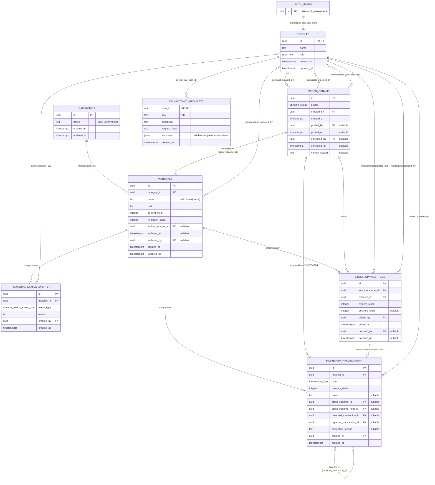

# Database Design Document

# Smart Warehouse Firaza

> **Status dokumen:** desain database Smart Warehouse Firaza.
> **Revisi:** Gelombang 2a, 29 Oktober 2026.
>
> - Kebutuhan produk mengacu pada [PRD-Smart-Warehouse-Firaza-Dicoding.md](PRD-Smart-Warehouse-Firaza-Dicoding.md) (PRD kanonik) dan [FEATURE-SPECIFICATION-Smart-Warehouse-Firaza.md](FEATURE-SPECIFICATION-Smart-Warehouse-Firaza.md). Keputusan teknologi mengacu pada [STACK-DECISION-LOG.md](STACK-DECISION-LOG.md).
> - Seluruh isi dokumen ini berstatus **[RENCANA — belum diimplementasikan]**. Belum ada SQL migration, database, maupun kode aplikasi. Belum ada constraint, function, atau policy yang diuji.
> - Dokumen ini menjelaskan desain, bukan artefak yang dapat dieksekusi. Ekspresi seperti `current_stock >= 0` atau `lower(name)` ditulis sebagai penjelasan aturan; SQL migration dibuat terpisah pada tahap implementasi.
> - Label sumber mengikuti legenda di PRD kanonik. Pilihan teknis yang belum disetujui ditulis sebagai **rekomendasi** dalam teks biasa, tanpa label tambahan.

## Keputusan Desain Database (Peninjauan File 5)

Keputusan berikut disetujui developer pada 29 Oktober 2026 saat meninjau rencana revisi dokumen ini. Keputusan ini **telah disinkronkan** ke requirement PRD kanonik dengan pemetaan: A → FR-CAT-03, FR-MAT-10; B → FR-MAT-05; C → FR-OPN-04 (menutup OD-11); D → FR-COR-06; E → FR-TRX-05; F → FR-MAT-11. Rincian teknis penegakan aturan tetap berada di dokumen ini.

| Ref | Keputusan [KEPUTUSAN] | Dirinci di |
|---|---|---|
| A | Nama kategori dan nama material unik tanpa membedakan huruf besar/kecil. Nama material arsip tetap dianggap terpakai. | §4.2, §4.3 |
| B | Material yang memiliki histori pengarsipan atau reaktivasi tidak dapat dihapus permanen. | §4.3, §4.4 |
| C | Penanda pembekuan material adalah `materials.active_opname_id` (menutup OD-11). | §4.3, §11 |
| D | Maksimal satu `REVERSAL` per transaksi asal; transaksi `REVERSAL` tidak dapat di-reverse; transaksi pengganti boleh dikoreksi lagi. | §4.5, §10 |
| E | Satu tabel idempotency untuk operasi mutasi yang relevan, unik per `(user_id, key)`, tanpa kedaluwarsa otomatis sebelum kebijakan retensi disetujui. | §4.8, §9 |
| F | Material arsip harus direaktivasi melalui proses resmi sebelum dapat diedit; selama diarsipkan, tidak ada field yang dapat diubah, termasuk nama, kategori, dan `minimum_stock`. | §4.3, §7 |

------------------------------------------------------------------------

# 1. Database Overview

Database Design Document ini menjelaskan rancangan struktur database
untuk aplikasi Smart Warehouse Firaza.

Database dirancang untuk mendukung proses utama aplikasi:

-   Authentication dan otorisasi pengguna.
-   Pengelolaan kategori dan raw material, termasuk pengarsipan.
-   Pencatatan saldo awal, stock in, dan stock out.
-   Koreksi transaksi final.
-   Stock Opname berbasis sesi.
-   Monitoring kondisi stok.
-   Audit history aktivitas pengguna.

## 1.1 Stack Database

| Aspek | Keputusan | Sumber |
|---|---|---|
| Database | PostgreSQL yang dikelola Supabase | [KEPUTUSAN] ADR-03 |
| Autentikasi | Supabase Auth; tidak ada password di tabel aplikasi | [KEPUTUSAN] ADR-04 |
| Akses data | Supabase JavaScript client, tanpa ORM | [KEPUTUSAN] ADR-06 |
| Perubahan skema | SQL migration yang disimpan di repository | [KEPUTUSAN] ADR-07 |
| Operasi atomik | PostgreSQL function yang dipanggil melalui Supabase RPC | [KEPUTUSAN] ADR-08 |
| Bahasa aplikasi | JavaScript | [KEPUTUSAN] ADR-02 |

## 1.2 Konvensi

-   Nama tabel dan kolom memakai `snake_case`. (berasal dari dokumentasi sebelumnya)
-   Primary key bertipe `uuid` yang dibangkitkan database, kecuali `profiles.id` yang mengikuti `auth.users.id`.
-   Seluruh waktu memakai `timestamptz` agar zona waktu tersimpan; server Supabase berjalan dalam UTC sedangkan pengguna berada di WIB. Rekomendasi.
-   Kuantitas memakai `integer`. Kuantitas pecahan tidak didukung. [KEPUTUSAN]
-   Nilai terbatas memakai enum PostgreSQL (§4.0).
-   `created_at` diisi otomatis. `updated_at` diperbarui oleh trigger database, karena PostgreSQL tidak memperbaruinya secara otomatis. Rekomendasi.
-   Kolom pelaku (`created_by`, `archived_by`, dan sejenisnya) merujuk `profiles.id`.

------------------------------------------------------------------------

# 2. Database Scope

Pada tahap MVP, database hanya berfokus pada pengelolaan Raw Material
Inventory. [KEPUTUSAN]

Jenis data yang dikelola:

## Raw Material

### Packaging Material

Contoh: - Kardus. - Ribbon. - Bubble wrap. - Plastik packaging. -
Sticker. - Box.

### Product Supporting Material

Contoh: - Handuk polos. - Sajadah polos.

Setiap material memiliki satuan dasar yang eksplisit dalam unit utuh (pcs, pack, roll, lembar, dan sejenisnya). Konversi satuan tidak termasuk MVP. [KEPUTUSAN]

Finished product inventory, supplier management, dan integrasi
marketplace tidak termasuk MVP.

------------------------------------------------------------------------

# 3. Entity Relationship Overview

## 3.1 Diagram ER (sumber Mermaid)

Diagram berikut adalah sumber diagram yang berlaku dan harus selalu cocok dengan §4. Diagram ini menggambarkan desain yang direncanakan, bukan database yang sudah ada.

## 3.2 Status ERD PNG

`ERD-Smart-Warehouse-Firaza.png` telah dirender ulang dari sumber Mermaid §3.1 pada 29 Oktober 2026 dan menggantikan versi lama yang tidak sesuai desain ini.

-   Renderer: Mermaid CLI (`@mermaid-js/mermaid-cli`) 11.4.2, dengan konfigurasi layout ELK, latar putih, skala 2.
-   Layout ELK dipakai karena layout bawaan menggabungkan dua relasi self-reference `INVENTORY_TRANSACTIONS` sehingga relasi `reversed_transaction_id` tidak tergambar. Sumber Mermaid tidak diubah.
-   Diperiksa secara visual dan dicocokkan dengan sumber: 9 entitas dan 20 relasi tergambar, kardinalitas sesuai, tidak ada bagian yang terpotong.
-   Gambar ini memvisualisasikan desain yang direncanakan, bukan database yang sudah diimplementasikan.
-   Jika §3.1 berubah, PNG harus dirender ulang; sumber Mermaid tetap menjadi acuan.

------------------------------------------------------------------------

# 4. Database Entities

## 4.0 Enum

| Enum | Nilai | Sumber |
|---|---|---|
| `user_role` | `OWNER`, `STAFF_WAREHOUSE` | [KEPUTUSAN] (PRD: dua role) |
| `transaction_type` | `OPENING_BALANCE`, `STOCK_IN`, `STOCK_OUT`, `ADJUSTMENT`, `REVERSAL` | [KEPUTUSAN] (PRD FR-TRX) |
| `opname_status` | `ACTIVE`, `POSTED`, `CANCELLED` | [KEPUTUSAN] (PRD FR-OPN-02) |
| `material_status_event_type` | `ARCHIVED`, `REACTIVATED` | [DITURUNKAN] (PRD FR-MAT-06, FR-MAT-08) |

------------------------------------------------------------------------

## 4.1 profiles

Menggantikan tabel `users` pada versi sebelumnya. Kredensial (email dan password) dikelola Supabase Auth di `auth.users`, bukan di tabel aplikasi. [DITURUNKAN] (ADR-04)

| Field | Type | Null | Constraint | Description |
|---|---|---|---|---|
| id | uuid | NOT NULL | PK; FK → `auth.users.id`, ON DELETE RESTRICT | Identitas pengguna dari Supabase Auth |
| name | text | NOT NULL | CHECK tidak kosong | Nama pengguna |
| role | user_role | NOT NULL | — | `OWNER` atau `STAFF_WAREHOUSE` |
| created_at | timestamptz | NOT NULL | default now() | Waktu dibuat |
| updated_at | timestamptz | NOT NULL | default now(); trigger | Waktu diperbarui |

Catatan:

-   Kardinalitas: setiap profil merujuk tepat satu akun Supabase Auth (dijamin FK). Sebaliknya, sebuah akun Auth memiliki **nol atau satu** profil: FK tidak menjamin setiap akun memiliki profil, dan mekanisme pembuatan profil belum diputuskan. Akun tanpa profil tidak memiliki role, sehingga ditolak oleh RLS (§12) dan oleh pemeriksaan role di function (§7.1).
-   ON DELETE RESTRICT menjaga agar akun yang pernah menjadi pelaku tidak terhapus beserta jejak auditnya. Rekomendasi.
-   Cara pembuatan baris profil (seed oleh developer atau trigger saat akun Auth dibuat) mengikuti asumsi bahwa akun dibuat developer [ASUMSI] (PRD FR-AUTH-02) dan belum diputuskan.
-   Pengguna tidak dapat mengubah `role` miliknya sendiri (§12).

------------------------------------------------------------------------

## 4.2 categories

| Field | Type | Null | Constraint | Description |
|---|---|---|---|---|
| id | uuid | NOT NULL | PK | ID kategori |
| name | text | NOT NULL | CHECK tidak kosong; unique index pada `lower(name)` | Nama kategori |
| created_at | timestamptz | NOT NULL | default now() | Waktu dibuat |
| updated_at | timestamptz | NOT NULL | default now(); trigger | Waktu diperbarui |

Aturan:

-   Nama kategori unik tanpa membedakan huruf besar/kecil: "Packaging Material" dan "packaging material" dianggap sama. [KEPUTUSAN] (Keputusan A) Unique index berlaku di database, sehingga tetap ditegakkan untuk jalur tulis mana pun, termasuk akses langsung melalui Supabase API.
-   Kategori yang masih direferensikan material tidak dapat dihapus, termasuk oleh material arsip, karena `materials.category_id` memakai ON DELETE RESTRICT. [KEPUTUSAN] (PRD FR-CAT-02)
-   [OPEN DECISION OD-19] Normalisasi spasi (spasi di awal/akhir nama) **belum menjadi keputusan bisnis** dan tetap berstatus rekomendasi. Tanpa normalisasi, "Kardus" dan "Kardus " lolos unique index `lower(name)` sebagai dua nama berbeda. Validasi input di Route Handler saja tidak cukup, karena tabel yang dapat ditulis langsung melalui Supabase API melewati Route Handler.

Pilihan penegakan normalisasi (berlaku sama untuk `categories` dan `materials`):

| Opsi | Cara | Jalur langsung ke Supabase | Catatan |
|---|---|---|---|
| 1. Validasi input saja | Route Handler merapikan nama | Tidak tertangani | Tidak konsisten |
| 2. CHECK di database | CHECK menolak nama yang berbeda dari versi tanpa spasi awal/akhir | Tertangani (ditolak) | Aturan satu baris; berlaku untuk semua jalur |
| 3. Seluruh tulis lewat function | Function merapikan nama sebelum menyimpan; tidak ada grant tulis langsung | Tidak ada jalur langsung | Konsisten dengan `materials` yang sudah ditulis lewat function |

Rekomendasi (belum disetujui): Opsi 3 dikombinasikan dengan Opsi 2 sebagai lapisan pertahanan. Selama belum diputuskan, desain ini tidak mewajibkan normalisasi; unique index `lower(name)` tetap wajib.

------------------------------------------------------------------------

## 4.3 materials

Tabel utama inventory.

| Field | Type | Null | Constraint | Description |
|---|---|---|---|---|
| id | uuid | NOT NULL | PK | ID material |
| category_id | uuid | NOT NULL | FK → `categories.id`, ON DELETE RESTRICT | Kategori |
| name | text | NOT NULL | CHECK tidak kosong; unique index pada `lower(name)` | Nama material |
| unit | text | NOT NULL | CHECK tidak kosong | Satuan dasar (pcs, pack, roll, lembar, …) |
| current_stock | integer | NOT NULL | default 0; CHECK `current_stock >= 0` | Stok saat ini |
| minimum_stock | integer | NOT NULL | CHECK `minimum_stock >= 0` | Batas minimum stok |
| active_opname_id | uuid | NULL | FK → `stock_opname.id`, ON DELETE RESTRICT | Sesi Stock Opname aktif yang membekukan material; NULL jika tidak dibekukan |
| archived_at | timestamptz | NULL | — | Waktu diarsipkan; NULL jika aktif |
| archived_by | uuid | NULL | FK → `profiles.id`, ON DELETE RESTRICT | Pelaku pengarsipan |
| created_at | timestamptz | NOT NULL | default now() | Waktu dibuat |
| updated_at | timestamptz | NOT NULL | default now(); trigger | Waktu diperbarui |

CHECK tingkat baris:

-   `archived_at` dan `archived_by` sama-sama NULL atau sama-sama terisi. [DITURUNKAN]
-   Jika `archived_at` terisi, `current_stock = 0`. [DITURUNKAN] (PRD FR-MAT-06)

Aturan:

-   Material baru dibuat dengan `current_stock = 0`. Stok hanya berubah melalui transaksi dan posting Stock Opname; mekanisme saldo awal mengikuti OD-17. [DITURUNKAN] (PRD FR-MAT-04)
-   Nama material unik tanpa membedakan huruf besar/kecil, **termasuk** terhadap material arsip; unique index tidak dibatasi pada material aktif. [KEPUTUSAN] (Keputusan A)
-   `unit` tidak dapat diubah setelah material memiliki transaksi atau tercatat sebagai item Stock Opname. Aturan ini melibatkan tabel lain sehingga ditegakkan oleh function `update_material`, bukan CHECK. [DITURUNKAN] (PRD FR-MAT-03)
-   Material arsip tidak dapat diedit sama sekali sebelum direaktivasi melalui `reactivate_material`; seluruh perubahan field ditolak, termasuk nama, kategori, dan `minimum_stock`. [KEPUTUSAN] (Keputusan F) Setelah reaktivasi, aturan `unit` di atas tetap berlaku.
-   Material hanya dapat dihapus permanen jika tidak direferensikan oleh `inventory_transactions`, `stock_opname_items`, maupun `material_status_events`. Seluruh referensi tersebut memakai ON DELETE RESTRICT sehingga database menolak penghapusan. [KEPUTUSAN] (PRD FR-MAT-05; Keputusan B)
-   `current_stock`, `active_opname_id`, `archived_at`, dan `archived_by` hanya diubah oleh database function (§7, §12).
-   Status stok operasional tidak disimpan sebagai kolom (§6.1).

Contoh:

Kardus Medium: - Unit: pcs - Current Stock: 200 - Minimum Stock: 50

------------------------------------------------------------------------

## 4.4 material_status_events

Riwayat pengarsipan dan reaktivasi material.

| Field | Type | Null | Constraint | Description |
|---|---|---|---|---|
| id | uuid | NOT NULL | PK | ID peristiwa |
| material_id | uuid | NOT NULL | FK → `materials.id`, ON DELETE RESTRICT | Material terkait |
| event_type | material_status_event_type | NOT NULL | — | `ARCHIVED` atau `REACTIVATED` |
| reason | text | NOT NULL | CHECK tidak kosong | Alasan wajib |
| created_by | uuid | NOT NULL | FK → `profiles.id`, ON DELETE RESTRICT | Pelaku |
| created_at | timestamptz | NOT NULL | default now() | Waktu |

Aturan:

-   Setiap pengarsipan dan reaktivasi menghasilkan satu baris, ditulis dalam transaksi yang sama dengan perubahan kolom arsip di `materials`. [KEPUTUSAN] (PRD FR-MAT-06, FR-MAT-08)
-   Baris tidak dapat diubah atau dihapus. [DITURUNKAN] (NFR-03)
-   ON DELETE RESTRICT pada `material_id` membuat material yang memiliki riwayat ini tidak dapat dihapus permanen. [KEPUTUSAN] (Keputusan B)

------------------------------------------------------------------------

## 4.5 inventory_transactions

Menyimpan seluruh perubahan stok. Baris bersifat final: tidak dapat diubah atau dihapus. [KEPUTUSAN] (PRD FR-COR-01)

| Field | Type | Null | Constraint | Description |
|---|---|---|---|---|
| id | uuid | NOT NULL | PK | ID transaksi |
| material_id | uuid | NOT NULL | FK → `materials.id`, ON DELETE RESTRICT | Material terkait |
| type | transaction_type | NOT NULL | — | Tipe transaksi |
| quantity_delta | integer | NOT NULL | CHECK sesuai tipe (tabel di bawah) | Perubahan stok bertanda |
| notes | text | NULL | — | Catatan transaksi |
| stock_opname_id | uuid | NULL | FK → `stock_opname.id`, ON DELETE RESTRICT | Sesi asal, khusus `ADJUSTMENT` |
| stock_opname_item_id | uuid | NULL | FK → `stock_opname_items.id`, ON DELETE RESTRICT | Item asal, khusus `ADJUSTMENT` |
| reversed_transaction_id | uuid | NULL | FK → `inventory_transactions.id`, ON DELETE RESTRICT | Transaksi asal yang dibalik, khusus `REVERSAL` |
| replaces_transaction_id | uuid | NULL | FK → `inventory_transactions.id`, ON DELETE RESTRICT | Transaksi asal yang digantikan, khusus transaksi pengganti |
| correction_reason | text | NULL | — | Alasan koreksi, wajib pada `REVERSAL` |
| created_by | uuid | NOT NULL | FK → `profiles.id`, ON DELETE RESTRICT | Pelaku |
| created_at | timestamptz | NOT NULL | default now() | Waktu transaksi |

### Semantik dan tanda per tipe

| Tipe | Makna | Syarat `quantity_delta` (CHECK baris) | Relasi wajib | Sumber |
|---|---|---|---|---|
| `STOCK_IN` | Material masuk | `> 0` | — | [KEPUTUSAN] FR-TRX-01 |
| `STOCK_OUT` | Material keluar | `< 0` | — | [KEPUTUSAN] FR-TRX-02 |
| `ADJUSTMENT` | Penyesuaian dari posting Stock Opname | `<> 0` (selisih nol tidak menghasilkan transaksi) | `stock_opname_id` dan `stock_opname_item_id` terisi | [KEPUTUSAN] FR-OPN-11, FR-OPN-12 |
| `REVERSAL` | Pembalik efek transaksi asal | `<> 0`; nilai tepat `= −quantity_delta` transaksi asal ditegakkan function (lintas baris) | `reversed_transaction_id` dan `correction_reason` terisi | [KEPUTUSAN] FR-COR-02 |
| `OPENING_BALANCE` | Saldo awal | Belum ditetapkan | Belum ditetapkan | [OPEN DECISION OD-17] |

CHECK tingkat baris lainnya [DITURUNKAN]:

-   `stock_opname_id` dan `stock_opname_item_id` terisi **jika dan hanya jika** `type = ADJUSTMENT`.
-   `reversed_transaction_id` terisi **jika dan hanya jika** `type = REVERSAL`; pada `REVERSAL`, `correction_reason` tidak kosong.
-   `replaces_transaction_id` tidak boleh terisi pada `ADJUSTMENT` dan `REVERSAL`. Tipe lain yang sah sebagai transaksi pengganti mengikuti OD-10 dan OD-17.

Unique index parsial [KEPUTUSAN] (Keputusan D) / [DITURUNKAN]:

-   `reversed_transaction_id` unik jika terisi: satu transaksi asal paling banyak memiliki satu `REVERSAL`.
-   `replaces_transaction_id` unik jika terisi: karena satu transaksi asal hanya dapat dibalik sekali, ia paling banyak memiliki satu transaksi pengganti.
-   `stock_opname_item_id` unik jika terisi: satu item Stock Opname paling banyak menghasilkan satu `ADJUSTMENT`.

Aturan yang tidak dapat ditegakkan CHECK karena melibatkan baris lain, dan karenanya ditegakkan function (§7, §10):

-   `REVERSAL.quantity_delta` sama dengan negatif `quantity_delta` transaksi asal, dan `material_id`-nya sama.
-   Transaksi bertipe `REVERSAL` dan `ADJUSTMENT` tidak dapat menjadi transaksi asal sebuah `REVERSAL`.
-   Stok hasil tidak negatif dan material tidak dibekukan atau diarsipkan.

Immutability:

-   Tidak ada grant maupun policy UPDATE dan DELETE untuk pengguna aplikasi; INSERT hanya terjadi di dalam database function (§12).
-   Trigger yang menolak UPDATE dan DELETE sebagai lapisan pertahanan tambahan. Rekomendasi.

Contoh:

| Kejadian | Tipe | `quantity_delta` |
|---|---|---|
| Kardus Medium datang 200 pcs | `STOCK_IN` | +200 |
| Kardus Medium dipakai 50 pcs | `STOCK_OUT` | −50 |
| Hitung fisik 146, sistem 150 | `ADJUSTMENT` | −4 |

------------------------------------------------------------------------

## 4.6 stock_opname

Header sesi Stock Opname. Menggantikan tabel `stock_opname` per material pada versi sebelumnya.

| Field | Type | Null | Constraint | Description |
|---|---|---|---|---|
| id | uuid | NOT NULL | PK | ID sesi |
| status | opname_status | NOT NULL | default `ACTIVE` | Status sesi |
| created_by | uuid | NOT NULL | FK → `profiles.id`, ON DELETE RESTRICT | Pembuat sesi |
| created_at | timestamptz | NOT NULL | default now() | Waktu dibuat |
| posted_by | uuid | NULL | FK → `profiles.id`, ON DELETE RESTRICT | Pelaku posting |
| posted_at | timestamptz | NULL | — | Waktu posting |
| cancelled_by | uuid | NULL | FK → `profiles.id`, ON DELETE RESTRICT | Pelaku pembatalan |
| cancelled_at | timestamptz | NULL | — | Waktu pembatalan |
| cancel_reason | text | NULL | — | Alasan pembatalan |

CHECK konsistensi status (baris yang sama) [DITURUNKAN] (PRD FR-OPN-02, FR-OPN-14):

| Status | `posted_by`, `posted_at` | `cancelled_by`, `cancelled_at`, `cancel_reason` |
|---|---|---|
| `ACTIVE` | NULL | NULL |
| `POSTED` | terisi | NULL |
| `CANCELLED` | NULL | terisi; `cancel_reason` tidak kosong |

Aturan:

-   Perpindahan status hanya `ACTIVE → POSTED` atau `ACTIVE → CANCELLED`, melalui function. `POSTED` dan `CANCELLED` bersifat terminal. [KEPUTUSAN]
-   Tidak ada kolom maupun job kedaluwarsa; sesi tidak kedaluwarsa otomatis pada MVP. [KEPUTUSAN] (PRD FR-OPN-16)
-   Baris sesi tidak dapat dihapus.

------------------------------------------------------------------------

## 4.7 stock_opname_items

Satu baris per material per sesi.

| Field | Type | Null | Constraint | Description |
|---|---|---|---|---|
| id | uuid | NOT NULL | PK | ID item |
| stock_opname_id | uuid | NOT NULL | FK → `stock_opname.id`, ON DELETE RESTRICT | Sesi |
| material_id | uuid | NOT NULL | FK → `materials.id`, ON DELETE RESTRICT | Material |
| system_stock | integer | NOT NULL | CHECK `system_stock >= 0` | Stok sistem saat material ditambahkan (snapshot) |
| counted_stock | integer | NULL | CHECK `counted_stock >= 0` | Hasil hitung terakhir; NULL jika belum dihitung |
| added_by | uuid | NOT NULL | FK → `profiles.id`, ON DELETE RESTRICT | Pelaku penambahan item |
| added_at | timestamptz | NOT NULL | default now() | Waktu penambahan |
| counted_by | uuid | NULL | FK → `profiles.id`, ON DELETE RESTRICT | Pelaku pengisian/perubahan hitungan terakhir |
| counted_at | timestamptz | NULL | — | Waktu pengisian/perubahan hitungan terakhir |

Constraint:

-   UNIQUE (`stock_opname_id`, `material_id`): material yang sama tidak dapat ditambahkan dua kali ke sesi yang sama.
-   CHECK: `counted_stock`, `counted_by`, dan `counted_at` sama-sama NULL atau sama-sama terisi.

Aturan:

-   Yang disimpan adalah hasil hitung terakhir beserta pelaku dan waktunya, **bukan** riwayat lengkap revisi nilai. [KEPUTUSAN] (PRD FR-OPN-07)
-   Item hanya dapat diubah selama sesi `ACTIVE`, melalui function. Setelah sesi `POSTED` atau `CANCELLED`, item tidak dapat diubah.
-   Menghapus item dari sesi aktif belum diputuskan. [OPEN DECISION OD-01]
-   Blind count tidak diwajibkan; `system_stock` boleh ditampilkan. [KEPUTUSAN] (PRD FR-OPN-17)

------------------------------------------------------------------------

## 4.8 idempotency_requests

Mencatat request mutasi agar pengiriman ulang tidak menggandakan perubahan stok. [KEPUTUSAN] (PRD FR-TRX-05; Keputusan E)

| Field | Type | Null | Constraint | Description |
|---|---|---|---|---|
| user_id | uuid | NOT NULL | PK (bersama `key`); FK → `profiles.id`, ON DELETE RESTRICT | Pemilik key |
| key | text | NOT NULL | PK (bersama `user_id`); CHECK tidak kosong | Idempotency key dari klien |
| operation | text | NOT NULL | — | Nama operasi, misalnya `post_stock_movement` |
| request_hash | text | NOT NULL | — | Hash payload ternormalisasi beserta nama operasi |
| response | jsonb | NULL | — | Hasil operasi; terisi sebelum transaksi selesai |
| created_at | timestamptz | NOT NULL | default now() | Waktu request pertama |

Aturan:

-   Key unik per pengguna melalui primary key `(user_id, key)`. [KEPUTUSAN] (Keputusan E)
-   Tidak ada kedaluwarsa atau penghapusan otomatis sebelum kebijakan retensi disetujui. [KEPUTUSAN] (Keputusan E)
-   Mekanisme lengkap dijelaskan di §9.

------------------------------------------------------------------------

## 4.9 Ringkasan Indeks

| Tabel | Indeks | Jenis | Tujuan | Dasar |
|---|---|---|---|---|
| categories | `lower(name)` | Unique | Nama kategori unik tanpa membedakan huruf | [KEPUTUSAN] Keputusan A |
| materials | `lower(name)` | Unique, seluruh baris termasuk arsip | Nama material unik | [KEPUTUSAN] Keputusan A |
| materials | `category_id` | Biasa | Filter per kategori; pemeriksaan FK saat hapus kategori | Rekomendasi |
| materials | `active_opname_id` (hanya jika terisi) | Biasa, parsial | Mencari material yang dibekukan sebuah sesi | Rekomendasi |
| material_status_events | (`material_id`, `created_at`) | Biasa | Riwayat status per material | Rekomendasi |
| inventory_transactions | (`material_id`, `created_at`) | Biasa | Histori per material, rekonsiliasi | Rekomendasi |
| inventory_transactions | `created_at` | Biasa | Filter rentang tanggal | Rekomendasi |
| inventory_transactions | `reversed_transaction_id` (jika terisi) | Unique parsial | Satu `REVERSAL` per transaksi asal | [KEPUTUSAN] Keputusan D |
| inventory_transactions | `replaces_transaction_id` (jika terisi) | Unique parsial | Satu transaksi pengganti per transaksi asal | [DITURUNKAN] |
| inventory_transactions | `stock_opname_item_id` (jika terisi) | Unique parsial | Satu `ADJUSTMENT` per item | [DITURUNKAN] |
| inventory_transactions | `stock_opname_id` | Biasa | Transaksi per sesi | Rekomendasi |
| stock_opname | `status` | Biasa | Daftar sesi aktif untuk pemantauan Owner | Rekomendasi |
| stock_opname_items | (`stock_opname_id`, `material_id`) | Unique | Satu material sekali per sesi | [DITURUNKAN] |
| stock_opname_items | `material_id` | Biasa | Riwayat opname per material; pemeriksaan FK | Rekomendasi |
| idempotency_requests | (`user_id`, `key`) | Primary key | Keunikan key per pengguna | [KEPUTUSAN] Keputusan E |

------------------------------------------------------------------------

# 5. Database Relationship

## Profiles - Aktivitas

One Profile → Many Transactions, Status Events, Stock Opname, Items, Idempotency Requests, dan Materials yang diarsipkan

Setiap baris yang mencatat aktivitas menyimpan pelakunya melalui FK ke `profiles`.

-   FK pelaku wajib (NOT NULL): `material_status_events.created_by`, `inventory_transactions.created_by`, `stock_opname.created_by`, `stock_opname_items.added_by`, `idempotency_requests.user_id`.
-   FK pelaku opsional (nullable, terisi hanya setelah peristiwanya terjadi): `materials.archived_by`, `stock_opname.posted_by`, `stock_opname.cancelled_by`, `stock_opname_items.counted_by`.

------------------------------------------------------------------------

## Categories - Materials

Relationship:

One Category → Many Materials

Penjelasan:

Satu kategori dapat memiliki banyak material. Kategori tidak dapat dihapus selama masih direferensikan material, termasuk material arsip.

------------------------------------------------------------------------

## Materials - Transactions

Relationship:

One Material → Many Transactions

Penjelasan:

Satu material dapat memiliki banyak histori transaksi. Material yang memiliki transaksi tidak dapat dihapus permanen.

------------------------------------------------------------------------

## Materials - Material Status Events

One Material → Many Status Events

Material yang memiliki riwayat arsip atau reaktivasi tidak dapat dihapus permanen.

------------------------------------------------------------------------

## Stock Opname - Items - Materials

One Stock Opname → Many Items; One Material → Many Items (lintas sesi)

Satu sesi dapat mencakup banyak material; satu material dapat dihitung di banyak sesi sepanjang waktu, tetapi paling banyak di satu sesi aktif.

------------------------------------------------------------------------

## Stock Opname - Materials (pembekuan)

Zero-or-One Active Stock Opname → Many Materials, melalui `materials.active_opname_id`.

------------------------------------------------------------------------

## Stock Opname Items - Transactions

One Item → Zero-or-One `ADJUSTMENT`

------------------------------------------------------------------------

## Transactions - Transactions (koreksi)

-   One Transaction → Zero-or-One `REVERSAL` (melalui `reversed_transaction_id`).
-   One Transaction → Zero-or-One transaksi pengganti (melalui `replaces_transaction_id`).

------------------------------------------------------------------------

# 6. Business Rules

## 6.1 Status Stok Operasional

Status ditentukan dari `current_stock` dan `minimum_stock` [KEPUTUSAN] (PRD FR-STS-01):

| Status | Kondisi |
|---|---|
| `OUT_OF_STOCK` | `current_stock == 0` |
| `LOW_STOCK` | `current_stock > 0` dan `current_stock <= minimum_stock` |
| `NORMAL` | `current_stock > minimum_stock` |

-   Status dihitung dari data saat dibaca dan tidak disimpan sebagai kolom, agar tidak pernah basi. [DITURUNKAN] (PRD FR-STS-02) Penyediaannya melalui view baca. Rekomendasi.
-   Status lama "Aman / Perlu Perhatian / Prioritas Restock" digantikan oleh tiga status di atas.
-   Status operasional terpisah dari klasifikasi AI (§8). [KEPUTUSAN]

------------------------------------------------------------------------

## 6.2 Stock Update Rule

Setiap perubahan stok menulis satu atau lebih baris `inventory_transactions` dan memperbarui `materials.current_stock` di dalam **satu transaksi database**. [KEPUTUSAN] (PRD FR-TRX-08; ADR-08)

    current_stock (baru) = current_stock (lama) + quantity_delta

Pengguna memasukkan kuantitas positif; function menentukan tanda `quantity_delta` sesuai tipe. [KEPUTUSAN] (PRD FR-TRX-02)

------------------------------------------------------------------------

## 6.3 Invariant Saldo

Untuk setiap material: [DITURUNKAN] (NFR-02)

    current_stock = saldo histori
    saldo histori = COALESCE(SUM(quantity_delta), 0) atas seluruh transaksi material tersebut

`COALESCE(…, 0)` berarti material yang belum memiliki transaksi sama sekali dihitung bersaldo histori 0. Material baru dengan `current_stock = 0` dan tanpa baris transaksi **bukan** pelanggaran.

Invariant ini berlaku karena material dibuat dengan stok 0 dan setiap perubahan stok, termasuk saldo awal, dicatat sebagai transaksi. Aturan rinci `OPENING_BALANCE` tetap mengikuti OD-17; invariant ini tidak menetapkan aturan tersebut.

Invariant ini melibatkan banyak baris sehingga **tidak dapat** dijamin oleh CHECK. Penjagaannya:

1.  Seluruh perubahan stok hanya terjadi di database function yang menulis transaksi dan saldo dalam satu transaksi database.
2.  Tidak ada akses tulis langsung ke `current_stock` maupun `inventory_transactions` (§12).
3.  Pemeriksaan rekonsiliasi yang dapat diuji (§14.3).

------------------------------------------------------------------------

## 6.4 Ringkasan Aturan per Mekanisme

| Jenis aturan | Mekanisme | Contoh |
|---|---|---|
| Nilai dalam satu baris | CHECK | `current_stock >= 0`, `minimum_stock >= 0`, tanda `quantity_delta` per tipe, konsistensi kolom per status sesi |
| Keunikan | Unique index | `lower(name)`, satu `REVERSAL` per transaksi asal |
| Referensi histori | Foreign key ON DELETE RESTRICT | Hapus kategori yang dipakai; hapus material yang punya histori |
| Lintas baris / lintas tabel | PostgreSQL function dalam satu transaksi + row locking | Pembekuan, posting sesi, nilai `REVERSAL`, `unit` terkunci, invariant saldo |
| Siapa boleh melakukan apa | Pemeriksaan role di function + RLS dan grants | Owner tidak dapat mengubah stok |

RLS membatasi **siapa** yang boleh membaca atau menulis; RLS **tidak** menjamin atomisitas maupun konsistensi lintas baris. Kedua hal tersebut dijamin oleh function dan transaksi database.

------------------------------------------------------------------------

# 7. PostgreSQL Functions dan Kontrak Supabase RPC

Kewajiban operasi atomik melalui function adalah [KEPUTUSAN] (ADR-08). Nama function, parameter, dan kode error di bawah adalah rekomendasi; bentuk respons HTTP dirinci di dokumentasi API (Gelombang 2b).

## 7.1 Ketentuan Umum

Setiap function mutasi:

1.  Memeriksa `auth.uid()` memiliki profil dengan role yang berwenang; Owner ditolak untuk seluruh operasi tulis. [KEPUTUSAN]
2.  Memvalidasi input (bilangan bulat, nilai minimal, alasan tidak kosong).
3.  Mengunci baris yang akan diubah dengan urutan penguncian yang konsisten (§13).
4.  Menjalankan seluruh perubahan dalam satu transaksi; error apa pun membatalkan seluruh perubahan.
5.  Mengembalikan kode error bisnis yang dapat dipetakan Route Handler ke respons HTTP.

Rekomendasi keamanan: function berjalan sebagai `SECURITY DEFINER` dengan `search_path` kosong, hak eksekusi dicabut dari `anon` dan `public`, dan diberikan hanya kepada `authenticated` (§12).

## 7.2 Daftar Function

| Function | Input | Pemeriksaan utama | Efek atomik | Error utama (rekomendasi) |
|---|---|---|---|---|
| `create_material` | kategori, nama, unit, `minimum_stock` | Role Staff; nama unik | Insert material dengan `current_stock = 0` | `NAME_TAKEN`, `INVALID_INPUT` |
| `update_material` | id, nama, kategori, unit, `minimum_stock` | Role Staff; material diarsipkan → seluruh perubahan ditolak, reaktivasi wajib lebih dulu (Keputusan F); `unit` tidak berubah jika sudah ada transaksi atau item opname | Update kolom yang diizinkan | `MATERIAL_ARCHIVED`, `UNIT_LOCKED`, `NAME_TAKEN` |
| `archive_material` | id, alasan | Role Staff; belum arsip; `current_stock = 0`; alasan tidak kosong; material beku → [OPEN DECISION OD-05] | Isi `archived_at/by`; insert event `ARCHIVED` | `STOCK_NOT_ZERO`, `REASON_REQUIRED`, `ALREADY_ARCHIVED` |
| `reactivate_material` | id, alasan | Role Staff; sedang arsip; alasan tidak kosong | Kosongkan `archived_at/by`; insert event `REACTIVATED` | `NOT_ARCHIVED`, `REASON_REQUIRED` |
| `post_stock_movement` | material, tipe (`STOCK_IN`/`STOCK_OUT`), kuantitas positif, catatan, idempotency key | Role Staff; idempotency (§9); material tidak arsip; `active_opname_id` NULL; stok cukup untuk `STOCK_OUT` | Insert transaksi; update `current_stock`; simpan respons idempotency | `MATERIAL_FROZEN`, `MATERIAL_ARCHIVED`, `INSUFFICIENT_STOCK`, `INVALID_QUANTITY`, `IDEMPOTENCY_KEY_REUSED` |
| `correct_transaction` | transaksi asal, alasan, data pengganti, idempotency key | Lihat §10 | `REVERSAL` + pengganti + update stok | Lihat §10 |
| `create_stock_opname` | — | Role Staff | Insert sesi `ACTIVE` | — |
| `add_stock_opname_item` | sesi, material | Lihat §11 | Insert item + bekukan material | Lihat §11 |
| `record_stock_opname_count` | item, hasil hitung | Lihat §11 | Update hitungan terakhir | Lihat §11 |
| `post_stock_opname` | sesi | Lihat §11 | `ADJUSTMENT` + update stok + lepas pembekuan + `POSTED` | Lihat §11 |
| `cancel_stock_opname` | sesi, alasan | Lihat §11 | Lepas pembekuan + `CANCELLED` | Lihat §11 |
| `remove_stock_opname_item` | item | Hanya ada jika OD-01 disetujui | Hapus item + lepas pembekuan material itu | — |
| Pencatatan `OPENING_BALANCE` | — | [OPEN DECISION OD-17] | — | — |

CRUD kategori dan penghapusan material dapat dilakukan langsung ke tabel dengan policy khusus `STAFF_WAREHOUSE` (§12), karena keunikan nama dan larangan hapus ditegakkan constraint (unique index dan FK RESTRICT). Rekomendasi. Jika normalisasi nama disetujui dengan Opsi 3 (§4.2), penulisan kategori dipindahkan ke function (`create_category`, `update_category`) dan grant tulis langsung dicabut.

------------------------------------------------------------------------

# 8. Future Database Expansion

Pengembangan berikutnya dapat menambahkan:

## Supplier Management

Table: - suppliers - purchase_orders

## Finished Product Inventory

Table: - products - product_materials

Namun tidak termasuk dalam MVP.

## Fitur AI [Pending Confirmation]

Fitur AI pada brief (preprocessing, klasifikasi, inference API, ringkasan Generative AI, evaluasi model) berstatus Pending Confirmation sesuai PRD, bagian Ruang Lingkup AI. Desain ini **tidak** menetapkan tabel AI. Jika fitur AI dikonfirmasi, tabelnya dirancang terpisah dan tidak boleh mengubah status operasional (§6.1) maupun aturan transaksi. Tabel `inventory_predictions` pada versi sebelumnya dokumen ini tidak berlaku sebagai rencana.

------------------------------------------------------------------------

# 9. Idempotency

[KEPUTUSAN] (PRD FR-TRX-05, FR-COR-05; Keputusan E). Mekanisme rinci di bawah adalah rekomendasi.

## 9.1 Cakupan

Dua konsep dibedakan:

-   **Idempotency dengan replay** — request ulang dengan key dan payload yang sama mengembalikan hasil operasi pertama tanpa mengulang mutasi. Memakai tabel `idempotency_requests`.
-   **Pencegahan mutasi duplikat** — request ulang ditolak oleh pemeriksaan status atau unique constraint. Mutasi tidak terjadi dua kali, tetapi request kedua menerima **error**, bukan respons yang identik dengan request pertama.

| Kelompok | Operasi | Mekanisme | Dasar |
|---|---|---|---|
| Wajib memakai `idempotency_requests` | `post_stock_movement`, `correct_transaction` | Replay hasil sebelumnya; key sama + payload berbeda ditolak | [KEPUTUSAN] PRD FR-TRX-05, FR-COR-05 |
| Pencegahan duplikat lewat status | `post_stock_opname`, `cancel_stock_opname` | Request kedua menemukan sesi bukan `ACTIVE` → ditolak `OPNAME_NOT_ACTIVE` | [KEPUTUSAN] (OD-12: pemeriksaan status dalam transaksi database) |
| Pencegahan duplikat lewat status | `archive_material`, `reactivate_material` | Request kedua ditolak `ALREADY_ARCHIVED` / `NOT_ARCHIVED` | [DITURUNKAN] |
| Pencegahan duplikat lewat constraint | `add_stock_opname_item` | UNIQUE (`stock_opname_id`, `material_id`) dan `active_opname_id` → request kedua ditolak | [DITURUNKAN] |
| Pencegahan duplikat lewat constraint | `create_material`, penulisan kategori | Unique index nama → request kedua ditolak `NAME_TAKEN` | [DITURUNKAN] |
| Efek ulang tidak menggandakan data | `record_stock_opname_count`, `update_material` | Menimpa nilai dengan nilai yang sama | [DITURUNKAN] |
| Belum diputuskan | Pencatatan `OPENING_BALANCE` | — | [OPEN DECISION OD-17] |
| Belum diputuskan | `create_stock_opname` | Tidak ada constraint yang mencegah duplikat: request ulang dapat menghasilkan sesi kosong tambahan, yang hanya dapat dibatalkan (PRD FR-OPN-09). Penggunaan `idempotency_requests` untuk operasi ini adalah rekomendasi, belum disetujui | [OPEN DECISION OD-20] |

Bentuk respons HTTP untuk request ulang yang ditolak oleh status atau constraint dirinci di dokumentasi API (Gelombang 2b).

## 9.2 Hash Payload

-   `request_hash` dihitung di database dari payload dalam bentuk JSON ternormalisasi (urutan field tidak berpengaruh) ditambah nama operasi, tanpa menyertakan key itu sendiri.
-   Nama operasi ikut di-hash sehingga key yang sama untuk operasi lain dianggap payload berbeda.

## 9.3 Alur di Dalam Function

Seluruh langkah berada dalam satu transaksi database bersama mutasi stok:

1.  Mencoba menyisipkan baris `(user_id, key, operation, request_hash)` dengan pengabaian konflik.
2.  Jika baris baru berhasil disisipkan: jalankan operasi, simpan `response`, lalu commit. Mutasi stok dan catatan idempotency tersimpan bersama atau gagal bersama.
3.  Jika key sudah ada:
    -   `request_hash` sama → kembalikan `response` yang tersimpan tanpa mengulang mutasi.
    -   `request_hash` berbeda → tolak dengan `IDEMPOTENCY_KEY_REUSED`. [KEPUTUSAN]

## 9.4 Request Bersamaan

Jika dua request dengan key yang sama tiba bersamaan, penyisipan kedua menunggu transaksi pertama selesai karena primary key `(user_id, key)`:

-   Transaksi pertama commit → request kedua membaca baris yang sudah lengkap dan mengikuti langkah 3.
-   Transaksi pertama gagal (rollback) → baris pertama tidak pernah ada, sehingga request kedua diproses sebagai request baru.

Dengan demikian tidak pernah ada mutasi ganda, dan tidak ada catatan idempotency tanpa mutasinya. UI tidak dijadikan penjaga utama terhadap transaksi ganda. [KEPUTUSAN]

## 9.5 Retensi

Tidak ada kedaluwarsa atau penghapusan otomatis sebelum kebijakan retensi disetujui. [KEPUTUSAN] (Keputusan E)

------------------------------------------------------------------------

# 10. Koreksi Transaksi Final

## 10.1 Aturan

| Aturan | Sumber |
|---|---|
| Koreksi = `REVERSAL` (merujuk transaksi asal) + transaksi pengganti, atomik, alasan wajib | [KEPUTUSAN] PRD FR-COR-02 |
| Transaksi asal tidak diedit atau dihapus | [KEPUTUSAN] PRD FR-COR-01 |
| Maksimal satu `REVERSAL` per transaksi asal | [KEPUTUSAN] Keputusan D |
| Transaksi `REVERSAL` tidak dapat di-reverse | [KEPUTUSAN] Keputusan D |
| Transaksi pengganti boleh dikoreksi lagi (ia transaksi biasa) | [KEPUTUSAN] Keputusan D |
| `ADJUSTMENT` tidak dikoreksi dengan `REVERSAL`; koreksi melalui sesi Stock Opname baru | [KEPUTUSAN] PRD FR-COR-03 |
| Ditolak jika material beku atau stok hasil negatif | [DITURUNKAN] PRD FR-COR-04 |
| Ditolak jika material diarsipkan, karena material arsip tidak dapat dipakai dalam transaksi baru | [DITURUNKAN] PRD FR-MAT-07 |
| Transaksi pengganti dengan material dan tipe yang sama dengan transaksi asal | [DITURUNKAN] PRD FR-COR-02 |
| Koreksi tanpa transaksi pengganti | [OPEN DECISION OD-09] |
| Pengganti dengan material atau tipe berbeda | [OPEN DECISION OD-10] |
| Koreksi transaksi `OPENING_BALANCE` | [OPEN DECISION OD-17] |

## 10.2 Kontrak `correct_transaction`

1.  Role Staff; alasan tidak kosong; idempotency (§9).
2.  Kunci baris transaksi asal; tolak jika tipenya `REVERSAL` (`NOT_REVERSIBLE`), `ADJUSTMENT` (`USE_NEW_OPNAME`), atau `OPENING_BALANCE` (menunggu OD-17).
3.  Tolak jika transaksi asal sudah memiliki `REVERSAL` (`ALREADY_REVERSED`); unique index parsial menjadi pertahanan terakhir bila dua koreksi berjalan bersamaan.
4.  Kunci baris material; tolak jika `active_opname_id` terisi (`MATERIAL_FROZEN`) atau material diarsipkan (`MATERIAL_ARCHIVED`).
5.  Hitung stok hasil = stok saat ini + delta `REVERSAL` + delta pengganti; tolak jika negatif (`INSUFFICIENT_STOCK`).
6.  Insert `REVERSAL` (`quantity_delta = −delta asal`, `reversed_transaction_id`, `correction_reason`) dan insert pengganti (`replaces_transaction_id` = transaksi asal).
7.  Update `current_stock` **sekali** dengan efek bersih kedua transaksi.

Langkah 7 penting: CHECK `current_stock >= 0` diperiksa setiap kali baris diubah. Jika `REVERSAL` dan pengganti diterapkan ke saldo secara terpisah, saldo dapat bernilai negatif sesaat walaupun hasil akhirnya valid, sehingga CHECK menolak operasi yang seharusnya sah. Aturan "tidak boleh negatif" berlaku pada hasil koreksi (PRD FR-COR-04).

Contoh: stok 10, Stock In tercatat +20 seharusnya +200 → `REVERSAL` −20, pengganti `STOCK_IN` +200, efek bersih +180, stok hasil 190.

------------------------------------------------------------------------

# 11. Stock Opname dan Pembekuan Material

## 11.1 Penanda Pembekuan

`materials.active_opname_id` menunjuk sesi aktif yang membekukan material; NULL berarti tidak dibekukan. [KEPUTUSAN] (Keputusan C, menutup OD-11)

-   Satu kolom hanya dapat berisi satu nilai, sehingga satu material tidak dapat dibekukan oleh dua sesi sekaligus. [KEPUTUSAN] (PRD FR-OPN-05)
-   Kolom ini **tidak cukup sendirian**. Invariant berikut melibatkan beberapa tabel dan dijaga oleh function serta diperiksa oleh rekonsiliasi (§14.3):

        materials.active_opname_id = S
          ⇔  ada item (S, material) di stock_opname_items
             dan stock_opname S berstatus ACTIVE

    Akibatnya, tidak boleh ada material yang menunjuk sesi `POSTED` atau `CANCELLED`.

## 11.2 Kewenangan

| Operasi | Pembuat sesi | Staff Warehouse lain | Owner |
|---|---|---|---|
| Membuat sesi | Ya [KEPUTUSAN] | — | Tidak |
| Menambah item, mengisi/mengedit hitungan | Ya [KEPUTUSAN] (FR-OPN-01/03/06) | [OPEN DECISION OD-02] | Tidak |
| Memposting | Ya [KEPUTUSAN] (FR-OPN-13) | [OPEN DECISION OD-16] | Tidak |
| Membatalkan sesi aktif (alasan wajib) | Ya | Ya [KEPUTUSAN] (FR-OPN-14) | Tidak |
| Membaca sesi dan item | Ya | Ya | Ya (memantau) |

Kolom `created_by` (sesi), `added_by`, dan `counted_by` (item) tersedia untuk mendukung keputusan OD-02 dan OD-16 apa pun hasilnya.

## 11.3 Kontrak Function

### `add_stock_opname_item`

1.  Kunci baris sesi; tolak jika bukan `ACTIVE` (`OPNAME_NOT_ACTIVE`); periksa kewenangan (§11.2).
2.  Kunci baris material; tolak jika diarsipkan (`MATERIAL_ARCHIVED`) atau `active_opname_id` sudah terisi (`MATERIAL_ALREADY_IN_OPNAME`).
3.  Insert item dengan `system_stock = current_stock`, `added_by`, `added_at`.
4.  Isi `materials.active_opname_id` dengan id sesi.

Langkah 3 dan 4 berada dalam transaksi yang sama sehingga penambahan item dan pembekuan terjadi bersamaan atau tidak sama sekali.

### `record_stock_opname_count`

1.  Kunci baris sesi; tolak jika bukan `ACTIVE`; periksa kewenangan (§11.2).
2.  Validasi hasil hitung bilangan bulat ≥ 0.
3.  Update `counted_stock`, `counted_by`, `counted_at` (menimpa nilai sebelumnya).

### `post_stock_opname`

1.  Kunci baris sesi; tolak jika bukan `ACTIVE`; periksa kewenangan (§11.2).
2.  Tolak jika sesi tidak memiliki item (`OPNAME_EMPTY`) atau ada item dengan `counted_stock` NULL (`OPNAME_UNCOUNTED`). [KEPUTUSAN] (FR-OPN-08, FR-OPN-09)
3.  Kunci seluruh baris material item sesi, terurut berdasarkan `materials.id`.
4.  Pastikan tidak ada material lain, di luar item sesi ini, yang `active_opname_id`-nya menunjuk sesi ini (pemeriksaan defensif invariant §11.1, arah kedua). Jika ada, batalkan seluruh posting (`OPNAME_INVARIANT_VIOLATION`). Kondisi ini menandakan bug, bukan kesalahan pengguna.
5.  Untuk setiap item:
    -   Pastikan `active_opname_id` material = sesi ini. Jika tidak sama, batalkan seluruh posting (`OPNAME_INVARIANT_VIOLATION`).
    -   Pastikan `current_stock = system_stock` (pemeriksaan defensif; selama dibekukan stok tidak boleh berubah). Jika tidak sama, batalkan seluruh posting (`OPNAME_INVARIANT_VIOLATION`).
    -   `delta = counted_stock − current_stock`.
    -   Jika `delta ≠ 0`: insert `ADJUSTMENT` dengan `stock_opname_id` dan `stock_opname_item_id`, lalu update `current_stock`. Jika `delta = 0`: tidak ada transaksi. [KEPUTUSAN] (FR-OPN-11)
    -   Kosongkan `active_opname_id`.
6.  Ubah status menjadi `POSTED`, isi `posted_by`, `posted_at`.

Satu kegagalan di langkah mana pun membatalkan seluruh posting: tidak ada `ADJUSTMENT` maupun perubahan stok parsial, status sesi tetap `ACTIVE`, dan pembekuan tetap utuh. [KEPUTUSAN] (FR-OPN-10)

### `cancel_stock_opname`

1.  Pemanggil `STAFF_WAREHOUSE`, termasuk untuk sesi buatan Staff lain. [KEPUTUSAN] Tolak jika alasan kosong (`REASON_REQUIRED`).
2.  Kunci baris sesi; tolak jika bukan `ACTIVE` (termasuk `POSTED` dan `CANCELLED`) dengan `OPNAME_NOT_ACTIVE`.
3.  Identifikasi seluruh material dari item sesi ini (`stock_opname_items`), bukan dari `materials.active_opname_id`.
4.  Kunci seluruh baris material tersebut, terurut menaik berdasarkan `materials.id` (urutan yang sama dengan operasi lain, §13.3).
5.  Pastikan invariant pembekuan (§11.1) terpenuhi:
    -   setiap material item sesi ini memiliki `active_opname_id` = sesi ini; dan
    -   tidak ada material lain yang `active_opname_id`-nya menunjuk sesi ini.

    Jika ada yang tidak sesuai, batalkan seluruh operasi tanpa perubahan apa pun (`OPNAME_INVARIANT_VIOLATION`). Kondisi ini menandakan bug, bukan kesalahan pengguna.
6.  Jika semua valid: kosongkan `active_opname_id` seluruh material tersebut, lalu ubah status menjadi `CANCELLED` dan isi `cancelled_by`, `cancelled_at`, `cancel_reason`. Langkah ini berada dalam transaksi yang sama.

Stok tidak berubah dan tidak ada transaksi yang dibuat. [KEPUTUSAN] (FR-OPN-14) Sesi tanpa item tetap dapat dibatalkan; langkah 3–5 tidak menemukan material dan tidak melakukan apa pun. Function ini tidak menghapus item dari sesi (OD-01 tetap terbuka).

## 11.4 Penolakan Operasi yang Bertentangan dengan Pembekuan

`post_stock_movement`, `correct_transaction`, dan pencatatan `OPENING_BALANCE` (sesuai hasil OD-17) mengunci baris material lalu menolak jika `active_opname_id` terisi. Karena operasi tersebut dan `add_stock_opname_item` sama-sama mengunci baris material yang sama, hanya ada dua kemungkinan urutan:

-   Mutasi stok selesai lebih dulu → snapshot `system_stock` sudah memuat perubahan itu.
-   Material lebih dulu dibekukan → mutasi stok menunggu kunci, lalu membaca `active_opname_id` yang terisi dan ditolak.

Tidak ada keadaan di mana mutasi stok lolos pemeriksaan pembekuan lalu mengubah stok material yang sedang dihitung.

------------------------------------------------------------------------

# 12. RLS, Grants, Autentikasi, dan Otorisasi

Kewajiban otorisasi di server **dan** database adalah [KEPUTUSAN] (PRD FR-AUTH-03, NFR-01). Rincian policy di bawah adalah rekomendasi.

## 12.1 Prinsip

-   Supabase API dapat diakses langsung dengan anon/publishable key yang ikut ke browser. Karena itu RLS aktif di **semua** tabel aplikasi, meskipun aplikasi selalu melewati Route Handlers.
-   Route Handlers memakai Supabase client dengan sesi pengguna, sehingga `auth.uid()` dan RLS berlaku pada setiap query (ADR-06; OD-18 tidak mengubah prinsip ini).
-   Service role key melewati RLS dan hanya dipakai di server untuk seed atau administrasi, tidak pernah untuk request pengguna.
-   Role pengguna dibaca dari `profiles` melalui helper function baca (`STABLE`, `SECURITY DEFINER`) agar policy tidak merujuk dirinya sendiri secara berulang.

## 12.2 Matriks Akses Tabel

| Tabel | SELECT | INSERT / UPDATE / DELETE langsung |
|---|---|---|
| profiles | Pengguna ber-profil (untuk menampilkan nama pelaku) | Tidak ada; `role` tidak dapat diubah pemiliknya |
| categories | Pengguna ber-profil | `STAFF_WAREHOUSE` (hapus dibatasi FK RESTRICT); berubah menjadi "hanya function" jika normalisasi nama Opsi 3 disetujui (§4.2) |
| materials | Pengguna ber-profil | DELETE untuk `STAFF_WAREHOUSE` (dibatasi FK RESTRICT); create/update/arsip/reaktivasi hanya melalui function |
| material_status_events | Pengguna ber-profil | Tidak ada (hanya function) |
| inventory_transactions | Pengguna ber-profil | Tidak ada (hanya function); UPDATE/DELETE tidak pernah diizinkan |
| stock_opname | Pengguna ber-profil | Tidak ada (hanya function) |
| stock_opname_items | Pengguna ber-profil | Tidak ada (hanya function) |
| idempotency_requests | Tidak ada | Tidak ada (hanya function) |

## 12.3 Function

-   Hak eksekusi function dicabut dari `anon` dan `public`, lalu diberikan kepada `authenticated`.
-   Function berjalan sebagai `SECURITY DEFINER` dengan `search_path` kosong dan selalu memeriksa role pemanggil di dalamnya, karena function di schema `public` dapat dipanggil langsung melalui RPC tanpa melewati Route Handler.
-   Pemeriksaan role di Route Handler tetap dilakukan untuk pesan error yang jelas; pemeriksaan di function adalah penegakan yang tidak dapat dilewati.

------------------------------------------------------------------------

# 13. Concurrency, Row Locking, dan Atomicity

## 13.1 Mengapa Function

Setiap request Supabase JavaScript client berjalan dalam transaksi databasenya sendiri. Rangkaian request terpisah ("insert transaksi" lalu "update stok") dapat berhenti di tengah dan meninggalkan histori tanpa perubahan saldo, atau sebaliknya. Satu function menjalankan seluruh langkah dalam satu transaksi. [KEPUTUSAN] (ADR-08)

## 13.2 Row Locking

-   Function mengunci baris yang akan dibaca-lalu-diubah dengan `SELECT … FOR UPDATE`, sehingga operasi lain atas baris yang sama menunggu sampai transaksi selesai.
-   Contoh: stok Ribbon Merah 8, dua Stock Out 5 bersamaan. Yang pertama mengunci dan menurunkan stok menjadi 3; yang kedua menunggu, lalu membaca 3 dan ditolak `INSUFFICIENT_STOCK`. Tanpa penguncian, keduanya dapat membaca 8 dan stok menjadi −2 (CHECK akan menolak salah satunya, tetapi dengan error yang tidak informatif).
-   Isolation level default `READ COMMITTED` memadai karena penguncian dilakukan secara eksplisit. Rekomendasi.

## 13.3 Urutan Penguncian

Untuk mengurangi risiko deadlock (dua transaksi saling menunggu kunci milik yang lain), seluruh function memakai urutan yang sama:

1.  Baris `stock_opname` (jika operasi menyangkut sesi).
2.  Baris transaksi asal (khusus koreksi).
3.  Baris `materials`, terurut menaik berdasarkan `id` jika lebih dari satu.

## 13.4 Penanganan Kegagalan

| Kondisi | Penanganan |
|---|---|
| Pelanggaran aturan bisnis | Function membatalkan transaksi dan mengembalikan kode error bisnis (§7) |
| Pelanggaran unique index (mis. nama kategori sudah dipakai) | Dipetakan menjadi error bisnis yang jelas, misalnya `NAME_TAKEN` |
| Pelanggaran FK RESTRICT saat hapus | Dipetakan menjadi `CATEGORY_IN_USE` atau `MATERIAL_HAS_HISTORY` |
| Menunggu kunci terlalu lama | `lock_timeout` singkat di function; request gagal cepat dan dapat diulang. Rekomendasi |
| Deadlock terdeteksi PostgreSQL | Transaksi dibatalkan; klien dapat mengulang dengan idempotency key yang sama (§9) |
| Error tidak dikenal | Dikembalikan sebagai error umum tanpa detail internal; detail dicatat di log server |

Pemetaan kode error ke status HTTP dirinci di dokumentasi API (Gelombang 2b).

------------------------------------------------------------------------

# 14. Urutan Migrasi dan Rencana Pengujian

## 14.1 Aturan Migrasi

-   Seluruh perubahan skema melalui file SQL migration yang disimpan di repository. Perubahan langsung lewat dashboard tanpa file migration tidak diperbolehkan. [KEPUTUSAN] (ADR-07)
-   Alat dan langkah menjalankan migration dirinci di dokumentasi environment (Gelombang 2b).

## 14.2 Urutan Migrasi (rekomendasi)

1.  Enum, tabel `profiles`, helper role, trigger `updated_at`.
2.  `categories`, `materials` (tanpa FK `active_opname_id` terlebih dahulu), `material_status_events`.
3.  `stock_opname`, `stock_opname_items`, lalu FK `materials.active_opname_id`.
4.  `inventory_transactions` beserta CHECK dan unique index parsial.
5.  `idempotency_requests`.
6.  Database functions (§7).
7.  RLS policies dan grants (§12).
8.  View status stok operasional (§6.1).
9.  Seed data sintetis dan akun (PRD NFR-04; [ASUMSI] FR-AUTH-02).

Urutan ini menghindari FK yang merujuk tabel yang belum ada; pada tahap implementasi migration dapat digabung atau dipecah selama dependensinya terjaga.

## 14.3 Rekonsiliasi

Pemeriksaan baca yang dapat dijalankan kapan saja dan dalam test. Hasil yang diharapkan: tidak ada baris yang dikembalikan.

| Pemeriksaan | Pelanggaran yang dicari |
|---|---|
| Saldo vs histori | Material dengan `current_stock ≠ COALESCE(SUM(quantity_delta), 0)`. Pemeriksaan dimulai dari tabel `materials` sehingga material tanpa transaksi ikut diperiksa dengan saldo histori 0 |
| Pembekuan | Material dengan `active_opname_id` yang menunjuk sesi non-`ACTIVE`, atau tanpa item yang sesuai; atau item sesi `ACTIVE` yang materialnya tidak menunjuk sesi tersebut |
| Reversal | `REVERSAL` yang `quantity_delta`-nya bukan negatif dari transaksi asal, atau berbeda material |
| Posting | Sesi `POSTED` dengan item yang belum dihitung, atau item ber-selisih tidak nol tanpa `ADJUSTMENT` |
| Arsip | Material arsip dengan stok tidak nol atau tanpa event `ARCHIVED` terakhir |

## 14.4 Rencana Pengujian

Belum ada test yang dibuat. Bentuk dan alat test ditentukan di dokumentasi Development Task (Gelombang 2b).

| Area | Skenario | Hasil yang diharapkan |
|---|---|---|
| Stok negatif | Stock Out melebihi stok; update langsung `current_stock` menjadi −1 | Ditolak |
| Idempotency | Request identik dikirim dua kali | Satu transaksi; respons kedua sama dengan respons pertama |
| Idempotency | Key sama, payload berbeda | Ditolak `IDEMPOTENCY_KEY_REUSED` |
| Idempotency | Dua request identik bersamaan | Satu transaksi |
| Atomicity | Error yang disengaja di tengah function | Tidak ada transaksi maupun perubahan stok tersisa |
| Pembekuan | Stock In/Out/koreksi pada material dalam sesi aktif | Ditolak `MATERIAL_FROZEN` |
| Pembekuan | Material di luar sesi | Berhasil |
| Pembekuan | Material yang sama ke sesi aktif kedua | Ditolak |
| Konkurensi | Dua Stock Out bersamaan melebihi stok | Satu berhasil, satu ditolak |
| Konkurensi | Stock Out bersamaan dengan penambahan material ke sesi | Snapshot konsisten atau Stock Out ditolak |
| Konkurensi | Posting dan pembatalan bersamaan | Hanya satu yang berhasil |
| Posting | Sesi kosong; ada item belum dihitung | Ditolak |
| Posting | Selisih −4 dan selisih 0 | Satu `ADJUSTMENT` −4 tertaut sesi dan item; selisih 0 tanpa transaksi; pembekuan lepas |
| Posting | Error pada salah satu item | Seluruh posting batal, stok dan pembekuan tidak berubah |
| Pembatalan | Tanpa alasan | Ditolak |
| Pembatalan | Oleh Staff lain | Berhasil; stok tetap; pembekuan lepas; status `CANCELLED` |
| Pembatalan | Sesi `POSTED` atau sudah `CANCELLED` | Ditolak |
| Koreksi | Reversal kedua untuk transaksi yang sama | Ditolak |
| Koreksi | Reverse transaksi `REVERSAL` atau `ADJUSTMENT` | Ditolak |
| Koreksi | Mengoreksi transaksi pengganti | Berhasil |
| Koreksi | Saldo negatif sesaat tetapi hasil akhir valid | Berhasil |
| Histori | UPDATE/DELETE transaksi | Ditolak |
| Histori | Rekonsiliasi §14.3 setelah seluruh skenario | Tidak ada pelanggaran |
| Histori | Material baru tanpa transaksi (`current_stock = 0`) | Tidak dilaporkan sebagai pelanggaran rekonsiliasi |
| Pembatalan | Invariant pembekuan sengaja dirusak sebelum pembatalan | Pembatalan ditolak; sesi, item, dan pembekuan tidak berubah |
| Posting | Invariant pembekuan sengaja dirusak sebelum posting (material di luar item sesi menunjuk sesi tersebut) | Posting ditolak `OPNAME_INVARIANT_VIOLATION`; tidak ada `ADJUSTMENT`, stok tidak berubah, status sesi tetap `ACTIVE`, dan pembekuan tidak berubah |
| Arsip | Arsip saat stok > 0; arsip tanpa alasan | Ditolak |
| Arsip | Transaksi atau item opname baru untuk material arsip | Ditolak |
| Arsip | Edit material arsip sebelum reaktivasi | Ditolak |
| Hapus | Material dengan transaksi, item opname, atau event status | Ditolak |
| Hapus | Kategori yang dipakai material arsip | Ditolak |
| Keunikan | "Kardus Medium" dan "kardus medium"; nama sama dengan material arsip | Ditolak |
| Otorisasi | Owner memanggil function tulis | Ditolak |
| Otorisasi | Akses tulis langsung ke tabel melalui REST Supabase | Ditolak RLS |
| Otorisasi | Pengguna mengubah `role` sendiri | Ditolak |

------------------------------------------------------------------------

# 15. Keputusan Terbuka dan Dampaknya terhadap Database

Rekomendasi rinci tercatat di PRD kanonik dan STACK-DECISION-LOG. Status di bawah tidak mengubah keputusan apa pun.

| OD | Topik | Status | Dampak pada desain ini |
|---|---|---|---|
| OD-01 | Menghapus item dari sesi aktif | Terbuka | `remove_stock_opname_item` hanya dibuat jika disetujui; skema tidak berubah |
| OD-02 | Staff lain menambah item / mengisi hitungan | Terbuka | Pemeriksaan kewenangan di `add_stock_opname_item` dan `record_stock_opname_count`; kolom pelaku sudah tersedia |
| OD-05 | Mengarsipkan material yang sedang dibekukan | Terbuka | Satu pemeriksaan di `archive_material` |
| OD-09 | Koreksi tanpa transaksi pengganti | Terbuka | Apakah data pengganti di `correct_transaction` wajib |
| OD-10 | Pengganti dengan material atau tipe berbeda | Terbuka | Jumlah material yang dikunci dan validasi tipe di `correct_transaction` |
| OD-11 | Penanda pembekuan material | **Diputuskan** (Keputusan C): `materials.active_opname_id` | §4.3, §11 |
| OD-15 | Library dan platform | Terbuka | Tidak berdampak pada skema |
| OD-16 | Staff lain memposting sesi | Terbuka | Pemeriksaan kewenangan di `post_stock_opname`; `posted_by` tersedia |
| OD-17 | Aturan `OPENING_BALANCE` | Terbuka | Syarat tanda, keunikan per material, function pencatatan, koreksi, idempotency, dan pembekuan untuk tipe ini |
| OD-18 | Pola pembacaan data server-side | Terbuka | Tidak mengubah skema; RLS SELECT berlaku untuk jalur baca mana pun |
| OD-19 | Normalisasi spasi nama kategori dan material | Terbuka | Pilihan penegakan di §4.2 (validasi saja, CHECK, atau seluruh tulis lewat function); jika lewat function, penulisan kategori pindah ke function (§7.2, §12.2). Unique index `lower(name)` tetap wajib apa pun hasilnya |
| OD-20 | Idempotency untuk `create_stock_opname` | Terbuka | Apakah operasi ini memakai `idempotency_requests` (§9.1); tanpa itu, request ulang dapat menghasilkan sesi kosong tambahan yang hanya dapat dibatalkan |

Keputusan A–F, termasuk penutupan OD-11 dan pencatatan OD-19 serta OD-20 sebagai keputusan terbuka, telah disinkronkan ke PRD kanonik (bagian Inventaris Keputusan dan requirement yang dipetakan di blok Keputusan Desain Database). Rincian teknis penegakan aturan tetap berada di dokumen ini.
