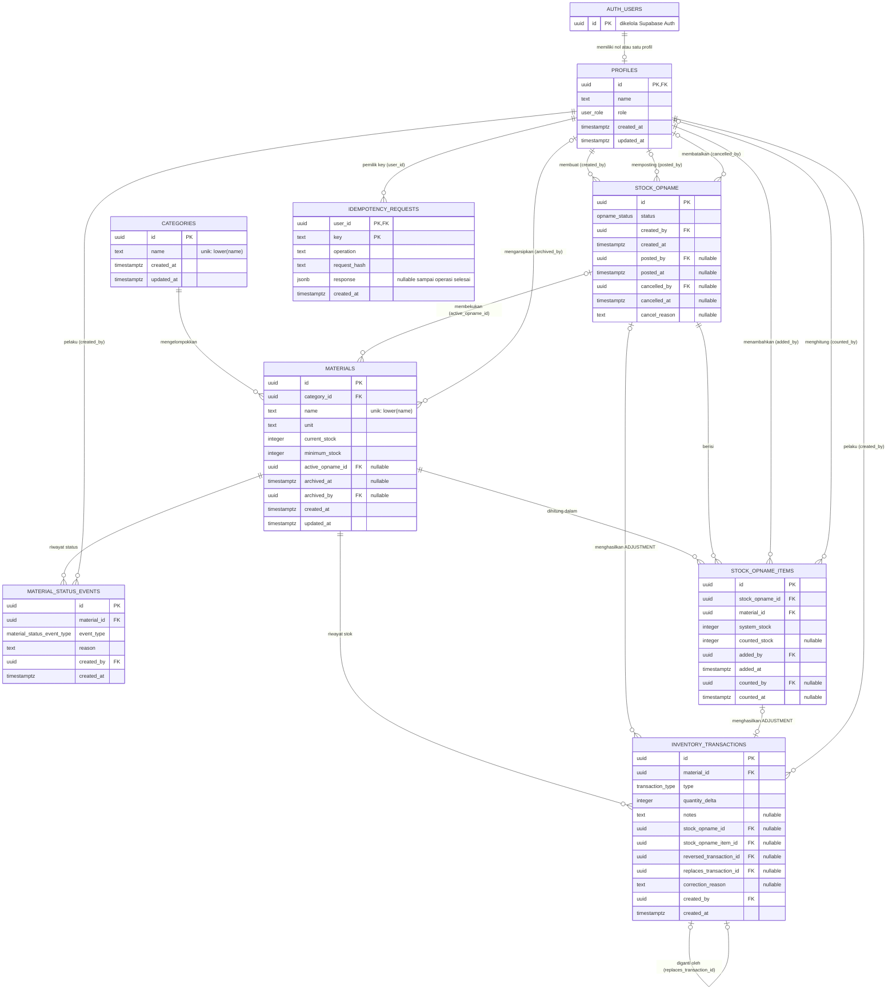

# Database Design Document

# Smart Warehouse Firaza

> **Status dokumen:** desain database Smart Warehouse Firaza.
> **Revisi:** Gelombang 2a, 29 Oktober 2026. Pembaruan 30 Oktober 2026: penyelarasan dengan ADR-09 sampai ADR-11, konsep Catatan Owner (§4.10), dan OD-21 sampai OD-29. Pembaruan 31 Oktober 2026: baseline keamanan database dan aturan migration sesuai ADR-13. Pembaruan lanjutan 31 Oktober 2026: status implementasi dan uji lokal, desain prosedur admin siklus akun sesuai ADR-14, serta koreksi kontrak idempotency (`request_fingerprint` dan urutan pemeriksaan expected state). Pembaruan 1 November 2026: migration admin (langkah 1a) diterapkan dan diuji di lokal; bukti uji §14.5, temuan urutan ban (§12.5.4), dan keputusan terbuka G1–G3 (STACK-DECISION-LOG ADR-14) disinkronkan. Pembaruan lanjutan 1 November 2026: G1–G3 disetujui pemilik proyek sebagai kebijakan MVP lokal; perilaku terpasang dan perilaku target G1 dibedakan (§12.5.6), durasi ban G2 dan runbook manual G3 dicatat (§12.5.5–§12.5.7); G1 belum diimplementasikan, dan OD-29 tetap terbuka. Pembaruan 1 November 2026 (7SUP.4B-3I): G1 diterapkan sebagai migration keempat (§14.2 langkah 1b) dan lulus uji terarah di lokal; status §14.5 #21, #27, #31, dan #40 disinkronkan; OD-29 tetap terbuka. Pembaruan 1 November 2026 (7SUP.5A-2 dan 7SUP.5A-3): migration kelima (§14.2 langkah 2–7) dan data demo lokal, RPC `post_stock_movement`, otorisasi fail-closed (STACK-DECISION-LOG ADR-15), Route Handler yang memakainya, serta penutupan OD-18 dengan Pilihan C; status §14.5 #1, #2, #5, dan #6 diperbarui. Pembaruan 1 November 2026 (7SUP.5A-3B): hasil uji penerimaan browser manual dan rekonsiliasi data lokal sesudahnya dicatat di §15, termasuk satu sesi Auth tertinggal sebagai residual risk; skema dan migration tidak berubah, dan OD-29 tetap terbuka. Pembaruan 2 November 2026 (7SUP.5B-2B dan 7SUP.5B-3A): bukti uji HTTP Stock Out, insiden 7SUP.5B-3A beserta keputusan K3, baseline lokal yang disahkan (K4), dan penundaan uji mutasi (K5) dicatat di §15; skema dan migration tidak berubah. Pembaruan 4 November 2026 (DOC-SYNC-01): status Git migration disinkronkan; skema dan migration tidak berubah. Pembaruan 4 November 2026 (P0-SEC-01, DOC-SYNC-02): hasil penerapan migration dari database baru (P0-TEST-01) dan uji integrasi pada stack uji lokal sekali pakai (P0-TEST-02) dicatat di blok status pembuka dan §15; skema dan migration tidak berubah, dan database pengembangan tidak disentuh. Pembaruan 5 November 2026 (P0-CLOUD-FIX-01): assertion jumlah function `public` di blok verifikasi migration 5 dikoreksi agar kompatibel dengan otomasi RLS Supabase Cloud (`rls_auto_enable` / `ensure_rls`); DDL dan skema hasil tidak berubah; dicatat di blok status pembuka dan §15. Supabase Cloud belum dimigrasikan.
>
> - Kebutuhan produk mengacu pada [PRD-Smart-Warehouse-Firaza-Dicoding.md](PRD-Smart-Warehouse-Firaza-Dicoding.md) (PRD kanonik) dan [FEATURE-SPECIFICATION-Smart-Warehouse-Firaza.md](FEATURE-SPECIFICATION-Smart-Warehouse-Firaza.md). Keputusan teknologi mengacu pada [STACK-DECISION-LOG.md](STACK-DECISION-LOG.md).
> - Kecuali disebutkan lain, isi dokumen ini berstatus **[RENCANA — belum diimplementasikan]**.
> - Yang sudah diimplementasikan, hanya di Supabase **lokal**, adalah §14.2 langkah 0, 1, 1a, dan 1b: baseline keamanan, schema `app_private`, enum `user_role`, tabel `profiles` (termasuk `deactivated_at` dan `session_valid_after`), policy baca profil sendiri, helper `app_private.current_app_role()`, tabel audit `app_private.account_lifecycle_events` (§4.11), dan enam function admin (§12.5.8). Semuanya diterapkan melalui empat SQL migration: `20261031084000_security_baseline.sql`, `20261031084100_profiles_authz_foundation.sql`, `20261031163955_account_lifecycle_admin.sql`, dan `20261101044858_admin_role_change_session_cutoff.sql` (G1: perubahan role memajukan cutoff sesi). Langkah 2–7 diterapkan melalui migration kelima `20261101064015_inventory_stock_movement_foundation.sql` (7SUP.5A-2), yang membuat:
>   - Enum bisnis.
>   - Tabel `categories`, `materials`, `material_status_events`, `stock_opname`, `stock_opname_items` (skema saja), dan `inventory_transactions`.
>   - Tabel `app_private.idempotency_requests`.
>   - RPC `post_stock_movement` (`STOCK_IN` dan `STOCK_OUT`).
>   - View `material_stock_status`.
> - Yang sudah diuji di lokal: atomicity migration Supabase CLI (§14.1), default-deny dan grant pada objek tersebut, uji integrasi dengan Supabase Auth asli untuk otorisasi `profiles`, penonaktifan, dan cutoff sesi, function admin siklus akun termasuk konkurensi dan audit, urutan ban dan pencabutan ban Auth, serta batas eksposur Data API (§12.5, §14.5). Status per skenario tercatat di §14.5. Fondasi inventori dan RPC lulus uji database (7SUP.5A-2), dan Route Handler Next.js yang memakainya lulus uji HTTP (7SUP.5A-3). Rinciannya ada di §15.
> - Status Git (4 November 2026): kelima file migration di-commit secara lokal di branch `feat/supabase-foundation`, yaitu empat migration pertama di C-2 (`d7b2432`) dan migration kelima di C-3 (`0a47e3d`), dan belum di-push ke GitHub. Commit tidak membuktikan migration berhasil diterapkan dari database kosong; uji itu belum dijalankan.
>   - Pembaruan 4 November 2026 (P0-TEST-01): kelima migration di commit HEAD `125b352` diterapkan berurutan dari database baru pada stack Supabase lokal sekali pakai (PostgreSQL 17.11, Supabase CLI 2.122.0), tanpa error, dan tercatat di `supabase_migrations.schema_migrations`. Tabel, view, function, policy, trigger, RLS, grant, dan hak `EXECUTE` sesuai desain; tidak ada temuan Critical maupun High. Kalimat "uji itu belum dijalankan" di atas adalah potret sebelum P0-TEST-01. Penerapan di project Supabase cloud belum diverifikasi.
>   - Pembaruan 4 November 2026 (P1-DOC-READY-01): branch `feat/supabase-foundation`, termasuk C-2 dan C-3, di-push ke GitHub dan diajukan melalui PR #3 (belum di-merge ke `main`). Kalimat "belum di-push ke GitHub" di atas adalah potret sebelum push. Migration belum diterapkan ke project Supabase cloud.
>   - Pembaruan 5 November 2026 (P0-CLOUD-FIX-01): PR #3 telah di-merge ke `main` (`577755b`). Di branch lokal `fix/cloud-migration-rls-compat` (belum di-commit), blok verifikasi migration kelima dikoreksi: function `public` yang mengembalikan `event_trigger` tidak lagi dihitung, karena project Supabase Cloud sudah memiliki `public.rls_auto_enable()`. Isi file berubah (SHA-256 `afaed084…` menjadi `ab6f2d1a…`), sedangkan versinya tetap. Supabase Cloud: **NOT YET MIGRATED**. Rincian di §15.
> - Belum diimplementasikan:
>   - Function bisnis selain `post_stock_movement`: material, kategori, koreksi, Stock Opname, `OPENING_BALANCE`, dan Catatan Owner.
>   - File seed. Data demo lokal disiapkan melalui sesi SQL tepercaya dan `admin_provision_profile`.
>   - Layanan orkestrasi admin permanen.
>   - Perubahan maupun verifikasi project Supabase cloud.
> - Dokumen ini menjelaskan desain, bukan artefak yang dapat dieksekusi. Ekspresi seperti `current_stock >= 0` atau `lower(name)` ditulis sebagai penjelasan aturan; SQL migration dibuat terpisah pada tahap implementasi.
> - Label sumber mengikuti legenda di PRD kanonik. Pilihan teknis yang belum disetujui ditulis sebagai **rekomendasi** dalam teks biasa, tanpa label tambahan.

## Keputusan Desain Database (Peninjauan File 5)

Keputusan berikut disetujui developer pada 29 Oktober 2026 saat meninjau rencana revisi dokumen ini. Keputusan ini **telah disinkronkan** ke requirement PRD kanonik dengan pemetaan: A → FR-CAT-03, FR-MAT-10; B → FR-MAT-05; C → FR-OPN-04 (menutup OD-11); D → FR-COR-06; E → FR-TRX-05; F → FR-MAT-11. Rincian teknis penegakan aturan tetap berada di dokumen ini.

| Ref | Keputusan [KEPUTUSAN] | Dirinci di |
|---|---|---|
| A | Nama kategori dan nama material unik tanpa membedakan huruf besar/kecil. Nama material arsip tetap dianggap terpakai. | §4.2, §4.3 |
| B | Material yang memiliki histori pengarsipan atau reaktivasi tidak dapat dihapus permanen. | §4.3, §4.4 |
| C | Penanda pembekuan material adalah `materials.active_opname_id` (menutup OD-11). | §4.3, §11 |
| D | Maksimal satu `REVERSAL` per transaksi asal; transaksi `REVERSAL` tidak dapat di-reverse; transaksi pengganti boleh dikoreksi lagi. | §4.5, §10 |
| E | Satu tabel idempotency untuk operasi mutasi yang relevan, unik per `(user_id, key)`, tanpa kedaluwarsa otomatis sebelum kebijakan retensi disetujui. | §4.8, §9 |
| F | Material arsip harus direaktivasi melalui proses resmi sebelum dapat diedit; selama diarsipkan, tidak ada field yang dapat diubah, termasuk nama, kategori, dan `minimum_stock`. | §4.3, §7 |

------------------------------------------------------------------------

# 1. Database Overview

Database Design Document ini menjelaskan rancangan struktur database
untuk aplikasi Smart Warehouse Firaza.

Database dirancang untuk mendukung proses utama aplikasi:

-   Authentication dan otorisasi pengguna.
-   Pengelolaan kategori dan raw material, termasuk pengarsipan.
-   Pencatatan saldo awal, stock in, dan stock out.
-   Koreksi transaksi final.
-   Stock Opname berbasis sesi.
-   Monitoring kondisi stok.
-   Catatan Owner: tugas dan reminder dari Owner kepada Staff Warehouse.
-   Audit history aktivitas pengguna.

## 1.1 Stack Database

| Aspek | Keputusan | Sumber |
|---|---|---|
| Database | PostgreSQL yang dikelola Supabase | [KEPUTUSAN] ADR-03 |
| Autentikasi | Supabase Auth; tidak ada password di tabel aplikasi | [KEPUTUSAN] ADR-04 |
| Akses data | Supabase JavaScript client, tanpa ORM | [KEPUTUSAN] ADR-06 |
| Perubahan skema | SQL migration yang disimpan di repository | [KEPUTUSAN] ADR-07 |
| Operasi atomik | PostgreSQL function yang dipanggil melalui Supabase RPC | [KEPUTUSAN] ADR-08 |
| Bahasa aplikasi | JavaScript | [KEPUTUSAN] ADR-02 |
| Pola keamanan function | Wrapper `SECURITY INVOKER` yang diekspos dan implementasi `SECURITY DEFINER` di schema privat | [KEPUTUSAN] ADR-09 |
| Alat migration | Supabase CLI dengan Supabase lokal di Docker | [KEPUTUSAN] ADR-10 |
| Akun dan profil | Provisioning manual oleh developer; public signup dinonaktifkan; offboarding tanpa menghapus profil | [KEPUTUSAN] ADR-11 |
| Baseline keamanan database | Schema `public` diekspos dengan grant eksplisit dan RLS; schema internal `app_private`; default-deny; `anon` tanpa hak; penonaktifan akun lewat `profiles.deactivated_at` dan ban Supabase Auth | [KEPUTUSAN] ADR-13 |

## 1.2 Konvensi

-   Nama tabel dan kolom memakai `snake_case`. (berasal dari dokumentasi sebelumnya)
-   Primary key bertipe `uuid` yang dibangkitkan database, kecuali `profiles.id` yang mengikuti `auth.users.id`.
-   Seluruh waktu memakai `timestamptz` agar zona waktu tersimpan; server Supabase berjalan dalam UTC sedangkan pengguna berada di WIB. Rekomendasi.
-   Kuantitas memakai `integer`. Kuantitas pecahan tidak didukung. [KEPUTUSAN]
-   Nilai terbatas memakai enum PostgreSQL (§4.0).
-   `created_at` diisi otomatis. `updated_at` diperbarui oleh trigger database, karena PostgreSQL tidak memperbaruinya secara otomatis. Rekomendasi.
-   Kolom pelaku (`created_by`, `archived_by`, dan sejenisnya) merujuk `profiles.id`.

------------------------------------------------------------------------

# 2. Database Scope

Pada tahap MVP, database hanya berfokus pada pengelolaan Raw Material
Inventory. [KEPUTUSAN]

Jenis data yang dikelola:

## Raw Material

### Packaging Material

Contoh: - Kardus. - Ribbon. - Bubble wrap. - Plastik packaging. -
Sticker. - Box.

### Product Supporting Material

Contoh: - Handuk polos. - Sajadah polos.

Setiap material memiliki satuan dasar yang eksplisit dalam unit utuh (pcs, pack, roll, lembar, dan sejenisnya). Konversi satuan tidak termasuk MVP. [KEPUTUSAN]

Finished product inventory, supplier management, dan integrasi
marketplace tidak termasuk MVP.

------------------------------------------------------------------------

# 3. Entity Relationship Overview

## 3.1 Diagram ER (sumber Mermaid)

Diagram berikut adalah sumber diagram yang berlaku dan harus selalu cocok dengan §4. Diagram ini menggambarkan desain yang direncanakan, bukan database yang sudah ada.

## 3.2 Status ERD PNG

`ERD-Smart-Warehouse-Firaza.png` telah dirender ulang dari sumber Mermaid §3.1 pada 29 Oktober 2026 dan menggantikan versi lama yang tidak sesuai desain ini.

-   Renderer: Mermaid CLI (`@mermaid-js/mermaid-cli`) 11.4.2, dengan konfigurasi layout ELK, latar putih, skala 2.
-   Layout ELK dipakai karena layout bawaan menggabungkan dua relasi self-reference `INVENTORY_TRANSACTIONS` sehingga relasi `reversed_transaction_id` tidak tergambar. Sumber Mermaid tidak diubah.
-   Diperiksa secara visual dan dicocokkan dengan sumber: 9 entitas dan 20 relasi tergambar, kardinalitas sesuai, tidak ada bagian yang terpotong.
-   Gambar ini memvisualisasikan desain yang direncanakan, bukan database yang sudah diimplementasikan.
-   Jika §3.1 berubah, PNG harus dirender ulang; sumber Mermaid tetap menjadi acuan.
-   Entitas Catatan Owner (§4.10) belum dimasukkan ke §3.1 maupun PNG karena strukturnya belum final. Diagram diperbarui dan PNG dirender ulang setelah OD-22, OD-23, dan OD-25 diputuskan dan perubahan ERD disetujui.

------------------------------------------------------------------------

# 4. Database Entities

## 4.0 Enum

| Enum | Nilai | Sumber |
|---|---|---|
| `user_role` | `OWNER`, `STAFF_WAREHOUSE` | [KEPUTUSAN] (PRD: dua role) |
| `transaction_type` | `OPENING_BALANCE`, `STOCK_IN`, `STOCK_OUT`, `ADJUSTMENT`, `REVERSAL` | [KEPUTUSAN] (PRD FR-TRX) |
| `opname_status` | `ACTIVE`, `POSTED`, `CANCELLED` | [KEPUTUSAN] (PRD FR-OPN-02) |
| `material_status_event_type` | `ARCHIVED`, `REACTIVATED` | [DITURUNKAN] (PRD FR-MAT-06, FR-MAT-08) |

------------------------------------------------------------------------

## 4.1 profiles

Menggantikan tabel `users` pada versi sebelumnya. Kredensial (email dan password) dikelola Supabase Auth di `auth.users`, bukan di tabel aplikasi. [DITURUNKAN] (ADR-04)

| Field | Type | Null | Constraint | Description |
|---|---|---|---|---|
| id | uuid | NOT NULL | PK; FK → `auth.users.id`, ON DELETE RESTRICT | Identitas pengguna dari Supabase Auth |
| name | text | NOT NULL | CHECK tidak kosong | Nama pengguna |
| role | user_role | NOT NULL | — | `OWNER` atau `STAFF_WAREHOUSE` |
| deactivated_at | timestamptz | NULL | — | Waktu akses akun dinonaktifkan; NULL berarti aktif (ADR-13 D9) |
| session_valid_after | timestamptz | NULL | — | Hanya sesi Supabase Auth yang dibuat setelah waktu ini yang diterima. Diisi saat reaktivasi, dan menurut desain ADR-14 juga saat provisioning profil (§12.5.8). Diimplementasikan dan lulus uji integrasi lokal (§12.5, §14.5). Menurut kebijakan G1 (ADR-14, disetujui 1 November 2026) juga dimajukan pada perubahan role `APPLIED`; diimplementasikan di lokal melalui migration `20261101044858` dan lulus uji terarah (§12.5.6, §14.5 #40) |
| created_at | timestamptz | NOT NULL | default now() | Waktu dibuat |
| updated_at | timestamptz | NOT NULL | default now(); trigger | Waktu diperbarui |

Catatan:

-   Kardinalitas: setiap profil merujuk tepat satu akun Supabase Auth (dijamin FK). Sebaliknya, sebuah akun Auth memiliki **nol atau satu** profil: FK tidak menjamin setiap akun memiliki profil. Akun tanpa profil tidak memiliki role, sehingga ditolak oleh RLS (§12) dan oleh pemeriksaan role di function (§7.1), termasuk dari Catatan Owner. [KEPUTUSAN] (PRD FR-AUTH-05)
-   ON DELETE RESTRICT menjaga agar akun yang pernah menjadi pelaku tidak terhapus beserta jejak auditnya. Rekomendasi.
-   Akun dibuat developer melalui administrasi Supabase Auth, dan public signup dinonaktifkan. Baris profil beserta role disiapkan melalui prosedur admin terkontrol; tidak ada trigger otomatis pada `auth.users` untuk membuat profil. [KEPUTUSAN] (PRD FR-AUTH-02; ADR-11) Prosedur administrasi ditetapkan di ADR-14 (function `admin_provision_profile`, §12.5.8), lalu diimplementasikan dan diuji di lokal (1 November 2026). Profil pada uji integrasi awal (7SUP.4A-R2, 7SUP.4B-1) dibuat dengan SQL langsung sebagai `postgres`; uji berikutnya memakai `admin_provision_profile`.
-   Pengguna tidak dapat menetapkan, mengubah, atau menaikkan `role` miliknya sendiri; role hanya diubah melalui proses admin terkontrol (§12). [KEPUTUSAN] (PRD FR-AUTH-05)
-   Offboarding menonaktifkan akses akun tanpa menghapus profil maupun histori audit. [KEPUTUSAN] (PRD FR-AUTH-04; ADR-11) Mekanisme teknis mengikuti ADR-13 (D9) [KEPUTUSAN]:
    -   Penonaktifan mengisi `deactivated_at` dan memberlakukan ban di Supabase Auth melalui prosedur admin terkontrol.
    -   Helper role (§12.1) tidak mengembalikan role untuk profil dengan `deactivated_at` terisi. Karena itu, RLS dan function privat menolak akses bisnis pada request berikutnya, tanpa menunggu access token kedaluwarsa.
    -   Ban di Supabase Auth mencegah login baru dan pembaruan sesi, tetapi tidak mencabut access token yang sudah terbit.
    -   Pengguna tidak dapat mengubah `deactivated_at` miliknya sendiri, karena `authenticated` tidak memiliki grant tulis pada `profiles` (§12.2).
    -   Prosedur penonaktifan dan reaktivasi, validasi sesi, serta perlindungan OWNER aktif terakhir dirinci di §12.5. Penolakan berbasis `deactivated_at` dan validasi sesi sudah diimplementasikan dan lulus uji integrasi lokal. Prosedur admin dan perlindungan OWNER aktif terakhir didesain (ADR-14), lalu diimplementasikan dan lulus uji integrasi lokal (1 November 2026). [OPEN DECISION OD-29]

------------------------------------------------------------------------

## 4.2 categories

| Field | Type | Null | Constraint | Description |
|---|---|---|---|---|
| id | uuid | NOT NULL | PK | ID kategori |
| name | text | NOT NULL | CHECK tidak kosong; unique index pada `lower(name)` | Nama kategori |
| created_at | timestamptz | NOT NULL | default now() | Waktu dibuat |
| updated_at | timestamptz | NOT NULL | default now(); trigger | Waktu diperbarui |

Aturan:

-   Nama kategori unik tanpa membedakan huruf besar/kecil: "Packaging Material" dan "packaging material" dianggap sama. [KEPUTUSAN] (Keputusan A) Unique index berlaku di database, sehingga tetap ditegakkan untuk jalur tulis mana pun, termasuk akses langsung melalui Supabase API.
-   Kategori yang masih direferensikan material tidak dapat dihapus, termasuk oleh material arsip, karena `materials.category_id` memakai ON DELETE RESTRICT. [KEPUTUSAN] (PRD FR-CAT-02)
-   [OPEN DECISION OD-19] Normalisasi spasi (spasi di awal/akhir nama) **belum menjadi keputusan bisnis** dan tetap berstatus rekomendasi. Tanpa normalisasi, "Kardus" dan "Kardus " lolos unique index `lower(name)` sebagai dua nama berbeda. Validasi input di Route Handler saja tidak cukup, karena tabel yang dapat ditulis langsung melalui Supabase API melewati Route Handler.

Pilihan penegakan normalisasi (berlaku sama untuk `categories` dan `materials`):

| Opsi | Cara | Jalur langsung ke Supabase | Catatan |
|---|---|---|---|
| 1. Validasi input saja | Route Handler merapikan nama | Tidak tertangani | Tidak konsisten |
| 2. CHECK di database | CHECK menolak nama yang berbeda dari versi tanpa spasi awal/akhir | Tertangani (ditolak) | Aturan satu baris; berlaku untuk semua jalur |
| 3. Seluruh tulis lewat function | Function merapikan nama sebelum menyimpan; tidak ada grant tulis langsung | Tidak ada jalur langsung | Konsisten dengan `materials` yang sudah ditulis lewat function |

Rekomendasi (belum disetujui): Opsi 3 dikombinasikan dengan Opsi 2 sebagai lapisan pertahanan. Selama belum diputuskan, desain ini tidak mewajibkan normalisasi; unique index `lower(name)` tetap wajib.

------------------------------------------------------------------------

## 4.3 materials

Tabel utama inventory.

| Field | Type | Null | Constraint | Description |
|---|---|---|---|---|
| id | uuid | NOT NULL | PK | ID material |
| category_id | uuid | NOT NULL | FK → `categories.id`, ON DELETE RESTRICT | Kategori |
| name | text | NOT NULL | CHECK tidak kosong; unique index pada `lower(name)` | Nama material |
| unit | text | NOT NULL | CHECK tidak kosong | Satuan dasar (pcs, pack, roll, lembar, …) |
| current_stock | integer | NOT NULL | default 0; CHECK `current_stock >= 0` | Stok saat ini |
| minimum_stock | integer | NOT NULL | CHECK `minimum_stock >= 0` | Batas minimum stok |
| active_opname_id | uuid | NULL | FK → `stock_opname.id`, ON DELETE RESTRICT | Sesi Stock Opname aktif yang membekukan material; NULL jika tidak dibekukan |
| archived_at | timestamptz | NULL | — | Waktu diarsipkan; NULL jika aktif |
| archived_by | uuid | NULL | FK → `profiles.id`, ON DELETE RESTRICT | Pelaku pengarsipan |
| created_at | timestamptz | NOT NULL | default now() | Waktu dibuat |
| updated_at | timestamptz | NOT NULL | default now(); trigger | Waktu diperbarui |

CHECK tingkat baris:

-   `archived_at` dan `archived_by` sama-sama NULL atau sama-sama terisi. [DITURUNKAN]
-   Jika `archived_at` terisi, `current_stock = 0`. [DITURUNKAN] (PRD FR-MAT-06)

Aturan:

-   Material baru dibuat dengan `current_stock = 0`. Stok hanya berubah melalui transaksi dan posting Stock Opname; mekanisme saldo awal mengikuti OD-17. [DITURUNKAN] (PRD FR-MAT-04)
-   Nama material unik tanpa membedakan huruf besar/kecil, **termasuk** terhadap material arsip; unique index tidak dibatasi pada material aktif. [KEPUTUSAN] (Keputusan A)
-   `unit` tidak dapat diubah setelah material memiliki transaksi atau tercatat sebagai item Stock Opname. Aturan ini melibatkan tabel lain sehingga ditegakkan oleh function `update_material`, bukan CHECK. [DITURUNKAN] (PRD FR-MAT-03)
-   Material arsip tidak dapat diedit sama sekali sebelum direaktivasi melalui `reactivate_material`; seluruh perubahan field ditolak, termasuk nama, kategori, dan `minimum_stock`. [KEPUTUSAN] (Keputusan F) Setelah reaktivasi, aturan `unit` di atas tetap berlaku.
-   Material hanya dapat dihapus permanen jika tidak direferensikan oleh `inventory_transactions`, `stock_opname_items`, maupun `material_status_events`. Seluruh referensi tersebut memakai ON DELETE RESTRICT sehingga database menolak penghapusan. [KEPUTUSAN] (PRD FR-MAT-05; Keputusan B)
-   `current_stock`, `active_opname_id`, `archived_at`, dan `archived_by` hanya diubah oleh database function (§7, §12).
-   Status stok operasional tidak disimpan sebagai kolom (§6.1).

Contoh:

Kardus Medium: - Unit: pcs - Current Stock: 200 - Minimum Stock: 50

------------------------------------------------------------------------

## 4.4 material_status_events

Riwayat pengarsipan dan reaktivasi material.

| Field | Type | Null | Constraint | Description |
|---|---|---|---|---|
| id | uuid | NOT NULL | PK | ID peristiwa |
| material_id | uuid | NOT NULL | FK → `materials.id`, ON DELETE RESTRICT | Material terkait |
| event_type | material_status_event_type | NOT NULL | — | `ARCHIVED` atau `REACTIVATED` |
| reason | text | NOT NULL | CHECK tidak kosong | Alasan wajib |
| created_by | uuid | NOT NULL | FK → `profiles.id`, ON DELETE RESTRICT | Pelaku |
| created_at | timestamptz | NOT NULL | default now() | Waktu |

Aturan:

-   Setiap pengarsipan dan reaktivasi menghasilkan satu baris, ditulis dalam transaksi yang sama dengan perubahan kolom arsip di `materials`. [KEPUTUSAN] (PRD FR-MAT-06, FR-MAT-08)
-   Baris tidak dapat diubah atau dihapus. [DITURUNKAN] (NFR-03)
-   ON DELETE RESTRICT pada `material_id` membuat material yang memiliki riwayat ini tidak dapat dihapus permanen. [KEPUTUSAN] (Keputusan B)

------------------------------------------------------------------------

## 4.5 inventory_transactions

Menyimpan seluruh perubahan stok. Baris bersifat final: tidak dapat diubah atau dihapus. [KEPUTUSAN] (PRD FR-COR-01)

| Field | Type | Null | Constraint | Description |
|---|---|---|---|---|
| id | uuid | NOT NULL | PK | ID transaksi |
| material_id | uuid | NOT NULL | FK → `materials.id`, ON DELETE RESTRICT | Material terkait |
| type | transaction_type | NOT NULL | — | Tipe transaksi |
| quantity_delta | integer | NOT NULL | CHECK sesuai tipe (tabel di bawah) | Perubahan stok bertanda |
| notes | text | NULL | — | Catatan transaksi |
| stock_opname_id | uuid | NULL | FK → `stock_opname.id`, ON DELETE RESTRICT | Sesi asal, khusus `ADJUSTMENT` |
| stock_opname_item_id | uuid | NULL | FK → `stock_opname_items.id`, ON DELETE RESTRICT | Item asal, khusus `ADJUSTMENT` |
| reversed_transaction_id | uuid | NULL | FK → `inventory_transactions.id`, ON DELETE RESTRICT | Transaksi asal yang dibalik, khusus `REVERSAL` |
| replaces_transaction_id | uuid | NULL | FK → `inventory_transactions.id`, ON DELETE RESTRICT | Transaksi asal yang digantikan, khusus transaksi pengganti |
| correction_reason | text | NULL | — | Alasan koreksi, wajib pada `REVERSAL` |
| created_by | uuid | NOT NULL | FK → `profiles.id`, ON DELETE RESTRICT | Pelaku |
| created_at | timestamptz | NOT NULL | default now() | Waktu transaksi |

### Semantik dan tanda per tipe

| Tipe | Makna | Syarat `quantity_delta` (CHECK baris) | Relasi wajib | Sumber |
|---|---|---|---|---|
| `STOCK_IN` | Material masuk | `> 0` | — | [KEPUTUSAN] FR-TRX-01 |
| `STOCK_OUT` | Material keluar | `< 0` | — | [KEPUTUSAN] FR-TRX-02 |
| `ADJUSTMENT` | Penyesuaian dari posting Stock Opname | `<> 0` (selisih nol tidak menghasilkan transaksi) | `stock_opname_id` dan `stock_opname_item_id` terisi | [KEPUTUSAN] FR-OPN-11, FR-OPN-12 |
| `REVERSAL` | Pembalik efek transaksi asal | `<> 0`; nilai tepat `= −quantity_delta` transaksi asal ditegakkan function (lintas baris) | `reversed_transaction_id` dan `correction_reason` terisi | [KEPUTUSAN] FR-COR-02 |
| `OPENING_BALANCE` | Saldo awal | Belum ditetapkan | Belum ditetapkan | [OPEN DECISION OD-17] |

CHECK tingkat baris lainnya [DITURUNKAN]:

-   `stock_opname_id` dan `stock_opname_item_id` terisi **jika dan hanya jika** `type = ADJUSTMENT`.
-   `reversed_transaction_id` terisi **jika dan hanya jika** `type = REVERSAL`; pada `REVERSAL`, `correction_reason` tidak kosong.
-   `replaces_transaction_id` tidak boleh terisi pada `ADJUSTMENT` dan `REVERSAL`. Tipe lain yang sah sebagai transaksi pengganti mengikuti OD-10 dan OD-17.

Unique index parsial [KEPUTUSAN] (Keputusan D) / [DITURUNKAN]:

-   `reversed_transaction_id` unik jika terisi: satu transaksi asal paling banyak memiliki satu `REVERSAL`.
-   `replaces_transaction_id` unik jika terisi: karena satu transaksi asal hanya dapat dibalik sekali, ia paling banyak memiliki satu transaksi pengganti.
-   `stock_opname_item_id` unik jika terisi: satu item Stock Opname paling banyak menghasilkan satu `ADJUSTMENT`.

Aturan yang tidak dapat ditegakkan CHECK karena melibatkan baris lain, dan karenanya ditegakkan function (§7, §10):

-   `REVERSAL.quantity_delta` sama dengan negatif `quantity_delta` transaksi asal, dan `material_id`-nya sama.
-   Transaksi bertipe `REVERSAL` dan `ADJUSTMENT` tidak dapat menjadi transaksi asal sebuah `REVERSAL`.
-   Stok hasil tidak negatif dan material tidak dibekukan atau diarsipkan.

Immutability:

-   Tidak ada grant maupun policy UPDATE dan DELETE untuk pengguna aplikasi; INSERT hanya terjadi di dalam database function (§12).
-   Trigger yang menolak UPDATE dan DELETE sebagai lapisan pertahanan tambahan. Rekomendasi.

Contoh:

| Kejadian | Tipe | `quantity_delta` |
|---|---|---|
| Kardus Medium datang 200 pcs | `STOCK_IN` | +200 |
| Kardus Medium dipakai 50 pcs | `STOCK_OUT` | −50 |
| Hitung fisik 146, sistem 150 | `ADJUSTMENT` | −4 |

------------------------------------------------------------------------

## 4.6 stock_opname

Header sesi Stock Opname. Menggantikan tabel `stock_opname` per material pada versi sebelumnya.

| Field | Type | Null | Constraint | Description |
|---|---|---|---|---|
| id | uuid | NOT NULL | PK | ID sesi |
| status | opname_status | NOT NULL | default `ACTIVE` | Status sesi |
| created_by | uuid | NOT NULL | FK → `profiles.id`, ON DELETE RESTRICT | Pembuat sesi |
| created_at | timestamptz | NOT NULL | default now() | Waktu dibuat |
| posted_by | uuid | NULL | FK → `profiles.id`, ON DELETE RESTRICT | Pelaku posting |
| posted_at | timestamptz | NULL | — | Waktu posting |
| cancelled_by | uuid | NULL | FK → `profiles.id`, ON DELETE RESTRICT | Pelaku pembatalan |
| cancelled_at | timestamptz | NULL | — | Waktu pembatalan |
| cancel_reason | text | NULL | — | Alasan pembatalan |

CHECK konsistensi status (baris yang sama) [DITURUNKAN] (PRD FR-OPN-02, FR-OPN-14):

| Status | `posted_by`, `posted_at` | `cancelled_by`, `cancelled_at`, `cancel_reason` |
|---|---|---|
| `ACTIVE` | NULL | NULL |
| `POSTED` | terisi | NULL |
| `CANCELLED` | NULL | terisi; `cancel_reason` tidak kosong |

Aturan:

-   Perpindahan status hanya `ACTIVE → POSTED` atau `ACTIVE → CANCELLED`, melalui function. `POSTED` dan `CANCELLED` bersifat terminal. [KEPUTUSAN]
-   Tidak ada kolom maupun job kedaluwarsa; sesi tidak kedaluwarsa otomatis pada MVP. [KEPUTUSAN] (PRD FR-OPN-16)
-   Baris sesi tidak dapat dihapus.

------------------------------------------------------------------------

## 4.7 stock_opname_items

Satu baris per material per sesi.

| Field | Type | Null | Constraint | Description |
|---|---|---|---|---|
| id | uuid | NOT NULL | PK | ID item |
| stock_opname_id | uuid | NOT NULL | FK → `stock_opname.id`, ON DELETE RESTRICT | Sesi |
| material_id | uuid | NOT NULL | FK → `materials.id`, ON DELETE RESTRICT | Material |
| system_stock | integer | NOT NULL | CHECK `system_stock >= 0` | Stok sistem saat material ditambahkan (snapshot) |
| counted_stock | integer | NULL | CHECK `counted_stock >= 0` | Hasil hitung terakhir; NULL jika belum dihitung |
| added_by | uuid | NOT NULL | FK → `profiles.id`, ON DELETE RESTRICT | Pelaku penambahan item |
| added_at | timestamptz | NOT NULL | default now() | Waktu penambahan |
| counted_by | uuid | NULL | FK → `profiles.id`, ON DELETE RESTRICT | Pelaku pengisian/perubahan hitungan terakhir |
| counted_at | timestamptz | NULL | — | Waktu pengisian/perubahan hitungan terakhir |

Constraint:

-   UNIQUE (`stock_opname_id`, `material_id`): material yang sama tidak dapat ditambahkan dua kali ke sesi yang sama.
-   CHECK: `counted_stock`, `counted_by`, dan `counted_at` sama-sama NULL atau sama-sama terisi.

Aturan:

-   Yang disimpan adalah hasil hitung terakhir beserta pelaku dan waktunya, **bukan** riwayat lengkap revisi nilai. [KEPUTUSAN] (PRD FR-OPN-07)
-   Item hanya dapat diubah selama sesi `ACTIVE`, melalui function. Setelah sesi `POSTED` atau `CANCELLED`, item tidak dapat diubah.
-   Menghapus item dari sesi aktif belum diputuskan. [OPEN DECISION OD-01]
-   Blind count tidak diwajibkan; `system_stock` boleh ditampilkan. [KEPUTUSAN] (PRD FR-OPN-17)

------------------------------------------------------------------------

## 4.8 idempotency_requests

Mencatat request mutasi agar pengiriman ulang tidak menggandakan perubahan stok. [KEPUTUSAN] (PRD FR-TRX-05; Keputusan E)

| Field | Type | Null | Constraint | Description |
|---|---|---|---|---|
| user_id | uuid | NOT NULL | PK (bersama `key`); FK → `profiles.id`, ON DELETE RESTRICT | Pemilik key |
| key | text | NOT NULL | PK (bersama `user_id`); CHECK tidak kosong | Idempotency key dari klien |
| operation | text | NOT NULL | — | Nama operasi, misalnya `post_stock_movement` |
| request_hash | text | NOT NULL | — | Hash payload ternormalisasi beserta nama operasi |
| response | jsonb | NULL | — | Hasil operasi; terisi sebelum transaksi selesai |
| created_at | timestamptz | NOT NULL | default now() | Waktu request pertama |

Aturan:

-   Tabel ini berada di schema `app_private`, bukan di schema yang diekspos Data API. Tabel tidak memiliki grant untuk `anon` maupun `authenticated`, dan hanya diakses implementasi `SECURITY DEFINER` (§7.1). RLS tetap diaktifkan. [KEPUTUSAN] (ADR-13 D6)
-   Key unik per pengguna melalui primary key `(user_id, key)`. [KEPUTUSAN] (Keputusan E)
-   Tidak ada kedaluwarsa atau penghapusan otomatis sebelum kebijakan retensi disetujui. [KEPUTUSAN] (Keputusan E)
-   Mekanisme lengkap dijelaskan di §9.

------------------------------------------------------------------------

## 4.9 Ringkasan Indeks

| Tabel | Indeks | Jenis | Tujuan | Dasar |
|---|---|---|---|---|
| categories | `lower(name)` | Unique | Nama kategori unik tanpa membedakan huruf | [KEPUTUSAN] Keputusan A |
| materials | `lower(name)` | Unique, seluruh baris termasuk arsip | Nama material unik | [KEPUTUSAN] Keputusan A |
| materials | `category_id` | Biasa | Filter per kategori; pemeriksaan FK saat hapus kategori | Rekomendasi |
| materials | `active_opname_id` (hanya jika terisi) | Biasa, parsial | Mencari material yang dibekukan sebuah sesi | Rekomendasi |
| material_status_events | (`material_id`, `created_at`) | Biasa | Riwayat status per material | Rekomendasi |
| inventory_transactions | (`material_id`, `created_at`) | Biasa | Histori per material, rekonsiliasi | Rekomendasi |
| inventory_transactions | `created_at` | Biasa | Filter rentang tanggal | Rekomendasi |
| inventory_transactions | `reversed_transaction_id` (jika terisi) | Unique parsial | Satu `REVERSAL` per transaksi asal | [KEPUTUSAN] Keputusan D |
| inventory_transactions | `replaces_transaction_id` (jika terisi) | Unique parsial | Satu transaksi pengganti per transaksi asal | [DITURUNKAN] |
| inventory_transactions | `stock_opname_item_id` (jika terisi) | Unique parsial | Satu `ADJUSTMENT` per item | [DITURUNKAN] |
| inventory_transactions | `stock_opname_id` | Biasa | Transaksi per sesi | Rekomendasi |
| stock_opname | `status` | Biasa | Daftar sesi aktif untuk pemantauan Owner | Rekomendasi |
| stock_opname_items | (`stock_opname_id`, `material_id`) | Unique | Satu material sekali per sesi | [DITURUNKAN] |
| stock_opname_items | `material_id` | Biasa | Riwayat opname per material; pemeriksaan FK | Rekomendasi |
| idempotency_requests | (`user_id`, `key`) | Primary key | Keunikan key per pengguna | [KEPUTUSAN] Keputusan E |

Indeks untuk Catatan Owner ditentukan setelah strukturnya final (§4.10).

------------------------------------------------------------------------

## 4.10 Catatan Owner (konsep)

Entitas untuk Catatan Owner (PRD FR-NOTE). Nama kerja tabel: `dashboard_notes`. **Nama tabel, nama kolom, tipe, dan constraint di bawah adalah usulan, belum final.** Struktur akhir menunggu OD-22, OD-23, dan OD-25. Entitas ini belum tercantum di diagram §3.1, ringkasan indeks §4.9, maupun ERD PNG.

Rekomendasi: satu tabel, bila OD-22 memilih satu feedback per catatan. Tabel feedback terpisah hanya dibutuhkan bila feedback harus berversi.

| Kelompok | Atribut usulan | Kebutuhan | Status kebutuhan |
|---|---|---|---|
| Identitas | `id` | Identitas catatan | Kebutuhan disetujui; bentuk mengikuti konvensi §1.2 |
| Isi | `content` (tidak kosong) | Isi catatan Owner | [KEPUTUSAN] (FR-NOTE-01) |
| Pembuatan | `created_by` (FK `profiles`, wajib), `created_at`, `updated_at` | Pembuat dan waktu | [KEPUTUSAN] (FR-NOTE-16) |
| Penyelesaian | `completed_by` (FK `profiles`, opsional), `completed_at` | Satu penyelesai beserta waktunya | [KEPUTUSAN] (FR-NOTE-06) |
| Feedback | `feedback`, `feedback_by` (FK `profiles`), `feedback_updated_at` | Isi, penulis, dan waktu feedback | Kebutuhan [KEPUTUSAN] (FR-NOTE-07); struktur [OPEN DECISION OD-22] |
| Peninjauan | `reviewed_by` (FK `profiles`, opsional), `reviewed_at` | Peninjau dan waktu, terpisah dari penyelesaian | [KEPUTUSAN] (FR-NOTE-10) |
| Penghapusan | `deleted_by`, `deleted_at` | Hanya bila soft delete dipilih | [OPEN DECISION OD-25] |

Kondisi catatan diturunkan dari data, bukan disimpan sebagai kolom status. Rekomendasi.

| Kondisi (PRD FR-NOTE) | Data |
|---|---|
| Belum selesai | `completed_at` kosong |
| Selesai, menunggu tinjauan | `completed_at` terisi, `reviewed_at` kosong |
| Selesai, sudah ditinjau | `completed_at` dan `reviewed_at` terisi |

Aturan konsistensi baris, bila struktur di atas dipakai (rekomendasi, ditegakkan CHECK):

-   `completed_by` dan `completed_at` sama-sama kosong atau sama-sama terisi.
-   `reviewed_by` dan `reviewed_at` sama-sama kosong atau sama-sama terisi.
-   `reviewed_at` hanya boleh terisi bila `completed_at` terisi. [DITURUNKAN] (FR-NOTE-10)

Aturan lain:

-   Hanya Owner yang membuat, mengubah, menghapus, dan meninjau catatan; ubah dan hapus hanya oleh pembuat catatan. Hanya Staff Warehouse yang menyelesaikan catatan dan menulis feedback. Pemeriksaan role dan kepemilikan dilakukan di function privat (ADR-09). [KEPUTUSAN] (FR-NOTE-03, FR-NOTE-04, FR-NOTE-06, FR-NOTE-10, FR-NOTE-11) Ubah dan hapus setelah selesai atau ditinjau mengikuti OD-24.
-   Pembaruan feedback ditolak setelah `reviewed_at` terisi. Penolakan ditegakkan di function privat, bukan hanya di UI. [KEPUTUSAN] (FR-NOTE-08) Function penyimpan feedback dan function peninjauan mengunci baris catatan yang sama, sehingga pembaruan feedback yang bersamaan dengan peninjauan diproses berurutan. Rekomendasi.
-   Identitas pelaku diisi dari `auth.uid()` dan waktu dari jam database di dalam function, bukan dari parameter klien. [KEPUTUSAN] (FR-NOTE-16)
-   Pembuatan catatan memakai mekanisme idempotency bersama di §9: pembuatan catatan dan pencatatan hasil idempotency adalah satu unit atomik, replay tidak menambah catatan baru, dan catatan berisi identik tetap diperbolehkan bila berasal dari tindakan berbeda dengan key berbeda. [KEPUTUSAN] (FR-NOTE-21) Tidak ada kolom idempotency tambahan pada tabel catatan.
-   Daftar aktif dihitung saat dibaca: catatan dengan `completed_at` kosong, ditambah catatan yang tanggal `completed_at` di zona `Asia/Jakarta` sama dengan tanggal hari ini di zona yang sama. Aturannya [KEPUTUSAN] (FR-NOTE-13); cara penghitungan ini rekomendasi. Tidak ada job tengah malam, kolom tambahan, maupun penghapusan otomatis. [KEPUTUSAN] (FR-NOTE-14)
-   Batas 3 catatan hanya diterapkan saat menampilkan panel. Tidak ada constraint jumlah baris, jumlah catatan per hari, maupun jumlah akun. [KEPUTUSAN] (FR-NOTE-12)
-   Jumlah pada ringkasan sidebar dihitung dari seluruh baris yang memenuhi kriteria, bukan dari 3 catatan yang tampil di panel. [KEPUTUSAN] (FR-NOTE-20)
-   Semua FK pelaku ke `profiles` memakai ON DELETE RESTRICT, konsisten dengan §5. Rekomendasi.
-   Hak menulis Catatan Owner tidak memberi Owner hak apa pun pada tabel maupun function inventori (§7.1, §12.2). [KEPUTUSAN] (FR-NOTE-11)

------------------------------------------------------------------------

## 4.11 account_lifecycle_events (schema `app_private`)

Jejak audit perubahan status dan role akun yang dilakukan function admin (§12.5.8). [KEPUTUSAN] (STACK-DECISION-LOG ADR-14, J1) **Diimplementasikan di lokal** (migration `20261031163955_account_lifecycle_admin.sql`). Pencatatan atomik, korelasi `operation_id`, dan penolakan `UPDATE`, `DELETE`, serta `TRUNCATE` (`55000 APPEND_ONLY`) lulus uji lokal (§14.5 #26). Event dari uji lokal dipertahankan (J11).

| Field | Type | Null | Constraint | Description |
|---|---|---|---|---|
| id | bigint | NOT NULL | PK; identity | Urutan event |
| operation_id | uuid | NOT NULL | UNIQUE | ID operasi siklus akun dari operator (§12.5.9). Satu operasi menghasilkan tepat satu event |
| request_fingerprint | text | NOT NULL | CHECK tepat 64 karakter heksadesimal huruf kecil (`^[0-9a-f]{64}$`) | SHA-256 dari input material operasi yang sudah divalidasi dan dinormalisasi (§12.5.9). Dipakai untuk membedakan pengulangan identik dari input yang berbeda |
| occurred_at | timestamptz | NOT NULL | default `clock_timestamp()` | Waktu event ditulis |
| action | text | NOT NULL | CHECK salah satu dari `PROVISION`, `DEACTIVATE`, `REACTIVATE`, `SET_ROLE` | Jenis operasi |
| outcome | text | NOT NULL | CHECK `APPLIED` atau `NOOP` | `APPLIED` bila data berubah; `NOOP` bila operasi idempoten tidak mengubah apa pun |
| target_user_id | uuid | NOT NULL | Tanpa FK | Akun target. Tanpa FK agar histori tetap ada setelah akun uji dihapus (J11) |
| actor | text | NOT NULL | CHECK tidak kosong; panjang terbatas | Nama operator. **Dinyatakan sendiri** oleh operator, bukan identitas yang diautentikasi |
| reason | text | NOT NULL | CHECK tidak kosong; panjang terbatas | Alasan tindakan. Tidak boleh memuat secret maupun data pribadi yang tidak perlu |
| old_role, new_role | user_role | NULL | — | Role sebelum dan sesudah |
| old_deactivated_at, new_deactivated_at | timestamptz | NULL | — | Status nonaktif sebelum dan sesudah |
| old_session_valid_after, new_session_valid_after | timestamptz | NULL | — | Batas sesi sebelum dan sesudah |
| db_session_user | text | NOT NULL | default `session_user` | Role login sesi database yang menjalankan function |

Aturan:

-   Tabel berada di `app_private`. RLS diaktifkan tanpa policy. Tidak ada hak bagi `PUBLIC`, `anon`, `authenticated`, maupun `service_role` pada tabel dan sequence identity-nya. [KEPUTUSAN] (ADR-14 J1, J3)
-   Baris hanya ditulis function admin, dalam transaksi yang sama dengan perubahan `profiles`. Bila transaksi gagal, perubahan profil maupun event sama-sama batal.
-   Event `NOOP` ditulis untuk penonaktifan, reaktivasi, dan perubahan role yang idempoten (misalnya penonaktifan akun yang sudah nonaktif), agar setiap `operation_id` memiliki jejak.
-   Sejak migration `20261101044858` (G1), event `SET_ROLE` dengan outcome `APPLIED` mencatat `old_session_valid_after` dan `new_session_valid_after` yang berbeda. Event `NOOP` mencatat nilai yang sama. Terverifikasi di lokal (7SUP.4B-3I, §14.5 #40).
-   `request_fingerprint` dihitung oleh function admin dari input kanonik (§12.5.9), tidak dikirim operator. Pengulangan dengan `operation_id` yang sama hanya dianggap identik bila fingerprint-nya sama. Fingerprint bukan perlindungan kerahasiaan: email dan input lain berentropi rendah dapat ditebak dengan mencoba kandidat. Nilai `actor` dan `reason` tetap tersimpan sebagai teks biasa.
-   Penolakan (error `P0001`, §12.5.8) dan error infrastruktur membatalkan transaksi, sehingga **tidak tercatat** di tabel ini. Penolakan dicatat di runbook operator.
-   Langkah Supabase Auth (ban, pencabutan ban, pembuatan akun) tidak tercatat di tabel ini. Langkah tersebut dicatat di runbook dan `auth.audit_log_entries`, dan dihubungkan melalui `operation_id` di runbook.
-   Append-only: trigger menolak `UPDATE`, `DELETE`, dan `TRUNCATE`. Proteksi ini **dapat dilewati** pemilik tabel (`postgres`) maupun superuser, misalnya dengan menonaktifkan atau menghapus trigger. Tabel ini bukan bukti anti-manipulasi terhadap pemegang hak tersebut.
-   Indeks: unique `operation_id`; (`target_user_id`, `id`) untuk mencari event terbaru per akun. Rekomendasi.
-   Tidak ada penghapusan atau retensi otomatis. Event dari uji integrasi lokal dipertahankan dan tidak dihapus hanya untuk mengembalikan jumlah baris ke nol. [KEPUTUSAN] (ADR-14 J11)
-   Tabel ini tidak menggantikan runbook maupun log audit Auth.

------------------------------------------------------------------------

# 5. Database Relationship

## Profiles - Aktivitas

One Profile → Many Transactions, Status Events, Stock Opname, Items, Idempotency Requests, dan Materials yang diarsipkan

Setiap baris yang mencatat aktivitas menyimpan pelakunya melalui FK ke `profiles`.

-   FK pelaku wajib (NOT NULL): `material_status_events.created_by`, `inventory_transactions.created_by`, `stock_opname.created_by`, `stock_opname_items.added_by`, `idempotency_requests.user_id`.
-   FK pelaku opsional (nullable, terisi hanya setelah peristiwanya terjadi): `materials.archived_by`, `stock_opname.posted_by`, `stock_opname.cancelled_by`, `stock_opname_items.counted_by`.

## Profiles - Catatan Owner (konsep)

One Profile → Many catatan sebagai pembuat; Zero-or-Many catatan sebagai penyelesai, penulis feedback, atau peninjau. Relasi ini mengikuti struktur usulan §4.10 dan belum tergambar di ERD.

------------------------------------------------------------------------

## Categories - Materials

Relationship:

One Category → Many Materials

Penjelasan:

Satu kategori dapat memiliki banyak material. Kategori tidak dapat dihapus selama masih direferensikan material, termasuk material arsip.

------------------------------------------------------------------------

## Materials - Transactions

Relationship:

One Material → Many Transactions

Penjelasan:

Satu material dapat memiliki banyak histori transaksi. Material yang memiliki transaksi tidak dapat dihapus permanen.

------------------------------------------------------------------------

## Materials - Material Status Events

One Material → Many Status Events

Material yang memiliki riwayat arsip atau reaktivasi tidak dapat dihapus permanen.

------------------------------------------------------------------------

## Stock Opname - Items - Materials

One Stock Opname → Many Items; One Material → Many Items (lintas sesi)

Satu sesi dapat mencakup banyak material; satu material dapat dihitung di banyak sesi sepanjang waktu, tetapi paling banyak di satu sesi aktif.

------------------------------------------------------------------------

## Stock Opname - Materials (pembekuan)

Zero-or-One Active Stock Opname → Many Materials, melalui `materials.active_opname_id`.

------------------------------------------------------------------------

## Stock Opname Items - Transactions

One Item → Zero-or-One `ADJUSTMENT`

------------------------------------------------------------------------

## Transactions - Transactions (koreksi)

-   One Transaction → Zero-or-One `REVERSAL` (melalui `reversed_transaction_id`).
-   One Transaction → Zero-or-One transaksi pengganti (melalui `replaces_transaction_id`).

------------------------------------------------------------------------

# 6. Business Rules

## 6.1 Status Stok Operasional

Status ditentukan dari `current_stock` dan `minimum_stock` [KEPUTUSAN] (PRD FR-STS-01):

| Status | Kondisi |
|---|---|
| `OUT_OF_STOCK` | `current_stock == 0` |
| `LOW_STOCK` | `current_stock > 0` dan `current_stock <= minimum_stock` |
| `NORMAL` | `current_stock > minimum_stock` |

-   Status dihitung dari data saat dibaca dan tidak disimpan sebagai kolom, agar tidak pernah basi. [DITURUNKAN] (PRD FR-STS-02) Penyediaannya melalui view baca. Rekomendasi. View tersebut memakai `security_invoker = true` sehingga RLS tabel `materials` berlaku bagi pemanggil. [KEPUTUSAN] (ADR-13 D5)
-   Status lama "Aman / Perlu Perhatian / Prioritas Restock" digantikan oleh tiga status di atas.
-   Status operasional terpisah dari klasifikasi AI (§8). [KEPUTUSAN]

------------------------------------------------------------------------

## 6.2 Stock Update Rule

Setiap perubahan stok menulis satu atau lebih baris `inventory_transactions` dan memperbarui `materials.current_stock` di dalam **satu transaksi database**. [KEPUTUSAN] (PRD FR-TRX-08; ADR-08)

    current_stock (baru) = current_stock (lama) + quantity_delta

Pengguna memasukkan kuantitas positif; function menentukan tanda `quantity_delta` sesuai tipe. [KEPUTUSAN] (PRD FR-TRX-02)

------------------------------------------------------------------------

## 6.3 Invariant Saldo

Untuk setiap material: [DITURUNKAN] (NFR-02)

    current_stock = saldo histori
    saldo histori = COALESCE(SUM(quantity_delta), 0) atas seluruh transaksi material tersebut

`COALESCE(…, 0)` berarti material yang belum memiliki transaksi sama sekali dihitung bersaldo histori 0. Material baru dengan `current_stock = 0` dan tanpa baris transaksi **bukan** pelanggaran.

Invariant ini berlaku karena material dibuat dengan stok 0 dan setiap perubahan stok, termasuk saldo awal, dicatat sebagai transaksi. Aturan rinci `OPENING_BALANCE` tetap mengikuti OD-17; invariant ini tidak menetapkan aturan tersebut.

Invariant ini melibatkan banyak baris sehingga **tidak dapat** dijamin oleh CHECK. Penjagaannya:

1.  Seluruh perubahan stok hanya terjadi di database function yang menulis transaksi dan saldo dalam satu transaksi database.
2.  Tidak ada akses tulis langsung ke `current_stock` maupun `inventory_transactions` (§12).
3.  Pemeriksaan rekonsiliasi yang dapat diuji (§14.3).

------------------------------------------------------------------------

## 6.4 Ringkasan Aturan per Mekanisme

| Jenis aturan | Mekanisme | Contoh |
|---|---|---|
| Nilai dalam satu baris | CHECK | `current_stock >= 0`, `minimum_stock >= 0`, tanda `quantity_delta` per tipe, konsistensi kolom per status sesi |
| Keunikan | Unique index | `lower(name)`, satu `REVERSAL` per transaksi asal |
| Referensi histori | Foreign key ON DELETE RESTRICT | Hapus kategori yang dipakai; hapus material yang punya histori |
| Lintas baris / lintas tabel | PostgreSQL function dalam satu transaksi + row locking | Pembekuan, posting sesi, nilai `REVERSAL`, `unit` terkunci, invariant saldo |
| Siapa boleh melakukan apa | Pemeriksaan role di function + RLS dan grants | Owner tidak dapat mengubah stok |

RLS membatasi **siapa** yang boleh membaca atau menulis; RLS **tidak** menjamin atomisitas maupun konsistensi lintas baris. Kedua hal tersebut dijamin oleh function dan transaksi database.

------------------------------------------------------------------------

# 7. PostgreSQL Functions dan Kontrak Supabase RPC

Kewajiban operasi atomik melalui function adalah [KEPUTUSAN] (ADR-08). Nama function, parameter, dan kode error di bawah adalah rekomendasi; bentuk respons HTTP dirinci di dokumentasi API (Gelombang 2b).

## 7.1 Ketentuan Umum

Setiap function mutasi:

1.  Memeriksa `auth.uid()` memiliki profil dengan role yang berwenang. Owner ditolak untuk seluruh operasi tulis inventori; operasi tulis Owner terbatas pada Catatan Owner (§4.10, §7.2). [KEPUTUSAN] (PRD FR-NOTE-11)
2.  Memvalidasi input (bilangan bulat, nilai minimal, alasan tidak kosong).
3.  Mengunci baris yang akan diubah dengan urutan penguncian yang konsisten (§13).
4.  Menjalankan seluruh perubahan dalam satu transaksi; error apa pun membatalkan seluruh perubahan.
5.  Mengembalikan kode error bisnis yang dapat dipetakan Route Handler ke respons HTTP.

Pola keamanan function mengikuti ADR-09 [KEPUTUSAN]: wrapper `SECURITY INVOKER` di schema yang diekspos memanggil implementasi `SECURITY DEFINER` di schema privat, dan implementasi privat menjalankan pemeriksaan butir 1–5. Nama function di §7.2 merujuk operasi; setiap operasi diwujudkan sebagai pasangan wrapper dan implementasi privat. Wrapper berada di schema `public` dan implementasi privat di schema `app_private` (ADR-13 D1, D2). Persyaratan keamanan: §12.3. Grant dan schema: §12.4.

## 7.2 Daftar Function

| Function | Input | Pemeriksaan utama | Efek atomik | Error utama (rekomendasi) |
|---|---|---|---|---|
| `create_material` | kategori, nama, unit, `minimum_stock` | Role Staff; nama unik | Insert material dengan `current_stock = 0` | `NAME_TAKEN`, `INVALID_INPUT` |
| `update_material` | id, nama, kategori, unit, `minimum_stock` | Role Staff; material diarsipkan → seluruh perubahan ditolak, reaktivasi wajib lebih dulu (Keputusan F); `unit` tidak berubah jika sudah ada transaksi atau item opname | Update kolom yang diizinkan | `MATERIAL_ARCHIVED`, `UNIT_LOCKED`, `NAME_TAKEN` |
| `archive_material` | id, alasan | Role Staff; belum arsip; `current_stock = 0`; alasan tidak kosong; material beku → [OPEN DECISION OD-05] | Isi `archived_at/by`; insert event `ARCHIVED` | `STOCK_NOT_ZERO`, `REASON_REQUIRED`, `ALREADY_ARCHIVED` |
| `reactivate_material` | id, alasan | Role Staff; sedang arsip; alasan tidak kosong | Kosongkan `archived_at/by`; insert event `REACTIVATED` | `NOT_ARCHIVED`, `REASON_REQUIRED` |
| `post_stock_movement` | material, tipe (`STOCK_IN`/`STOCK_OUT`), kuantitas positif, catatan, idempotency key | Role Staff; idempotency (§9); material tidak arsip; `active_opname_id` NULL; stok cukup untuk `STOCK_OUT` | Insert transaksi; update `current_stock`; simpan respons idempotency | `MATERIAL_FROZEN`, `MATERIAL_ARCHIVED`, `INSUFFICIENT_STOCK`, `INVALID_QUANTITY`, `IDEMPOTENCY_KEY_REUSED` |
| `correct_transaction` | transaksi asal, alasan, data pengganti, idempotency key | Lihat §10 | `REVERSAL` + pengganti + update stok | Lihat §10 |
| `create_stock_opname` | — | Role Staff | Insert sesi `ACTIVE` | — |
| `add_stock_opname_item` | sesi, material | Lihat §11 | Insert item + bekukan material | Lihat §11 |
| `record_stock_opname_count` | item, hasil hitung | Lihat §11 | Update hitungan terakhir | Lihat §11 |
| `post_stock_opname` | sesi | Lihat §11 | `ADJUSTMENT` + update stok + lepas pembekuan + `POSTED` | Lihat §11 |
| `cancel_stock_opname` | sesi, alasan | Lihat §11 | Lepas pembekuan + `CANCELLED` | Lihat §11 |
| `remove_stock_opname_item` | item | Hanya ada jika OD-01 disetujui | Hapus item + lepas pembekuan material itu | — |
| Pencatatan `OPENING_BALANCE` | — | [OPEN DECISION OD-17] | — | — |
| `create_note` | isi catatan, idempotency key (wajib) | Role Owner dengan profil valid; isi tidak kosong; key wajib; idempotency (§9): request identik di-replay, key yang dipakai untuk request berbeda ditolak (PRD FR-NOTE-21) | Insert catatan dan simpan respons idempotency dalam satu transaksi; pembuat dari `auth.uid()` dan waktu dari jam database, bukan dari input | — |
| `update_note` | id catatan, isi | Role Owner; pembuat catatan; setelah selesai atau ditinjau → [OPEN DECISION OD-24] | Update isi | — |
| `delete_note` | id catatan | Role Owner; pembuat catatan; setelah selesai atau ditinjau → [OPEN DECISION OD-24]; metode → [OPEN DECISION OD-25] | Hapus atau tandai terhapus | — |
| `complete_note` | id catatan | Role Staff; catatan belum selesai | Isi penyelesai dan waktu selesai | — |
| `save_note_feedback` | id catatan, feedback | Role Staff; catatan belum ditinjau; syarat lain → [OPEN DECISION OD-21], [OPEN DECISION OD-22] | Simpan feedback, penulis, dan waktu | — |
| `review_note` | id catatan | Role Owner; catatan sudah selesai; belum ditinjau; tanpa feedback → [OPEN DECISION OD-23] | Isi peninjau dan waktu tinjau; feedback terkunci | — |

CRUD kategori dan penghapusan material dapat dilakukan langsung ke tabel dengan policy khusus `STAFF_WAREHOUSE` (§12), karena keunikan nama dan larangan hapus ditegakkan constraint (unique index dan FK RESTRICT). Rekomendasi. Jika normalisasi nama disetujui dengan Opsi 3 (§4.2), penulisan kategori dipindahkan ke function (`create_category`, `update_category`) dan grant tulis langsung dicabut.

Catatan Owner tidak ditulis langsung ke tabel; seluruh penulisannya melalui function di atas, karena Owner dan Staff Warehouse memakai role database yang sama (`authenticated`) sehingga pembatasan kolom per role aplikasi tidak dapat ditegakkan dengan grant tabel. Rekomendasi. Kode error operasi Catatan Owner dirinci bersama dokumentasi API (Gelombang 2b).

------------------------------------------------------------------------

# 8. Future Database Expansion

Pengembangan berikutnya dapat menambahkan:

## Supplier Management

Table: - suppliers - purchase_orders

## Finished Product Inventory

Table: - products - product_materials

Namun tidak termasuk dalam MVP.

## Fitur AI [Pending Confirmation]

Fitur AI pada brief (preprocessing, klasifikasi, inference API, ringkasan Generative AI, evaluasi model) berstatus Pending Confirmation sesuai PRD, bagian Ruang Lingkup AI. Desain ini **tidak** menetapkan tabel AI. Jika fitur AI dikonfirmasi, tabelnya dirancang terpisah dan tidak boleh mengubah status operasional (§6.1) maupun aturan transaksi. Tabel `inventory_predictions` pada versi sebelumnya dokumen ini tidak berlaku sebagai rencana.

------------------------------------------------------------------------

# 9. Idempotency

[KEPUTUSAN] (PRD FR-TRX-05, FR-COR-05, FR-NOTE-21; Keputusan E). Mekanisme rinci di bawah adalah rekomendasi.

Tabel `idempotency_requests` dipakai bersama oleh operasi inventori dan pembuatan Catatan Owner. Keunikan `(user_id, key)` berlaku lintas seluruh operasi tersebut, dan nama operasi ikut dibandingkan (§9.2). [KEPUTUSAN] (FR-TRX-05, FR-NOTE-21)

## 9.1 Cakupan

Dua konsep dibedakan:

-   **Idempotency dengan replay** — request ulang dengan key dan payload yang sama mengembalikan hasil operasi pertama tanpa mengulang mutasi. Memakai tabel `idempotency_requests`.
-   **Pencegahan mutasi duplikat** — request ulang ditolak oleh pemeriksaan status atau unique constraint. Mutasi tidak terjadi dua kali, tetapi request kedua menerima **error**, bukan respons yang identik dengan request pertama.

| Kelompok | Operasi | Mekanisme | Dasar |
|---|---|---|---|
| Wajib memakai `idempotency_requests` | `post_stock_movement`, `correct_transaction`, `create_note` | Replay hasil sebelumnya; key sama + payload atau operasi berbeda ditolak; request tanpa key ditolak | [KEPUTUSAN] PRD FR-TRX-05, FR-COR-05, FR-NOTE-21 |
| Pencegahan duplikat lewat status | `post_stock_opname`, `cancel_stock_opname` | Request kedua menemukan sesi bukan `ACTIVE` → ditolak `OPNAME_NOT_ACTIVE` | [KEPUTUSAN] (OD-12: pemeriksaan status dalam transaksi database) |
| Pencegahan duplikat lewat status | `archive_material`, `reactivate_material` | Request kedua ditolak `ALREADY_ARCHIVED` / `NOT_ARCHIVED` | [DITURUNKAN] |
| Pencegahan duplikat lewat constraint | `add_stock_opname_item` | UNIQUE (`stock_opname_id`, `material_id`) dan `active_opname_id` → request kedua ditolak | [DITURUNKAN] |
| Pencegahan duplikat lewat constraint | `create_material`, penulisan kategori | Unique index nama → request kedua ditolak `NAME_TAKEN` | [DITURUNKAN] |
| Efek ulang tidak menggandakan data | `record_stock_opname_count`, `update_material` | Menimpa nilai dengan nilai yang sama | [DITURUNKAN] |
| Belum diputuskan | Pencatatan `OPENING_BALANCE` | — | [OPEN DECISION OD-17] |
| Belum diputuskan | `create_stock_opname` | Tidak ada constraint yang mencegah duplikat: request ulang dapat menghasilkan sesi kosong tambahan, yang hanya dapat dibatalkan (PRD FR-OPN-09). Penggunaan `idempotency_requests` untuk operasi ini adalah rekomendasi, belum disetujui | [OPEN DECISION OD-20] |

Bentuk respons HTTP untuk request ulang yang ditolak oleh status atau constraint dirinci di dokumentasi API (Gelombang 2b).

## 9.2 Hash Payload

-   `request_hash` dihitung di database dari payload dalam bentuk JSON ternormalisasi (urutan field tidak berpengaruh) ditambah nama operasi, tanpa menyertakan key itu sendiri.
-   Nama operasi ikut di-hash sehingga key yang sama untuk operasi lain dianggap payload berbeda.

## 9.3 Alur di Dalam Function

Pemeriksaan identitas dan role pemanggil (§7.1 butir 1) dijalankan sebelum langkah di bawah, sehingga juga berlaku untuk replay: hasil tersimpan tidak dikembalikan kepada pemanggil yang tidak lagi berwenang. [DITURUNKAN dari ADR-09] Penanganan akun yang dinonaktifkan mengikuti OD-29, dan replay untuk catatan yang sudah dihapus mengikuti OD-25.

Seluruh langkah berada dalam satu transaksi database bersama mutasinya (perubahan stok atau pembuatan catatan):

1.  Mencoba menyisipkan baris `(user_id, key, operation, request_hash)` dengan pengabaian konflik.
2.  Jika baris baru berhasil disisipkan: jalankan operasi, simpan `response`, lalu commit. Mutasi dan catatan idempotency tersimpan bersama atau gagal bersama.
3.  Jika key sudah ada:
    -   `request_hash` sama → kembalikan `response` yang tersimpan tanpa mengulang mutasi.
    -   `request_hash` berbeda → tolak dengan `IDEMPOTENCY_KEY_REUSED`. [KEPUTUSAN]

## 9.4 Request Bersamaan

Jika dua request dengan key yang sama tiba bersamaan, penyisipan kedua menunggu transaksi pertama selesai karena primary key `(user_id, key)`:

-   Transaksi pertama commit → request kedua membaca baris yang sudah lengkap dan mengikuti langkah 3.
-   Transaksi pertama gagal (rollback) → baris pertama tidak pernah ada, sehingga request kedua diproses sebagai request baru.

Dengan demikian tidak pernah ada mutasi ganda, dan tidak ada catatan idempotency tanpa mutasinya. UI tidak dijadikan penjaga utama terhadap transaksi ganda. [KEPUTUSAN]

## 9.5 Retensi

Tidak ada kedaluwarsa atau penghapusan otomatis sebelum kebijakan retensi disetujui. [KEPUTUSAN] (Keputusan E)

------------------------------------------------------------------------

# 10. Koreksi Transaksi Final

## 10.1 Aturan

| Aturan | Sumber |
|---|---|
| Koreksi = `REVERSAL` (merujuk transaksi asal) + transaksi pengganti, atomik, alasan wajib | [KEPUTUSAN] PRD FR-COR-02 |
| Transaksi asal tidak diedit atau dihapus | [KEPUTUSAN] PRD FR-COR-01 |
| Maksimal satu `REVERSAL` per transaksi asal | [KEPUTUSAN] Keputusan D |
| Transaksi `REVERSAL` tidak dapat di-reverse | [KEPUTUSAN] Keputusan D |
| Transaksi pengganti boleh dikoreksi lagi (ia transaksi biasa) | [KEPUTUSAN] Keputusan D |
| `ADJUSTMENT` tidak dikoreksi dengan `REVERSAL`; koreksi melalui sesi Stock Opname baru | [KEPUTUSAN] PRD FR-COR-03 |
| Ditolak jika material beku atau stok hasil negatif | [DITURUNKAN] PRD FR-COR-04 |
| Ditolak jika koreksi menulis transaksi pengubah stok (`REVERSAL` maupun transaksi pengganti) pada material yang diarsipkan; berlaku untuk setiap material yang stoknya dimutasi. Material harus direaktivasi lebih dulu (PRD FR-MAT-08). Histori material arsip tetap dapat dibaca, dan penolakan tidak meninggalkan transaksi maupun perubahan stok parsial | [KEPUTUSAN] PRD FR-COR-04 |
| Transaksi pengganti dengan material dan tipe yang sama dengan transaksi asal | [DITURUNKAN] PRD FR-COR-02 |
| Koreksi tanpa transaksi pengganti | [OPEN DECISION OD-09] |
| Pengganti dengan material atau tipe berbeda | [OPEN DECISION OD-10] |
| Koreksi transaksi `OPENING_BALANCE` | [OPEN DECISION OD-17] |

## 10.2 Kontrak `correct_transaction`

1.  Role Staff; alasan tidak kosong; idempotency (§9).
2.  Kunci baris transaksi asal; tolak jika tipenya `REVERSAL` (`NOT_REVERSIBLE`), `ADJUSTMENT` (`USE_NEW_OPNAME`), atau `OPENING_BALANCE` (menunggu OD-17).
3.  Tolak jika transaksi asal sudah memiliki `REVERSAL` (`ALREADY_REVERSED`); unique index parsial menjadi pertahanan terakhir bila dua koreksi berjalan bersamaan.
4.  Kunci baris material; tolak jika `active_opname_id` terisi (`MATERIAL_FROZEN`) atau material diarsipkan (`MATERIAL_ARCHIVED`).
5.  Hitung stok hasil = stok saat ini + delta `REVERSAL` + delta pengganti; tolak jika negatif (`INSUFFICIENT_STOCK`).
6.  Insert `REVERSAL` (`quantity_delta = −delta asal`, `reversed_transaction_id`, `correction_reason`) dan insert pengganti (`replaces_transaction_id` = transaksi asal).
7.  Update `current_stock` **sekali** dengan efek bersih kedua transaksi.

Langkah 7 penting: CHECK `current_stock >= 0` diperiksa setiap kali baris diubah. Jika `REVERSAL` dan pengganti diterapkan ke saldo secara terpisah, saldo dapat bernilai negatif sesaat walaupun hasil akhirnya valid, sehingga CHECK menolak operasi yang seharusnya sah. Aturan "tidak boleh negatif" berlaku pada hasil koreksi (PRD FR-COR-04).

Contoh: stok 10, Stock In tercatat +20 seharusnya +200 → `REVERSAL` −20, pengganti `STOCK_IN` +200, efek bersih +180, stok hasil 190.

------------------------------------------------------------------------

# 11. Stock Opname dan Pembekuan Material

## 11.1 Penanda Pembekuan

`materials.active_opname_id` menunjuk sesi aktif yang membekukan material; NULL berarti tidak dibekukan. [KEPUTUSAN] (Keputusan C, menutup OD-11)

-   Satu kolom hanya dapat berisi satu nilai, sehingga satu material tidak dapat dibekukan oleh dua sesi sekaligus. [KEPUTUSAN] (PRD FR-OPN-05)
-   Kolom ini **tidak cukup sendirian**. Invariant berikut melibatkan beberapa tabel dan dijaga oleh function serta diperiksa oleh rekonsiliasi (§14.3):

        materials.active_opname_id = S
          ⇔  ada item (S, material) di stock_opname_items
             dan stock_opname S berstatus ACTIVE

    Akibatnya, tidak boleh ada material yang menunjuk sesi `POSTED` atau `CANCELLED`.

## 11.2 Kewenangan

| Operasi | Pembuat sesi | Staff Warehouse lain | Owner |
|---|---|---|---|
| Membuat sesi | Ya [KEPUTUSAN] | — | Tidak |
| Menambah item, mengisi/mengedit hitungan | Ya [KEPUTUSAN] (FR-OPN-01/03/06) | [OPEN DECISION OD-02] | Tidak |
| Memposting | Ya [KEPUTUSAN] (FR-OPN-13) | [OPEN DECISION OD-16] | Tidak |
| Membatalkan sesi aktif (alasan wajib) | Ya | Ya [KEPUTUSAN] (FR-OPN-14) | Tidak |
| Membaca sesi dan item | Ya | Ya | Ya (memantau) |

Kolom `created_by` (sesi), `added_by`, dan `counted_by` (item) tersedia untuk mendukung keputusan OD-02 dan OD-16 apa pun hasilnya.

## 11.3 Kontrak Function

### `add_stock_opname_item`

1.  Kunci baris sesi; tolak jika bukan `ACTIVE` (`OPNAME_NOT_ACTIVE`); periksa kewenangan (§11.2).
2.  Kunci baris material; tolak jika diarsipkan (`MATERIAL_ARCHIVED`) atau `active_opname_id` sudah terisi (`MATERIAL_ALREADY_IN_OPNAME`).
3.  Insert item dengan `system_stock = current_stock`, `added_by`, `added_at`.
4.  Isi `materials.active_opname_id` dengan id sesi.

Langkah 3 dan 4 berada dalam transaksi yang sama sehingga penambahan item dan pembekuan terjadi bersamaan atau tidak sama sekali.

### `record_stock_opname_count`

1.  Kunci baris sesi; tolak jika bukan `ACTIVE`; periksa kewenangan (§11.2).
2.  Validasi hasil hitung bilangan bulat ≥ 0.
3.  Update `counted_stock`, `counted_by`, `counted_at` (menimpa nilai sebelumnya).

### `post_stock_opname`

1.  Kunci baris sesi; tolak jika bukan `ACTIVE`; periksa kewenangan (§11.2).
2.  Tolak jika sesi tidak memiliki item (`OPNAME_EMPTY`) atau ada item dengan `counted_stock` NULL (`OPNAME_UNCOUNTED`). [KEPUTUSAN] (FR-OPN-08, FR-OPN-09)
3.  Kunci seluruh baris material item sesi, terurut berdasarkan `materials.id`.
4.  Pastikan tidak ada material lain, di luar item sesi ini, yang `active_opname_id`-nya menunjuk sesi ini (pemeriksaan defensif invariant §11.1, arah kedua). Jika ada, batalkan seluruh posting (`OPNAME_INVARIANT_VIOLATION`). Kondisi ini menandakan bug, bukan kesalahan pengguna.
5.  Untuk setiap item:
    -   Pastikan `active_opname_id` material = sesi ini. Jika tidak sama, batalkan seluruh posting (`OPNAME_INVARIANT_VIOLATION`).
    -   Pastikan `current_stock = system_stock` (pemeriksaan defensif; selama dibekukan stok tidak boleh berubah). Jika tidak sama, batalkan seluruh posting (`OPNAME_INVARIANT_VIOLATION`).
    -   `delta = counted_stock − current_stock`.
    -   Jika `delta ≠ 0`: insert `ADJUSTMENT` dengan `stock_opname_id` dan `stock_opname_item_id`, lalu update `current_stock`. Jika `delta = 0`: tidak ada transaksi. [KEPUTUSAN] (FR-OPN-11)
    -   Kosongkan `active_opname_id`.
6.  Ubah status menjadi `POSTED`, isi `posted_by`, `posted_at`.

Satu kegagalan di langkah mana pun membatalkan seluruh posting: tidak ada `ADJUSTMENT` maupun perubahan stok parsial, status sesi tetap `ACTIVE`, dan pembekuan tetap utuh. [KEPUTUSAN] (FR-OPN-10)

### `cancel_stock_opname`

1.  Pemanggil `STAFF_WAREHOUSE`, termasuk untuk sesi buatan Staff lain. [KEPUTUSAN] Tolak jika alasan kosong (`REASON_REQUIRED`).
2.  Kunci baris sesi; tolak jika bukan `ACTIVE` (termasuk `POSTED` dan `CANCELLED`) dengan `OPNAME_NOT_ACTIVE`.
3.  Identifikasi seluruh material dari item sesi ini (`stock_opname_items`), bukan dari `materials.active_opname_id`.
4.  Kunci seluruh baris material tersebut, terurut menaik berdasarkan `materials.id` (urutan yang sama dengan operasi lain, §13.3).
5.  Pastikan invariant pembekuan (§11.1) terpenuhi:
    -   setiap material item sesi ini memiliki `active_opname_id` = sesi ini; dan
    -   tidak ada material lain yang `active_opname_id`-nya menunjuk sesi ini.

    Jika ada yang tidak sesuai, batalkan seluruh operasi tanpa perubahan apa pun (`OPNAME_INVARIANT_VIOLATION`). Kondisi ini menandakan bug, bukan kesalahan pengguna.
6.  Jika semua valid: kosongkan `active_opname_id` seluruh material tersebut, lalu ubah status menjadi `CANCELLED` dan isi `cancelled_by`, `cancelled_at`, `cancel_reason`. Langkah ini berada dalam transaksi yang sama.

Stok tidak berubah dan tidak ada transaksi yang dibuat. [KEPUTUSAN] (FR-OPN-14) Sesi tanpa item tetap dapat dibatalkan; langkah 3–5 tidak menemukan material dan tidak melakukan apa pun. Function ini tidak menghapus item dari sesi (OD-01 tetap terbuka).

## 11.4 Penolakan Operasi yang Bertentangan dengan Pembekuan

`post_stock_movement`, `correct_transaction`, dan pencatatan `OPENING_BALANCE` (sesuai hasil OD-17) mengunci baris material lalu menolak jika `active_opname_id` terisi. Karena operasi tersebut dan `add_stock_opname_item` sama-sama mengunci baris material yang sama, hanya ada dua kemungkinan urutan:

-   Mutasi stok selesai lebih dulu → snapshot `system_stock` sudah memuat perubahan itu.
-   Material lebih dulu dibekukan → mutasi stok menunggu kunci, lalu membaca `active_opname_id` yang terisi dan ditolak.

Tidak ada keadaan di mana mutasi stok lolos pemeriksaan pembekuan lalu mengubah stok material yang sedang dihitung.

------------------------------------------------------------------------

# 12. RLS, Grants, Autentikasi, dan Otorisasi

Kewajiban otorisasi di server **dan** database adalah [KEPUTUSAN] (PRD FR-AUTH-03, NFR-01). Rincian policy di bawah adalah rekomendasi.

## 12.1 Prinsip

-   Supabase API dapat diakses langsung dengan anon/publishable key yang ikut ke browser. Karena itu RLS aktif di **semua** tabel aplikasi. Operasi tulis dari aplikasi melewati Route Handlers (ADR-05), sedangkan pola baca server-side mengikuti OD-18. Function di schema yang diekspos tetap dapat dipanggil langsung tanpa Route Handler, sehingga penegakan wajib berada di database (ADR-09).
-   Route Handlers memakai Supabase client dengan sesi pengguna, sehingga `auth.uid()` dan RLS berlaku pada setiap query (ADR-06). OD-18 diputuskan dengan Pilihan C (STACK-DECISION-LOG ADR-15): pembacaan data bisnis juga melalui Route Handler, dan browser tidak memanggil Supabase langsung.
-   Service role key melewati RLS dan hanya dipakai di server untuk seed atau administrasi, tidak pernah untuk request pengguna.
-   Policy RLS dan function membutuhkan role pengguna dari `profiles`. [DITURUNKAN dari PRD FR-AUTH-03]
    -   Role dibaca melalui helper function `SECURITY DEFINER` di schema `app_private`, dengan `search_path` kosong dan nama objek ditulis lengkap dengan schema. [KEPUTUSAN] (ADR-13 D2, D8)
    -   Helper tidak berparameter dan hanya mengembalikan role pemanggil berdasarkan `auth.uid()`. Helper mengembalikan NULL bila pemanggil tidak memiliki profil atau profilnya dinonaktifkan (`deactivated_at` terisi). [KEPUTUSAN] (ADR-13 D9)
    -   Role hanya dibaca dari `profiles.role`. Helper tidak memakai `user_metadata` maupun `app_metadata` dari JWT atau dari `auth.users`, karena data tersebut tidak menjadi sumber otorisasi. [KEPUTUSAN] (ADR-13, amandemen OD-29)
    -   Helper juga memvalidasi sesi Supabase Auth pemanggil (§12.5). Mekanisme ini diimplementasikan dan lulus uji integrasi lokal. Uji wajib diulang setiap peningkatan versi Supabase (§14.5 #18).
    -   `authenticated` mendapat `USAGE` pada `app_private` dan `EXECUTE` pada helper ini, karena policy RLS menjalankannya dengan hak pemanggil. [KEPUTUSAN] (ADR-13 D8)
    -   Rekomendasi: helper ditandai `STABLE` dan dipanggil di policy dalam bentuk subquery `(SELECT …)`, agar dievaluasi sekali per query.
    -   Nama helper, pemilik function, serta policy final ditetapkan di migration dan diuji (§14.4). Di lokal: helper `app_private.current_app_role()` milik `postgres` (`STABLE`, `SECURITY DEFINER`, `search_path` kosong), dipakai oleh policy `profiles_select_own_active` (migration `20261031084100_profiles_authz_foundation.sql`).
-   Akun dan profil disiapkan developer (ADR-11). Pengguna tanpa profil valid tidak lolos pemeriksaan role sehingga ditolak dari seluruh fitur bisnis, termasuk Catatan Owner. [KEPUTUSAN] (PRD FR-AUTH-05)

## 12.2 Matriks Akses Tabel

Keputusan yang berlaku untuk seluruh matriks (ADR-13) [KEPUTUSAN]:

-   "Pengguna ber-profil" berarti pengguna `authenticated` yang memiliki profil aktif, yaitu `deactivated_at` NULL (D9).
-   `anon` tidak memiliki hak pada tabel, view, sequence, maupun function aplikasi (D7).
-   Setiap hak pada tabel diberikan dengan `GRANT` eksplisit di file migration yang sama dengan pembuatan tabel dan RLS-nya (D3, D4).
-   `service_role` tidak memperoleh hak otomatis; grant untuk `service_role` hanya diberikan bila kebutuhan administrasinya terdokumentasi (D3).

| Tabel | SELECT | INSERT / UPDATE / DELETE langsung |
|---|---|---|
| profiles | Kebutuhan: aplikasi dapat memperoleh profil dan role pengguna yang sedang login untuk memeriksa otorisasi [DITURUNKAN dari PRD FR-AUTH-05]. Mekanisme penyediaannya, yaitu RLS SELECT atas profil sendiri, function terkontrol, atau jalur server yang aman, menjadi keputusan implementasi. Implementasi lokal saat ini: `GRANT SELECT` untuk `authenticated` dan policy `profiles_select_own_active`, yang hanya mengembalikan baris milik pemanggil bila helper role tidak NULL; lulus uji integrasi lokal. Profil pengguna lain, termasuk nama pelaku di histori dan Catatan Owner: [OPEN DECISION OD-28] | Tidak ada; `role`, `deactivated_at`, dan `session_valid_after` hanya diubah melalui function admin (ADR-11, ADR-13, ADR-14; §12.5.8) |
| categories | Pengguna ber-profil | `STAFF_WAREHOUSE` (hapus dibatasi FK RESTRICT); berubah menjadi "hanya function" jika normalisasi nama Opsi 3 disetujui (§4.2) |
| materials | Pengguna ber-profil | DELETE untuk `STAFF_WAREHOUSE` (dibatasi FK RESTRICT); create/update/arsip/reaktivasi hanya melalui function |
| material_status_events | Pengguna ber-profil | Tidak ada (hanya function) |
| inventory_transactions | Pengguna ber-profil | Tidak ada (hanya function); UPDATE/DELETE tidak pernah diizinkan |
| stock_opname | Pengguna ber-profil | Tidak ada (hanya function) |
| stock_opname_items | Pengguna ber-profil | Tidak ada (hanya function) |
| idempotency_requests (schema `app_private`) | Tidak ada | Tidak ada (hanya function) |
| account_lifecycle_events (schema `app_private`, §4.11) | Tidak ada | Tidak ada. INSERT hanya oleh function admin yang dijalankan `postgres`; UPDATE, DELETE, dan TRUNCATE ditolak trigger append-only (ADR-14) |
| Catatan Owner (§4.10) | Pengguna ber-profil; akses Staff Warehouse ke catatan di luar daftar aktif mengikuti [OPEN DECISION OD-27]; catatan terhapus mengikuti [OPEN DECISION OD-25] | Tidak ada (hanya function, §7.2) |

## 12.3 Function

Pola keamanan function mengikuti ADR-09 [KEPUTUSAN]:

-   Function yang dipanggil melalui RPC berbentuk wrapper `SECURITY INVOKER` di schema yang diekspos Data API; implementasi bisnis berbentuk function `SECURITY DEFINER` di schema privat yang tidak diekspos.
-   Implementasi privat memeriksa `auth.uid()` tidak kosong, role dari `profiles`, kepemilikan resource bila relevan, dan seluruh invariant bisnis. Wrapper bukan satu-satunya pengendali keamanan.
-   Pemanggilan RPC langsung tanpa Route Handler tunduk pada pemeriksaan yang sama. Pemeriksaan role di Route Handler tetap dilakukan untuk pesan error yang jelas; pemeriksaan di function privat adalah penegakan yang tidak dapat dilewati.

Persyaratan yang wajib diverifikasi saat implementasi (ADR-09, ADR-13):

-   Hak `USAGE` pada schema dan `EXECUTE` pada function diberikan seminimal mungkin dan per function, tanpa grant menyeluruh untuk seluruh function dalam schema. Hak `EXECUTE` default untuk `PUBLIC` pada function baru ditangani melalui default-deny (§12.4).
-   Wrapper di `public`: `EXECUTE` hanya untuk `authenticated`, dan dicabut dari `PUBLIC` serta `anon`. Karena wrapper berjalan dengan hak pemanggil, `authenticated` membutuhkan `USAGE` pada `app_private` dan `EXECUTE` pada implementasi yang dipanggil wrapper tersebut saja. [KEPUTUSAN] (ADR-13 D8)
-   Pemilik setiap function dan hak efektifnya didokumentasikan. Function `SECURITY DEFINER` melewati RLS bila pemiliknya superuser, memiliki atribut `BYPASSRLS`, atau merupakan pemilik tabel yang tidak memakai `FORCE ROW LEVEL SECURITY`. Menurut dokumentasi Supabase, function yang dibuat melalui migration dimiliki `postgres` sehingga dalam praktik melewati RLS (STACK-DECISION-LOG ADR-09). Audit lokal 31 Oktober 2026 mengonfirmasi bahwa Supabase CLI menjalankan migration sebagai `postgres`, yang di lokal bukan superuser tetapi memiliki atribut `BYPASSRLS` (ADR-13). Karena itu pemeriksaan di dalam function wajib.
-   `search_path` setiap function `SECURITY DEFINER` kosong, dan objek dirujuk dengan nama schema lengkap. [KEPUTUSAN] (ADR-13 D8)
-   Schema privat tidak dianggap aman hanya karena tidak diekspos; hak atas schema tersebut tetap dibatasi dan diuji.
-   Pemanggilan RPC langsung diuji (§14.4).

Function admin siklus akun (§12.5.8) **bukan** bagian dari pola RPC di atas. Function tersebut tidak dipanggil melalui Data API, memakai `SECURITY INVOKER`, dan tidak memiliki `GRANT EXECUTE` kepada role mana pun selain pemiliknya, `postgres`. [KEPUTUSAN] (ADR-14 J3)

## 12.4 Keputusan Keamanan Database (ADR-13)

Rekomendasi keamanan dari audit fondasi backend (30 Oktober 2026) diputuskan pada 31 Oktober 2026 melalui STACK-DECISION-LOG ADR-13, kecuali pembatasan kolom `categories`. Default-deny (D3), schema `app_private` beserta haknya (D2, D8), serta RLS, policy, dan grant `profiles` (D4, D7) sudah diterapkan dan diverifikasi di Supabase lokal melalui `pg_default_acl` dan katalog. Keputusan untuk view (D5), `idempotency_requests` (D6), dan tabel bisnis belum diimplementasikan; SQL-nya disusun dan diverifikasi saat migration terkait dibuat.

| Rekomendasi awal | Status | Ketentuan | Bagian terdampak |
|---|---|---|---|
| Mencabut default privileges tabel, sequence, dan function baru di `public`, serta hak `EXECUTE` default untuk `PUBLIC`, sebelum tabel pertama dibuat | **Diputuskan** (D3) | Default-deny bagi `anon`, `authenticated`, dan `service_role` untuk objek yang dibuat role migration (`postgres`). Hak `EXECUTE` default untuk `PUBLIC` berlaku global, sehingga pencabutannya tidak memakai klausa `IN SCHEMA`. SQL final mengikuti hasil audit default ACL (ADR-13) dan diverifikasi melalui `pg_default_acl` | §14.2 langkah 0 |
| Mengaktifkan RLS dan mengatur grant di file migration yang sama dengan pembuatan tabel atau function | **Diputuskan** (D4) | Tabel, RLS, policy, dan `GRANT` dalam satu file migration | §14.1, §14.2 |
| View status stok memakai `security_invoker = true` | **Diputuskan** (D5) | — | §6.1 |
| Memilih schema yang diekspos: `public` atau schema `api` khusus | **Diputuskan** (D1, D2) | `public` diekspos; `app_private` untuk implementasi `SECURITY DEFINER`, helper role, dan tabel internal | §7.1, §12.3 |
| Menempatkan `idempotency_requests` di schema privat | **Diputuskan** (D6) | Di `app_private`, tanpa grant kepada `anon` maupun `authenticated` | §4.8, §12.2 |
| `anon` tidak memiliki hak apa pun pada tabel dan function aplikasi | **Diputuskan** (D7) | Berlaku untuk tabel, view, sequence, dan function aplikasi. `USAGE` pada schema `public` tidak diubah | §12.2 |
| Membatasi kolom yang dapat ditulis langsung pada `categories`, bila tulis langsung dipertahankan | **Belum diputuskan**; mengikuti [OPEN DECISION OD-19] | Tidak termasuk ADR-13. Jika OD-19 memilih Opsi 3, seluruh penulisan kategori melalui function dan rekomendasi ini tidak diperlukan | §4.2, §12.2 |
| Memberikan `USAGE` pada schema privat dan `EXECUTE` pada helper role kepada `authenticated` | **Diputuskan** (D8) | `USAGE` pada `app_private`; `EXECUTE` per function hanya pada helper dan implementasi yang dipanggil wrapper. Tidak ada grant menyeluruh | §12.1, §12.3 |

Penonaktifan akun (D9) dirinci di §4.1.

Status ini belum terverifikasi di project cloud. Default ACL, ekstensi, dan pengaturan RLS otomatis di project cloud diaudit sebelum migration pertama diterapkan ke remote (ADR-13).

## 12.5 Penonaktifan Akun, Reaktivasi, dan Validasi Sesi (OD-29)

Bagian ini merinci ADR-13 D9 beserta amandemennya (STACK-DECISION-LOG ADR-13, "Amandemen 31 Oktober 2026 — OD-29") dan prosedur admin ADR-14. Status setiap bagian, per 1 November 2026; semua uji dijalankan di Supabase **lokal** saja:

| Bagian | Status |
|---|---|
| Kolom `deactivated_at` dan `session_valid_after`, helper role fail-closed, dan validasi sesi (§12.5.2, §12.5.3) | **Diimplementasikan di lokal**; lulus uji integrasi lokal untuk jalur `profiles` (§14.5) |
| Penolakan akses setelah penonaktifan, keadaan ban dan pencabutan ban, cutoff sesi lama setelah reaktivasi, refresh token lama, dan logout | **Lulus uji integrasi lokal**. Semula dengan SQL langsung sebagai `postgres` (7SUP.4B-1), kemudian melalui function admin (7SUP.4B-3A, 7SUP.4B-3B-R2) |
| Function admin, tabel audit, dan perlindungan OWNER aktif terakhir (§4.11, §12.5.7–§12.5.10) | **Diimplementasikan di lokal** (migration `20261031163955_account_lifecycle_admin.sql`) dan lulus uji integrasi lokal, termasuk dua transaksi bersamaan (§14.5) |
| Runbook lintas sistem dan state perantara (§12.5.5, §12.5.6) | **Diuji di lokal** dengan ban dan pencabutan ban nyata, kegagalan Auth yang terkendali (request tidak valid), dan reaktivasi database yang ditolak terkendali. Pemulihan dari gangguan jaringan atau proses yang nyata **belum diuji**. Runbook manual satu operator disetujui sebagai kebijakan pada 1 November 2026 (STACK-DECISION-LOG ADR-14, G3; §12.5.7): **APPROVED — MANUAL OPERATIONAL POLICY**, bukan penegakan lintas sistem otomatis |
| Durasi ban administratif `876000h` (§12.5.5) | **APPROVED — MANUAL OPERATIONAL POLICY** untuk MVP lokal (ADR-14, G2); kebijakan produksi **DEFERRED TO PRODUCTION** |
| Sesi lama kehilangan otorisasi setelah perubahan role `APPLIED` (§12.5.6) | **APPROVED — IMPLEMENTED AND TARGETED-TESTED LOCALLY** (ADR-14, G1): migration `20261101044858_admin_role_change_session_cutoff.sql` diterapkan di lokal dan lulus uji terarah (§14.5 #40, 7SUP.4B-3I). Semula **APPROVED — NOT IMPLEMENTED** |
| Batas eksposur Data API dan penjaga konteks tepercaya | **Diuji di lokal** (§14.5 #19, #20) |
| Otorisasi tabel bisnis, view, dan RPC | **Diimplementasikan di lokal** untuk tabel inventori, view `material_stock_status`, dan `post_stock_movement` (migration `20261101064015`, ADR-15 B5.3). Lulus uji database, termasuk penolakan akun nonaktif dan cutoff G1 dengan klaim sesi asli dalam transaksi ROLLBACK (7SUP.5A-2). Penolakan dengan perubahan status yang di-commit melalui Data API atau API Next.js belum diuji |
| Project Supabase cloud | Belum diubah maupun diverifikasi |

### 12.5.1 Fakta Supabase Auth yang Menjadi Dasar

Awalnya diverifikasi dari source Supabase Auth (GoTrue) v2.197.0, yaitu versi container Auth lokal, dan dari katalog database lokal pada 31 Oktober 2026. Butir bertanda **[uji lokal]** kemudian dikonfirmasi dengan request nyata ke Supabase Auth lokal. Butir lain masih berdasarkan source atau katalog saja.

-   Ban admin (`PUT /admin/users/{user_id}` dengan `ban_duration`) hanya mengisi `auth.users.banned_until`. Ban tidak menghapus sesi maupun refresh token. **[uji lokal]**
-   Selama ban aktif, login dengan password dan refresh token ditolak dengan HTTP 400 `user_banned`. **[uji lokal]**
-   `ban_duration` memakai format durasi Go, misalnya `876000h`; nilai `none` mencabut ban. **[uji lokal]**
-   Access token yang sudah terbit tetap valid sampai kedaluwarsa. PostgREST memeriksa tanda tangan JWT, bukan status ban.
-   Refresh token memakai ulang sesi yang sama: `session_id` tetap, sedangkan `iat` baru. Setelah ban dicabut, refresh token lama dapat menghidupkan kembali sesi lama; uji lokal menunjukkan refresh tersebut berhasil (HTTP 200), tetapi akses bisnis tetap ditolak database. **[uji lokal]**
-   Logout dengan `scope=local` menghapus baris sesi yang bersangkutan dari `auth.sessions` tanpa menghapus sesi lain milik pengguna yang sama. **[uji lokal]**
-   Tidak ada endpoint admin untuk mengakhiri sesi pengguna berdasarkan `user_id`. Endpoint yang menghapus sesi hanya penghapusan pengguna, yang di luar scope (ADR-11).
-   Access token pengguna memuat klaim `session_id`. **[uji lokal]**
-   `auth.sessions` memiliki kolom `id`, `user_id`, `created_at` (nullable), dan `not_after`, serta indeks `(user_id, created_at)`. Role `postgres` dapat membacanya; `authenticated` tidak.
-   Perubahan admin dicatat di `auth.audit_log_entries`, bila log audit Auth aktif. Di lokal, ban dan pencabutan ban sama-sama tercatat sebagai `user_modified`, tanpa durasi ban, alasan, maupun identitas operator manusia. Log ini tidak mencatat perubahan PostgreSQL. **[uji lokal]**

### 12.5.2 Model Otorisasi Fail-Closed

Helper role di `app_private` (§12.1) mengembalikan role pemanggil hanya bila **semua** syarat berikut terpenuhi. Bila satu saja gagal, helper mengembalikan NULL; pemeriksaan role di policy RLS dan function privat lalu menolak.

1.  `auth.uid()` tidak NULL.
2.  Profil untuk `auth.uid()` ada, dan `deactivated_at` NULL.
3.  Validasi sesi (semula usulan; diimplementasikan dan lulus uji integrasi lokal):
    -   Klaim `session_id` ada dan berformat UUID valid. Klaim yang hilang atau rusak ditolak tanpa melempar error yang tidak tertangani.
    -   Baris `auth.sessions` dengan `id` tersebut ada dan `user_id`-nya sama dengan `auth.uid()`.
    -   `created_at` sesi tidak NULL.
    -   `not_after` NULL atau lebih besar dari waktu sekarang.
    -   Bila `profiles.session_valid_after` terisi, `created_at` sesi harus lebih besar dari nilai tersebut.
4.  Role dibaca dari `profiles.role`, bukan dari metadata JWT.

Ketentuan lain:

-   Setiap policy RLS pada tabel bisnis memanggil helper ini, termasuk tabel yang dibaca melalui view `security_invoker`.
-   Setiap implementasi `SECURITY DEFINER` memanggil helper yang sama, lalu memeriksa role yang dibutuhkan dan invariant bisnis secara mandiri. Pemanggilan RPC langsung tanpa Route Handler tunduk pada pemeriksaan yang sama.
-   Route Handler untuk request pengguna memakai Supabase client dengan sesi pengguna. Secret key atau `service_role` tidak pernah dipakai untuk request pengguna biasa.
-   **Batas waktu berlaku:**
    -   Penolakan berlaku untuk setiap statement yang dimulai setelah transaksi penonaktifan commit, karena pada `READ COMMITTED` setiap statement membaca snapshot baru.
    -   Transaksi yang sudah berjalan dan sudah lolos pemeriksaan sebelum commit tersebut dapat selesai.
    -   Pembatalan surut terhadap transaksi yang sedang berjalan tidak dijanjikan.

### 12.5.3 Validasi Sesi: Perbandingan Opsi

| Opsi | Cara | Masalah utama | Keputusan |
|---|---|---|---|
| A. Hanya `deactivated_at` dan ban Auth | Status database ditambah ban | Setelah reaktivasi dan pencabutan ban, refresh token lama menghidupkan sesi lama dan memperoleh akses bisnis lagi (risiko R3) | Tidak cukup |
| B. Batas waktu dibandingkan dengan `iat` JWT | `iat` harus lebih besar dari batas | Refresh setelah ban dicabut menerbitkan `iat` baru untuk sesi lama, sehingga sesi lama lolos | Ditolak |
| C. Batas waktu dibandingkan dengan `created_at` sesi dari `auth.sessions` melalui klaim `session_id` | Hanya sesi yang dibuat setelah reaktivasi yang diterima | Bergantung pada struktur internal schema `auth` yang dapat berubah antar versi; ada potensi selisih jam antara Auth dan database | **Dipilih**. Diimplementasikan dan lulus uji integrasi lokal; wajib diuji ulang setiap peningkatan versi |
| D. Mengakhiri sesi melalui operasi admin resmi | — | Tidak tersedia endpoint admin untuk mengakhiri sesi berdasarkan `user_id` di Auth v2.197.0. Client Supabase belum terpasang di proyek ini sehingga kemampuannya belum diverifikasi | Tidak dipakai |
| E. Hibrida | — | — | C dipadukan dengan `deactivated_at` dan ban Auth (D9) |

Risiko opsi C dan mitigasinya:

-   **Selisih jam:** `auth.sessions.created_at` diisi oleh layanan Auth, sedangkan `session_valid_after` diisi jam database.
    -   Bila jam Auth tertinggal, login yang terjadi sesaat setelah reaktivasi dapat ditolak. Ini fail-closed; pengguna cukup login ulang.
    -   Bila jam Auth lebih cepat, hanya sesi yang dibuat dalam selisih tersebut setelah ban dicabut yang dapat lolos. Sesi itu dibuat oleh pemilik akun yang sedang direaktivasi.
-   **Perubahan versi Supabase Auth:** setiap peningkatan versi CLI atau Auth wajib mengulang uji §14.5. Bila kolom atau klaim yang dibutuhkan tidak tersedia, helper menolak (fail-closed).
-   **Sesi yang dihapus** (logout atau penghentian sesi oleh Auth): helper menolak access token yang masih berlaku. Ini menutup celah token setelah logout. Untuk logout `scope=local`, perilaku ini lulus uji integrasi lokal.
-   **Sesi lama tetap dapat di-refresh di Supabase Auth** setelah ban dicabut. Satu-satunya penghalang akses bisnisnya adalah pemeriksaan `session_valid_after` di helper. Karena itu setiap policy dan function bisnis wajib memakai helper ini (§12.5.2); satu policy yang melewatkannya membuka kembali akses sesi lama.
-   **Respons penolakan:** untuk akun nonaktif, SELECT `profiles` melalui Data API menghasilkan HTTP 200 dengan nol baris, bukan 401 atau 403. Aplikasi wajib memperlakukan "profil tidak terbaca" sebagai tidak berwenang.
-   **Hak baca `auth.sessions`:** hanya helper `SECURITY DEFINER` milik `postgres` yang membaca metadata sesi. Helper membaca kolom `id`, `user_id`, `created_at`, dan `not_after` saja, tidak membaca refresh token. `authenticated` tidak diberi hak pada `auth.sessions`.
-   `auth.sessions` tidak diubah maupun dihapus secara manual tanpa prosedur terpisah yang disetujui.

### 12.5.4 Status Operasional (Runbook)

Status di bawah adalah status operasional runbook, diturunkan dari `profiles.deactivated_at`, `profiles.session_valid_after`, dan `auth.users.banned_until`. Status ini **bukan** enum database.

| Status | `deactivated_at` | Ban Auth | Akses bisnis |
|---|---|---|---|
| `ACTIVE` | NULL | Tidak ada | Diizinkan sesuai role |
| `DEACTIVATION_PENDING_AUTH` | Terisi | Tidak ada atau belum dipastikan | Ditolak (database) |
| `DEACTIVATED` | Terisi | Aktif | Ditolak |
| `REACTIVATION_PENDING_DB` | Terisi | Sudah dicabut | Ditolak (database); pengguna dapat login, tetapi tidak memperoleh akses bisnis |
| `REACTIVATED` | NULL; `session_valid_after` = waktu reaktivasi | Tidak ada | Hanya melalui sesi yang dibuat setelah reaktivasi |

Kondisi tidak konsisten: `deactivated_at` NULL tetapi ban Auth aktif, misalnya karena ban diberikan langsung dari dashboard, atau karena dua operasi lintas sistem saling tumpang tindih (§12.5.9).
-   Login dan refresh ditolak Auth, tetapi access token yang sudah terbit untuk sesi yang lolos pemeriksaan helper tetap memperoleh akses bisnis sampai kedaluwarsa (`jwt_expiry` lokal 3600 detik).
-   Developer menyelesaikannya mengikuti respons yang disetujui di §12.5.7 (G3): selidiki segera, dan bila diotorisasi serta aman, tutup akses lebih dulu dengan runbook penonaktifan lengkap memakai `operation_id` baru. Pencabutan ban hanya dilakukan setelah penyelidikan memastikan ban tersebut tidak disengaja.
-   **Terkonfirmasi di lokal** (7SUP.4B-3B-R2, INC-01 sampai INC-04): saat Auth di-ban dan profil database masih aktif, JWT yang terbit sebelumnya tetap membaca profil milik akun tersebut. Penonaktifan database kemudian langsung menolak JWT yang sama.
-   **Invariant operasional:** penonaktifan selalu **database lebih dulu, lalu ban Auth**; reaktivasi selalu **pencabutan ban Auth lebih dulu, lalu reaktivasi database**. Invariant ini ditegakkan oleh runbook dan disiplin operator, bukan oleh mekanisme otomatis. Ban yang diberikan langsung melalui dashboard atau API di luar runbook **tidak dicegat**.
-   Deteksi: operator tepercaya memeriksa status `INCONSISTENT_ACTIVE_BANNED` melalui `admin_get_account_state` sebelum dan sesudah setiap operasi. Deteksi otomatis tidak diimplementasikan. [KEPUTUSAN] (STACK-DECISION-LOG ADR-14, G3, disetujui 1 November 2026; respons wajib di §12.5.7)

Status yang dapat diturunkan dari database oleh `admin_get_account_state` (§12.5.8). Database tidak dapat membedakan `DEACTIVATION_PENDING_AUTH` dari `REACTIVATION_PENDING_DB`, karena keduanya berarti `deactivated_at` terisi tanpa ban aktif. Keduanya dilaporkan sebagai `DEACTIVATED_NOT_BANNED`, dan runbook operasi yang sedang berjalan menentukan artinya. Keduanya menolak akses bisnis.

| Status turunan | Kondisi |
|---|---|
| `NOT_FOUND` | Akun Auth tidak ada |
| `AUTH_ONLY_NO_PROFILE` | Akun Auth ada, profil belum ada. Akses bisnis ditolak (helper NULL) |
| `ACTIVE` | `deactivated_at` NULL dan tidak ada ban aktif. Mencakup status runbook `ACTIVE` dan `REACTIVATED` |
| `DEACTIVATED_NOT_BANNED` | `deactivated_at` terisi, tidak ada ban aktif |
| `DEACTIVATED` | `deactivated_at` terisi, ban aktif |
| `INCONSISTENT_ACTIVE_BANNED` | `deactivated_at` NULL, ban aktif |

### 12.5.5 Runbook Penonaktifan

[KEPUTUSAN] (ADR-13 amandemen OD-29; ADR-14). Dijalankan hanya oleh developer tepercaya, mengikuti aturan satu operasi pada satu waktu (§12.5.7). Langkah database memakai function admin melalui sesi SQL tepercaya sebagai `postgres`, bukan melalui Data API. Langkah Auth memakai Admin API dari script tepercaya; secret key dibaca dari environment atau file privat, tidak pernah dari argumen command line, browser, maupun Route Handler. **PostgreSQL dan Auth Admin API tidak berbagi satu transaksi.**

1.  **Baca status awal.** Buat `operation_id` baru (UUID) untuk operasi ini dan catat di runbook bersama target, alasan, dan nama operator. Panggil `admin_get_account_state(target)`. Catat `session_valid_after` (S) dan event terbaru target (L).
2.  **Ubah status database.** `admin_deactivate_account(target, S, actor, reason, operation_id)`.
    -   Hasil `DEACTIVATED` atau `ALREADY_DEACTIVATED`: catat `deactivated_at` (D) dan event operasi ini (E1).
    -   Error `P0001` (misalnya `LAST_ACTIVE_OWNER` atau `STATE_CONFLICT`): berhenti. Langkah Auth **tidak** dijalankan. Catat penolakan di runbook.
    -   Error infrastruktur atau respons hilang: hentikan urutan, lalu jalankan `admin_get_account_state(target, operation_id)`. Bila event operasi ini ada, perlakukan hasil tercatat sebagai hasil langkah 2. Bila tidak ada, operator dapat mengulang langkah 2 secara manual dengan `operation_id` yang sama setelah memverifikasi prasyaratnya, maksimal 3 kali (§12.5.9). Tidak ada retry otomatis (§12.5.7).
3.  **Pastikan database menolak akses.** `admin_get_account_state` menunjukkan `deactivated_at` = D. Penolakan sesi target secara nyata hanya dibuktikan dalam pengujian.
4.  **Ban Auth.** Tepat sebelum setiap percobaan, panggil `admin_get_account_state(target)` dan pastikan `deactivated_at` masih D serta event terbaru target masih E1. Bila tidak, langkah Auth **dibatalkan** sebagai perintah usang (§12.5.9). Lalu `PUT /auth/v1/admin/users/{id}` dengan `ban_duration` `876000h`.
    -   **Durasi yang disetujui** [KEPUTUSAN] (ADR-14 G2, 1 November 2026): `876000h` untuk MVP **lokal**. Durasi ini terbatas, sekitar 100 tahun, bukan ban permanen, dan pernah diterima Supabase Auth lokal v2.197.0 (7SUP.4B-1). Ban Auth adalah pertahanan tambahan yang membatasi login dan refresh. Ban tidak langsung membatalkan access JWT yang sudah terbit. Kontrol utama penolakan otorisasi aplikasi tetap `profiles.deactivated_at` (langkah 2).
    -   Durasi ban produksi, pemantauan masa berlaku ban, kompatibilitas versi Auth di cloud, dan kebijakan retensi akun ditinjau terpisah (**DEFERRED TO PRODUCTION**).
5.  **Verifikasi `banned_until`.** Baca ulang pengguna melalui Admin API: `banned_until` harus jauh di masa depan.
6.  **Verifikasi status akhir dan catat hasil.** `admin_get_account_state` harus `DEACTIVATED`, dengan `deactivated_at` = D dan event terbaru = E1. Catat di runbook: `operation_id`, operator, alasan, D, `banned_until`, waktu tiap langkah, dan hasil akhir. Rujukan tambahan: event E1 di `app_private.account_lifecycle_events` dan entri `user_modified` di `auth.audit_log_entries`.

Penanganan kegagalan:

-   Langkah 2 gagal: berhenti; ban Auth tidak dijalankan.
-   Langkah 4 atau 5 gagal (status `DEACTIVATION_PENDING_AUTH`):
    -   `deactivated_at` **dipertahankan**. Kegagalan Auth tidak pernah memulihkan akses database secara otomatis.
    -   Operator dapat mengulang langkah 4 dan 5 secara manual, maksimal 3 kali, masing-masing didahului pemeriksaan langkah 4. Ban hanya menimpa `banned_until`, tetapi permintaan ban **tidak idempotent secara transaksional**: durasi relatif yang diterapkan ulang dapat menggeser `banned_until`.
    -   Bila request ban timeout atau hasilnya tidak pasti, hentikan urutan dan baca pengguna dulu (langkah 5). Bila ban sudah berlaku, jangan mengulang.
    -   Bila batas pengulangan habis, akun dibiarkan `DEACTIVATION_PENDING_AUTH` (akses bisnis tetap ditolak database), dan kondisi parsial ini dicatat sebelum operasi lain dimulai.
-   Langkah 6 menemukan `deactivated_at` NULL atau event yang lebih baru dari operasi lain: status tidak konsisten. Berhenti, catat, dan putuskan secara manual apakah menjalankan penonaktifan baru dengan `operation_id` baru.

### 12.5.6 Runbook Reaktivasi

1.  **Baca status awal.** Prasyarat: validasi sesi (§12.5.2 butir 3) sudah diimplementasikan dan lulus uji §14.5; di lokal sudah terpenuhi. Buat `operation_id` baru dan catat di runbook. `admin_get_account_state(target)` harus `DEACTIVATED` atau `DEACTIVATED_NOT_BANNED`. Catat `deactivated_at` (E) dan event terbaru (L).
2.  **Cabut ban Auth.** Tepat sebelum setiap percobaan, pastikan `deactivated_at` masih E dan event terbaru masih L. Lalu `PUT /auth/v1/admin/users/{id}` dengan `ban_duration` `none`. Akses bisnis tetap ditolak database.
3.  **Verifikasi status Auth dan database.** Baca ulang pengguna: `banned_until` NULL atau sudah lewat. `admin_get_account_state(target)` harus `DEACTIVATED_NOT_BANNED` dengan `deactivated_at` masih E. Status menjadi `REACTIVATION_PENDING_DB`.
4.  **Ubah status database secara atomik.** `admin_reactivate_account(target, E, actor, reason, operation_id)`, dalam satu transaksi, setelah pemeriksaan `operation_id` (§12.5.9):
    -   Menolak dengan `STATE_CONFLICT` bila `deactivated_at` saat ini tidak sama dengan E, dibandingkan secara NULL-safe (`IS DISTINCT FROM`). Ini termasuk akun yang sudah aktif ketika operator mengharapkan akun nonaktif.
    -   Mengembalikan `ALREADY_ACTIVE` tanpa perubahan hanya bila operator secara eksplisit mengharapkan akun aktif (E = NULL) dan `deactivated_at` memang NULL. `session_valid_after` **tidak** dimajukan, agar sesi sah dari reaktivasi sebelumnya tidak terputus.
    -   Menolak dengan `AUTH_STILL_BANNED` bila `auth.users.banned_until` target masih di masa depan. Pemeriksaan ini hanya dilakukan bila reaktivasi benar-benar akan mengubah status, hanya berlaku pada saat itu, dan tidak mencegah ban yang diberikan sesudahnya.
    -   Selain itu: `session_valid_after = clock_timestamp()` dan `deactivated_at = NULL` dalam satu `UPDATE`, ditambah satu event `REACTIVATE`.
    -   Pengulangan dengan `operation_id` yang sama setelah reaktivasi berhasil mengembalikan hasil tercatat (`replayed = true`). Tidak ada `UPDATE` lagi dan cutoff tidak dimajukan.
5.  **Verifikasi cutoff dan status akhir.** `admin_get_account_state` harus `ACTIVE`, dengan `session_valid_after` = cutoff (C) dan event terbaru = event operasi ini. Catat di runbook.
6.  **Login ulang.** Pengguna wajib login ulang. Hanya sesi yang dibuat setelah C yang diterima; sesi lama, termasuk yang di-refresh, tetap ditolak. Bukti nyata dengan sesi target hanya dikumpulkan dalam pengujian.

Penanganan kegagalan:

-   Langkah 2 atau 3 gagal: status tetap `DEACTIVATED`. Hentikan urutan dan baca ulang kedua sistem. Operator dapat mengulang langkah 2 dan 3 secara manual, maksimal 3 kali, dengan pemeriksaan langkah 2.
-   Langkah 4 gagal setelah ban dicabut (status `REACTIVATION_PENDING_DB`):
    -   Database tetap menolak akses bisnis.
    -   Error infrastruktur atau respons hilang: hentikan urutan dan cek `admin_get_account_state(target, operation_id)` lebih dulu. Bila event operasi ini belum ada dan prasyarat terverifikasi, operator dapat mengulang langkah 4 secara manual dengan `operation_id` yang sama, maksimal 3 kali.
    -   Error `P0001`, atau batas pengulangan habis: **kompensasi** dengan memberlakukan ban lagi (langkah 4 dan 5 runbook penonaktifan, dengan pemeriksaan bahwa `deactivated_at` masih E). Akun kembali ke `DEACTIVATED`. Catat kondisi ini.
-   Bila ragu, database dibiarkan dalam keadaan nonaktif.

**Provisioning profil** (ADR-14 J8):

1.  Buat `operation_id` baru. Buat akun melalui Auth Admin API dengan email terkonfirmasi secara administratif, lalu catat ID akun. Status: `AUTH_ONLY_NO_PROFILE`; akses bisnis ditolak.
2.  `admin_provision_profile(target, expected_email, name, role, actor, reason, operation_id)`.
3.  Verifikasi `admin_get_account_state` = `ACTIVE`, lalu pengguna login. Sesi yang dibuat sebelum provisioning tidak diterima (§12.5.8).
4.  Bila langkah 2 gagal, akun tetap `AUTH_ONLY_NO_PROFILE` dan aman. Setelah penolakan `P0001`, baca status ulang dan ulangi langkah 2 dengan `operation_id` baru setelah penyebabnya diperbaiki (§12.5.9). Setelah error infrastruktur atau respons hilang tanpa event tercatat, `operation_id` yang sama boleh dipakai ulang secara manual. Menghapus akun Auth yang batal di luar akun uji memerlukan otorisasi tersendiri (ADR-11).

**Perubahan role** (ADR-14 J4, J5): `admin_get_account_state` → `admin_set_role(target, expected_role, new_role, actor, reason, operation_id)` → verifikasi status akhir.

-   **Perilaku historis** (migration `20261031163955_account_lifecycle_admin.sql` saja; teramati di 7SUP.4B-3A): perubahan role berlaku pada statement berikutnya, karena helper membaca `profiles.role` setiap kali dipanggil. `admin_set_role()` versi ini mengubah `profiles.role` tanpa memajukan `session_valid_after`, sehingga sesi yang sudah ada memperoleh hak role baru pada request terotorisasi berikutnya. Perilaku ini masih berlaku di lingkungan yang **belum** menerapkan migration keempat.
-   **Perilaku yang terpasang di lokal** [KEPUTUSAN] (ADR-14 G1, Opsi B, disetujui 1 November 2026; **APPROVED — IMPLEMENTED AND TARGETED-TESTED LOCALLY**; migration `20261101044858_admin_role_change_session_cutoff.sql`, 7SUP.4B-3I):
    -   Setiap perubahan role dengan outcome `APPLIED`, baik `STAFF_WAREHOUSE → OWNER` maupun `OWNER → STAFF_WAREHOUSE`, mengubah `role` dan memajukan `session_valid_after = clock_timestamp()` dalam satu `UPDATE`. Sesi Auth yang dibuat sebelum cutoff kehilangan otorisasi aplikasi, dan pengguna wajib membuat sesi Auth baru sebelum memakai hak role baru.
    -   `NOOP` (`ROLE_UNCHANGED`) tidak memajukan cutoff. Replay dengan `operation_id` yang sama mengembalikan hasil historis, termasuk cutoff historis, tanpa memajukan cutoff dan tanpa event baru.
    -   Kontrak kode error, `request_fingerprint` (§12.5.9), pemeriksaan expected state, perlindungan OWNER aktif terakhir, dan audit append-only (§4.11) tidak berubah. Event `SET_ROLE` `APPLIED` mencatat cutoff lama dan baru yang berbeda.
    -   **Batas:** cutoff tidak mencabut sesi maupun refresh token Supabase Auth. Refresh sesi lama tetap berhasil di Auth (HTTP 200), tetapi JWT hasilnya ditolak helper (§14.5 #40). Karena itu setiap policy RLS dan RPC bisnis wajib memakai `app_private.current_app_role()` (§12.5.2). Belum ada antarmuka login aplikasi maupun penanganan logout paksa. Login yang bersamaan dengan transaksi perubahan role belum diuji.
    -   Operator tetap membaca ulang state sebelum perintah berikutnya, karena perintah penonaktifan yang disiapkan sebelum perubahan role akan ditolak `STATE_CONFLICT` (expected `session_valid_after` sudah berubah).

### 12.5.7 Kebijakan Administratif

-   Hanya developer tepercaya yang membuat, menonaktifkan, dan mereaktivasi akun. Tidak ada antarmuka manajemen akun pada MVP.
-   Kewenangan administratif adalah sesi SQL tepercaya sebagai `postgres` ditambah Auth Admin API dari script tepercaya. Status `OWNER` di aplikasi **tidak** memberi kewenangan administratif. [KEPUTUSAN] (ADR-14 J3)
-   Staff Warehouse dan Owner tidak dapat mengubah status akun maupun role melalui API aplikasi. Hal ini dijamin oleh tidak adanya grant tulis pada `profiles` untuk `authenticated` dan tidak adanya hak `EXECUTE` pada function admin.
-   Pengguna tidak dapat menonaktifkan atau mereaktivasi akunnya sendiri melalui API aplikasi.
-   **Satu operator, satu operasi** [KEPUTUSAN] (ADR-14 J7, disetujui bersyarat):
    -   Hanya satu operasi siklus akun yang berjalan pada satu waktu, untuk seluruh akun. Tidak boleh ada script, terminal, maupun operator yang tumpang tindih.
    -   Setiap operasi selesai, atau masuk ke kondisi kegagalan parsial yang dicatat eksplisit, sebelum operasi lain dimulai.
    -   Setiap langkah Auth API diikuti verifikasi status akhir.
    -   Bila proses terputus, status database dan Auth diperiksa lebih dulu sebelum mengulang.
    -   Script orkestrasi tepercaya di masa depan memakai penjaga eksekusi eksklusif lokal bila memungkinkan secara teknis.
    -   **Batasan:** ini bukan penguncian terdistribusi dan tidak aman secara teknis terhadap dua operator atau mesin yang mengabaikan runbook. J7 tidak menghilangkan setiap race lintas sistem. Koordinasi operasi yang tahan lama wajib dipertimbangkan ulang sebelum ada lebih dari satu operator atau antarmuka admin.
-   **Runbook manual satu operator** [KEPUTUSAN] (ADR-14 G3, disetujui 1 November 2026; **APPROVED — MANUAL OPERATIONAL POLICY**). Ini prosedur operasional yang dijalankan operator, **bukan** penegakan lintas sistem otomatis:
    -   **Sebelum operasi:**
        -   Baca status akun dengan `admin_get_account_state`.
        -   Pastikan target yang dimaksud dan aksi yang diminta.
        -   Tetapkan parameter expected state dari hasil bacaan tersebut.
        -   Periksa apakah sudah ada state tidak konsisten antara Auth dan database.
        -   Buat dan catat `operation_id` baru untuk setiap mutasi database.
    -   **Penonaktifan:** database lebih dulu, verifikasi akses aplikasi ditolak, ban Auth dengan durasi yang disetujui (§12.5.5), lalu baca ulang kedua sistem dan verifikasi status akhir.
    -   **Reaktivasi:** pastikan akun sedang nonaktif, cabut ban Auth lebih dulu, pastikan profil database masih nonaktif, reaktivasi database dengan expected state yang benar, lalu verifikasi cutoff sesi baru dan status akhir (§12.5.6).
    -   **Deteksi dan respons `INCONSISTENT_ACTIVE_BANNED`** (profil database aktif, akun Auth dibanned):
        -   Uji lokal (7SUP.4B-3B-R2) menunjukkan JWT yang terbit sebelum ban tetap dapat membaca profilnya dalam state ini. Jangan menganggap ban Auth sudah mencabut seluruh akses aplikasi.
        -   Selidiki segera.
        -   Bila diotorisasi dan aman, nonaktifkan profil database melalui `admin_deactivate_account`, lalu verifikasi akses aplikasi ditolak.
        -   Bila penjaga keamanan seperti `LAST_ACTIVE_OWNER` mencegah transisi yang aman: STOP dan eskalasi.
    -   **Retry:** tidak ada retry otomatis. Setelah respons tidak pasti:
        1.  Hentikan urutan yang sedang berjalan.
        2.  Baca ulang status database dan Auth.
        3.  Periksa event siklus akun terkait dan `operation_id`-nya.
        4.  Tentukan apakah operasi sebelumnya sudah commit.
        5.  Ulangi hanya bila hasil dan prasyarat sudah cukup terverifikasi.
        6.  Kontrak idempotency panggilan database (§12.5.9) tetap berlaku.

        Permintaan HTTP Auth **tidak** idempotent secara transaksional: durasi ban relatif yang diterapkan ulang dapat menggeser `banned_until`.
    -   **STOP dan selidiki bila:**
        -   Terjadi `OPERATION_ID_CONFLICT`.
        -   `LAST_ACTIVE_OWNER` mencegah operasi.
        -   Expected state tidak cocok.
        -   `AUTH_STILL_BANNED` tetap muncul di luar dugaan.
        -   Hasil Auth dan database tidak dapat direkonsiliasi.
        -   Respons tidak pasti tidak dapat diselesaikan dengan aman.
        -   Target operasi atau kewenangan operator tidak pasti.
    -   **Bukti yang wajib disimpan:**
        -   ID akun target.
        -   `actor` dan `reason` dari operator.
        -   `operation_id` database.
        -   Status sebelum dan sesudah.
        -   SQLSTATE atau hasil database.
        -   Hasil HTTP Auth.
        -   Rujukan event siklus akun dan entri audit Auth.
        -   Setiap operasi yang tidak lengkap atau dikompensasi.

        Access token, refresh token, password, API key, maupun secret lain **tidak pernah** disimpan di runbook.
    -   **Batas:**
        -   PostgreSQL dan Auth Admin API tidak berbagi transaksi. Advisory lock database hanya menyerialkan transaksi function admin dan dilepas saat commit, sehingga tidak membuat panggilan HTTP Auth atomik.
        -   Belum ada layanan orkestrasi permanen, pemantauan latar, maupun koordinasi terdistribusi.
        -   Pemulihan dari crash dan gangguan jaringan nyata belum dibuktikan.
        -   Atribusi operator tidak dibuktikan secara kriptografis.
        -   Operasi multi-operator tidak disetujui.
-   **Perlindungan OWNER aktif terakhir:** mekanisme di §12.5.10. Jaminan ini hanya berlaku untuk operasi yang melalui function admin.
-   **Mutasi langsung dilarang:** runbook melarang `INSERT`, `UPDATE`, maupun `DELETE` langsung pada `role`, `deactivated_at`, dan `session_valid_after`, kecuali dalam prosedur pemulihan darurat yang diotorisasi terpisah. SQL berhak tinggi yang melewati function admin juga melewati perlindungan OWNER aktif terakhir dan pencatatan event. Trigger penjaga `UPDATE` langsung **ditunda** (ADR-14 J2).
-   **Pemulihan darurat:** bila seluruh OWNER terkunci, pemulihan dilakukan developer melalui sesi SQL sebagai `postgres`. Tindakan ini dicatat di runbook, merupakan prosedur tersendiri yang memerlukan otorisasi terpisah, dan tidak tersedia melalui API aplikasi.
-   Penghapusan akun berada di luar scope. ID pengguna, role, profil, dan rujukan audit transaksi tetap utuh (ADR-11). Penghapusan akun uji sekali pakai di lingkungan lokal hanya dilakukan pada checkpoint pengujian yang diotorisasi.
-   **Audit** [KEPUTUSAN] (ADR-14 J1, J11):
    -   Tidak ada kolom audit baru di `profiles`.
    -   Perubahan status dan role oleh function admin dicatat di `app_private.account_lifecycle_events` (§4.11).
    -   Langkah Auth, penolakan, dan kegagalan parsial dicatat di runbook operator.
    -   `auth.audit_log_entries` menjadi bukti pendukung langkah Auth saja. Log ini tidak membedakan ban dari pencabutan ban dan tidak mencatat perubahan PostgreSQL (§12.5.1).
    -   Ketiga sumber dihubungkan melalui `operation_id` dan waktu.

### 12.5.8 Antarmuka Function Admin

[KEPUTUSAN] (ADR-14 J3, J5, J6, J8, J9). **Diimplementasikan di lokal** (migration `20261031163955_account_lifecycle_admin.sql`; `admin_set_role` diganti oleh migration aditif `20261101044858_admin_role_change_session_cutoff.sql` untuk G1) dan lulus uji integrasi lokal (§14.5). Migration-nya bersifat aditif, tidak mengubah dua migration yang sudah diterapkan, dan tidak mengubah `app_private.current_app_role()`.

Properti umum semua function di bawah:

-   Berada di schema `app_private`, `LANGUAGE plpgsql`, `SECURITY INVOKER`, dan dimiliki `postgres` (diverifikasi di lingkungan lokal).
-   `SET search_path = ''` dan semua objek dirujuk dengan nama schema lengkap. Function mutasi juga memakai `SET lock_timeout = '5s'`.
-   `REVOKE ALL ON FUNCTION … FROM PUBLIC, anon, authenticated, service_role`, tanpa `GRANT` apa pun. `authenticated` tetap memiliki `USAGE` pada `app_private` karena dibutuhkan helper role, sehingga keamanan function admin bergantung pada tidak adanya `EXECUTE`. Hal ini diperiksa di akhir migration dan diuji.
-   Tidak dipanggil melalui Data API. `app_private` tidak diekspos.

| Function | Argumen | Kembalian | Perilaku |
|---|---|---|---|
| `admin_assert_trusted_context()` | — | `void` | Menolak dengan `UNTRUSTED_CONTEXT` bila `current_user` bukan `postgres`. Sebagai pertahanan tambahan, juga menolak bila setting `request.jwt.claims` terisi. Setting ini hanya sinyal pemanggilan melalui PostgREST, bukan kredensial identitas. Dipanggil pertama oleh semua function admin lain |
| `admin_get_account_state` | `p_user_id uuid`, `p_operation_id uuid` (opsional) | `jsonb` | Hanya membaca, tanpa advisory lock. Mengembalikan: keberadaan akun Auth, email terkonfirmasi atau tidak, `banned_until` dan status ban, keberadaan profil, `role`, `deactivated_at`, `session_valid_after`, status turunan (§12.5.4), jumlah OWNER aktif, jumlah sesi Auth target, event terbaru target, serta event untuk `p_operation_id` bila diberikan. Tidak mengembalikan email, token, maupun secret |
| `admin_provision_profile` | `p_user_id uuid`, `p_expected_email text`, `p_name text`, `p_role public.user_role`, `p_actor text`, `p_reason text`, `p_operation_id uuid` | `jsonb` | Akun Auth wajib sudah ada, emailnya sama dengan `p_expected_email` tanpa membedakan huruf besar/kecil, sudah terkonfirmasi, dan tidak sedang di-ban. Profil belum boleh ada; profil yang sudah ada ditolak dengan `STATE_CONFLICT`, termasuk yang isinya identik. Membuat profil dengan `deactivated_at` NULL dan `session_valid_after = clock_timestamp()`, sehingga sesi yang dibuat saat akun belum memiliki profil tidak memperoleh akses. Menulis event `PROVISION` |
| `admin_deactivate_account` | `p_user_id uuid`, `p_expected_session_valid_after timestamptz` (boleh NULL), `p_actor text`, `p_reason text`, `p_operation_id uuid` | `jsonb` | Pertama, bandingkan `session_valid_after` saat ini dengan nilai yang diharapkan secara NULL-safe (`IS DISTINCT FROM`); bila berbeda: `STATE_CONFLICT`. Perintah dari siklus aktivasi sebelumnya ditolak di sini. Baru kemudian: bila sudah nonaktif, `ALREADY_DEACTIVATED`, nilai `deactivated_at` awal dipertahankan, event `NOOP`. Selain itu: perlindungan OWNER aktif terakhir (§12.5.10), `deactivated_at = clock_timestamp()`, `session_valid_after` tidak diubah, event `APPLIED` |
| `admin_reactivate_account` | `p_user_id uuid`, `p_expected_deactivated_at timestamptz` (boleh NULL; NULL berarti operator secara eksplisit mengharapkan akun sudah aktif), `p_actor text`, `p_reason text`, `p_operation_id uuid` | `jsonb` | Lihat §12.5.6 langkah 4 |
| `admin_set_role` | `p_user_id uuid`, `p_expected_role public.user_role`, `p_new_role public.user_role`, `p_actor text`, `p_reason text`, `p_operation_id uuid` | `jsonb` | Pertama, bila role saat ini berbeda dari `p_expected_role`: `STATE_CONFLICT`, termasuk bila role saat ini kebetulan sudah sama dengan `p_new_role`. Baru kemudian: bila role saat ini sama dengan `p_new_role`, `ROLE_UNCHANGED` tanpa mengubah profil, dengan event `NOOP`. Penurunan dari OWNER aktif tunduk pada §12.5.10. Selain itu: ubah role dan tulis event `APPLIED`. Berlaku juga untuk profil nonaktif, karena tidak mengurangi jumlah OWNER aktif. Sejak migration `20261101044858` (G1), outcome `APPLIED` juga memajukan `session_valid_after` dalam `UPDATE` yang sama; `NOOP` dan replay tidak (§12.5.6) |

Urutan pemeriksaan pada function mutasi (wajib, [KEPUTUSAN] ADR-14 J5):

1.  `admin_assert_trusted_context()`.
2.  Validasi dan normalisasi semua argumen (§12.5.9): tidak NULL, kecuali argumen yang memang boleh NULL; `actor`, `reason`, dan nama profil tidak kosong setelah spasi di awal dan akhir dibuang, dengan panjang terbatas; timestamp yang diberikan harus berhingga (`infinity` dan `-infinity` ditolak).
3.  Hitung `request_fingerprint` dari input yang sudah dinormalisasi (§12.5.9).
4.  Advisory lock bersama (§12.5.10).
5.  Pemeriksaan `operation_id` dan replay (§12.5.9). Bila `operation_id` sudah ada, function berhenti di langkah ini: hasil tercatat dikembalikan, atau `OPERATION_ID_CONFLICT`.
6.  Kunci baris target (`FOR UPDATE`). Bila profil tidak ada: `PROFILE_NOT_FOUND`. Untuk provisioning: pemeriksaan akun Auth dan profil yang sudah ada.
7.  Pemeriksaan expected state, selalu sebelum jalur `NOOP`.
8.  Jalur idempoten (`NOOP`) bila status sudah sesuai tujuan.
9.  Pemeriksaan ban Auth (reaktivasi dan provisioning) dan perlindungan OWNER aktif terakhir, bila relevan.
10. `UPDATE` atau `INSERT` profil dan tepat satu `INSERT` event, termasuk `request_fingerprint`, dalam transaksi yang sama.

Kembalian sukses berbentuk `jsonb` dengan kunci `result`, `outcome` (`APPLIED` atau `NOOP`), `replayed`, `operation_id`, `event_id`, `user_id`, `role`, `deactivated_at`, dan `session_valid_after`. Nilai `result`: `PROVISIONED`, `DEACTIVATED`, `ALREADY_DEACTIVATED`, `REACTIVATED`, `ALREADY_ACTIVE`, `ROLE_CHANGED`, atau `ROLE_UNCHANGED`.

**Kontrak error** [KEPUTUSAN] (ADR-14 J9): error bisnis yang diharapkan dimunculkan dengan `RAISE EXCEPTION USING ERRCODE = 'P0001', MESSAGE = '<KODE>'`. `MESSAGE`, `DETAIL`, dan `HINT` tidak memuat email, token, secret, maupun detail akun yang sensitif.

| Kode | Kondisi |
|---|---|
| `UNTRUSTED_CONTEXT` | Function dipanggil di luar konteks tepercaya |
| `INVALID_ARGUMENT` | Argumen tidak valid, termasuk timestamp tidak berhingga. Juga dipakai saat provisioning bila akun Auth tidak ditemukan atau email tidak cocok; pesan tidak membedakan kedua kasus tersebut |
| `PROFILE_NOT_FOUND` | Profil target tidak ada |
| `LAST_ACTIVE_OWNER` | Operasi akan menyisakan nol OWNER aktif |
| `STATE_CONFLICT` | Expected state tidak cocok; profil sudah ada saat provisioning; email akun belum terkonfirmasi |
| `AUTH_STILL_BANNED` | Reaktivasi atau provisioning saat ban Auth aktif |
| `OPERATION_ID_CONFLICT` | `operation_id` sudah tercatat dengan `request_fingerprint` berbeda, yaitu input material yang berbeda, termasuk aksi atau target lain (§12.5.9). Kode tambahan dalam kontrak J9 |

Error infrastruktur, seperti `55P03` (`lock_timeout`), `40P01` (deadlock), dan koneksi terputus, tidak memakai `P0001`. Setiap error, baik bisnis maupun infrastruktur, membatalkan seluruh transaksi sehingga tidak ada perubahan database parsial.

### 12.5.9 `operation_id`, Idempotency, dan Perintah Usang

[KEPUTUSAN] (ADR-14 J5). Aturan ini memakai tabel event (§4.11), termasuk kolom `request_fingerprint`, sebagai state persisten. Tidak ada kolom atau tabel tambahan lain yang dibutuhkan.

-   **Arti:** satu `operation_id` (UUID dari operator) mewakili satu operasi siklus akun, yaitu satu aksi terhadap satu target dengan satu set input material dalam satu run runbook. ID yang sama dipakai untuk setiap pengulangan langkah database operasi tersebut, dengan input yang sama persis, dan dicatat di runbook untuk langkah Auth-nya.
-   **Keunikan:** `operation_id` unik di `account_lifecycle_events`. Satu operasi menghasilkan tepat satu event (`APPLIED` atau `NOOP`).
-   **Urutan wajib** (sama dengan §12.5.8):
    1.  Validasi konteks admin tepercaya.
    2.  Validasi dan normalisasi semua argumen.
    3.  Hitung `request_fingerprint`.
    4.  Ambil advisory lock bersama.
    5.  Periksa apakah `operation_id` sudah ada.
    6.  Bila sudah ada:
        -   Bandingkan `request_fingerprint`. Bila berbeda: `OPERATION_ID_CONFLICT`.
        -   Bila sama: kembalikan hasil historis yang tercatat dengan `replayed = true`, **apa pun status akun saat ini**.
        -   Profil tidak diubah dan tidak ada event baru.
        -   Hasil historis **tidak** memberi otorisasi untuk memanggil Auth API lagi. Keputusan langkah Auth tetap mengikuti pemeriksaan status langkah Auth di runbook (§12.5.5 langkah 4, §12.5.6 langkah 2).
    7.  Bila belum ada:
        -   Kunci baris target bila relevan.
        -   Periksa expected state saat ini.
        -   Terapkan mutasi yang diizinkan, atau `NOOP` yang sah.
        -   Catat tepat satu event secara atomik dalam transaksi yang sama.
-   **Hasil historis yang dikembalikan saat replay** diturunkan dari event tercatat:
    -   `result` dipetakan dari pasangan `action`/`outcome`: `PROVISION`/`APPLIED` → `PROVISIONED`; `DEACTIVATE`/`APPLIED` → `DEACTIVATED`; `DEACTIVATE`/`NOOP` → `ALREADY_DEACTIVATED`; `REACTIVATE`/`APPLIED` → `REACTIVATED`; `REACTIVATE`/`NOOP` → `ALREADY_ACTIVE`; `SET_ROLE`/`APPLIED` → `ROLE_CHANGED`; `SET_ROLE`/`NOOP` → `ROLE_UNCHANGED`.
    -   `role`, `deactivated_at`, dan `session_valid_after` diambil dari kolom `new_*` event, bukan dari status profil saat ini.
    -   Karena itu event `NOOP` juga mengisi kolom `old_*` dan `new_*` dengan nilai saat itu.
-   **Dampak replay:**
    -   Menangani kasus commit database berhasil tetapi respons hilang.
    -   Penonaktifan lama tidak pernah diterapkan ulang hanya karena konfirmasi HTTP atau SQL-nya hilang, termasuk bila akun sudah direaktivasi sesudahnya.
    -   Reaktivasi yang berhasil tidak menjalankan `UPDATE` lagi dan tidak memajukan cutoff saat di-replay.
-   **`operation_id` yang sama dengan input material berbeda**, termasuk aksi, target, expected state, role, nama, email, `actor`, atau `reason` yang berbeda: `OPERATION_ID_CONFLICT`, tanpa perubahan.
-   **Penolakan dan error infrastruktur tidak menulis event.** Karena itu:
    -   Pengulangan dengan `operation_id` yang sama setelah error infrastruktur dievaluasi ulang terhadap status saat ini, dan hanya diterapkan sekali.
    -   Setelah penolakan `P0001`, operasi dihentikan. Operator membaca status ulang, lalu memutuskan apakah memulai operasi baru dengan `operation_id` baru dan expected state baru.
-   **Commit berhasil tetapi respons hilang:** operator memanggil `admin_get_account_state(target, operation_id)`. Bila event operasi tersebut ada, hasilnya dipakai tanpa memanggil ulang function mutasi. Memanggil ulang dengan `operation_id` dan input yang sama persis juga aman, karena hasilnya berupa replay.
-   **Batas deteksi:** `OPERATION_ID_CONFLICT` hanya dapat dideteksi bila `operation_id` sudah memiliki event. `operation_id` dari percobaan yang ditolak atau gagal sebelum commit tidak memiliki event, sehingga pemakaian ulang dengan input berbeda tidak terdeteksi oleh database. Runbook mewajibkan `operation_id` baru setelah penolakan `P0001`.
-   **Perintah penonaktifan usang setelah reaktivasi selesai:** penonaktifan membawa `p_expected_session_valid_after` dari langkah 1. Reaktivasi selalu memajukan `session_valid_after`, sehingga perintah penonaktifan baru yang disusun dari status sebelum reaktivasi ditolak dengan `STATE_CONFLICT`.
-   **Pengulangan terlambat tidak boleh mengubah status yang lebih baru.** Expected state selalu diperiksa sebelum jalur `NOOP`, dengan perbandingan NULL-safe:
    -   **Penonaktifan:** `p_expected_session_valid_after` harus sama dengan `session_valid_after` saat ini, termasuk NULL dengan NULL. Hanya setelah itu `ALREADY_DEACTIVATED` dipertimbangkan.
    -   **Reaktivasi:** `p_expected_deactivated_at` harus sama dengan `deactivated_at` saat ini. Nilai NULL berarti operator mengharapkan akun sudah aktif; hanya dalam kondisi ini `ALREADY_ACTIVE` dikembalikan, tanpa memajukan cutoff. Nilai bukan NULL untuk akun yang sudah aktif, atau nilai yang berbeda untuk akun yang dinonaktifkan ulang, menghasilkan `STATE_CONFLICT`. Tidak ada ambiguitas, karena akun nonaktif selalu memiliki `deactivated_at` yang terisi.
    -   **Perubahan role:** `p_expected_role` yang berbeda dari role saat ini menghasilkan `STATE_CONFLICT`, bahkan bila role saat ini sudah sama dengan `p_new_role`. `ROLE_UNCHANGED` hanya dikembalikan setelah expected role cocok.
    -   `NOOP` yang sah dengan `operation_id` baru mencatat event `NOOP` baru. Pengulangan identik dengan `operation_id` lama hanya me-replay hasil historis tanpa event baru.

**Request fingerprint kanonik** [KEPUTUSAN] (ADR-14 J5):

-   **Rumus:** `encode(pg_catalog.sha256(pg_catalog.convert_to(<objek kanonik>::text, 'UTF8')), 'hex')`. `pg_catalog.sha256(bytea)` adalah function bawaan PostgreSQL. Tidak memerlukan extension. Hasilnya 64 karakter heksadesimal huruf kecil.
-   **Objek kanonik:** satu objek `jsonb` yang dibangun dengan `jsonb_build_object`, berisi tepat field yang tercantum di tabel di bawah untuk aksinya, tanpa field lain.
    -   Representasi teks `jsonb` mengurutkan kunci secara deterministik dan memakai format spasi yang tetap, sehingga urutan penulisan argumen tidak memengaruhi hasil. Ini terverifikasi read-only di PostgreSQL 17.11 lokal.
    -   Setiap peningkatan versi mayor PostgreSQL wajib mengulang uji fingerprint (§14.5). Bila format teks berubah, akibatnya adalah `OPERATION_ID_CONFLICT` palsu (fail-closed), bukan penerapan ulang.
-   **Versi:** field `v` bernilai `"firaza.admin_lifecycle.v1"`. Perubahan aturan kanonik wajib memakai nilai versi baru.
-   **NULL:** setiap field selalu ada. Argumen NULL ditulis sebagai JSON `null`.
-   **Normalisasi** (nilai yang sama juga dipakai operasi dan disimpan):
    -   **UUID:** teks UUID kanonik huruf kecil (`uuid::text`).
    -   **Timestamp:** `to_char(<nilai> AT TIME ZONE 'UTC', 'YYYY-MM-DD"T"HH24:MI:SS.US"Z"')`, yaitu UTC dengan presisi mikrodetik. Hasilnya tidak bergantung pada setting `TimeZone` sesi dan tidak memakai cast implisit. Nilai yang sama yang ditulis dalam zona waktu berbeda menghasilkan teks yang sama (terverifikasi read-only).
        -   Timestamp tidak berhingga ditolak saat validasi (`INVALID_ARGUMENT`), karena `to_char` mengembalikan NULL untuk `infinity` sehingga akan bertabrakan dengan NULL eksplisit.
    -   **Role:** label enum sebagai teks (`OWNER` atau `STAFF_WAREHOUSE`).
    -   **Email:** `lower(btrim(p_expected_email))`. Normalisasi yang sama dipakai saat membandingkan dengan `lower(auth.users.email)`.
    -   **Nama, `actor`, `reason`:** `btrim(...)`, yaitu spasi di awal dan akhir dibuang, sedangkan huruf besar/kecil dan spasi di tengah dipertahankan. Nilai hasil `btrim` inilah yang disimpan di profil (nama) dan di event (`actor`, `reason`).
-   **Dikecualikan:** `operation_id` (kunci pencarian), waktu saat ini, `session_user`, alamat klien, dan informasi runtime lain.

| Aksi | Field kanonik, selain `v` dan `action` |
|---|---|
| `PROVISION` (`admin_provision_profile`) | `target_user_id`, `expected_email`, `name`, `role`, `actor`, `reason` |
| `DEACTIVATE` (`admin_deactivate_account`) | `target_user_id`, `expected_session_valid_after` (boleh `null`), `actor`, `reason` |
| `REACTIVATE` (`admin_reactivate_account`) | `target_user_id`, `expected_deactivated_at` (boleh `null`), `actor`, `reason` |
| `SET_ROLE` (`admin_set_role`) | `target_user_id`, `expected_role`, `new_role`, `actor`, `reason` |

-   Field `action` berisi label aksi di atas. Karena aksi dan target termasuk dalam fingerprint, `operation_id` yang dipakai untuk aksi atau target lain selalu menghasilkan `OPERATION_ID_CONFLICT`.
-   **Batas:** fingerprint mendeteksi perbedaan input; ia **tidak** melindungi kerahasiaan. Email dan input lain yang mudah ditebak dapat dipulihkan dengan mencoba kandidat lalu menghitung hash-nya.
-   **Langkah Auth tidak membawa `operation_id`** dan tidak dapat dikunci oleh database. Sebelum setiap percobaan atau pengulangan langkah Auth, operator memastikan status database dan event terbaru target masih sama dengan yang dicatat operasi tersebut (§12.5.5 langkah 4, §12.5.6 langkah 2). Bila ada event yang lebih baru dari operasi lain, langkah Auth dibatalkan sebagai perintah usang. Pemeriksaan ini point-in-time dan bergantung pada aturan satu operator (§12.5.7).
-   **Atomicity lintas sistem tidak ada.** Lock database berakhir saat commit dan tidak melindungi langkah HTTP sesudahnya. Interleaving yang berbahaya, misalnya penonaktifan database, lalu reaktivasi oleh operasi lain, lalu ban dari operasi pertama, hanya dicegah oleh aturan satu operator dan dideteksi oleh verifikasi status akhir.

### 12.5.10 Penguncian dan Perlindungan OWNER Aktif Terakhir

[KEPUTUSAN] (ADR-14 J4). **Diimplementasikan dan lulus uji lokal**, termasuk dua transaksi bersamaan (§14.5 #15).

-   **Invariant:**
    -   Kondisi awal tanpa OWNER aktif, yaitu saat provisioning pertama, diizinkan.
    -   Setelah ada satu atau lebih OWNER aktif, operasi melalui function admin tidak boleh membuat jumlah OWNER aktif menjadi nol. Ini berlaku untuk penonaktifan maupun penurunan role dari `OWNER`.
    -   Operasi yang tidak mengurangi jumlah OWNER aktif selalu boleh dilakukan: penonaktifan STAFF, provisioning, reaktivasi, perubahan role pada profil nonaktif, dan kenaikan role ke `OWNER`.
-   **Urutan penguncian** di setiap function mutasi:
    1.  `pg_advisory_xact_lock(1179795802, 29)` sebagai kunci pertama. Kunci ini dipakai bersama oleh semua function mutasi status dan role, dan dilepas otomatis saat transaksi selesai. Nilai `1179795802` adalah `0x4652415A` (ASCII "FRAZ") dan `29` merujuk OD-29. Pasangan kunci ini dicadangkan; kode lain tidak boleh memakainya.
    2.  `SELECT … FOR UPDATE` pada baris profil target.
    3.  Bila target adalah OWNER aktif dan operasi akan menonaktifkannya atau menurunkan role-nya: kunci semua baris OWNER aktif dengan `ORDER BY id FOR UPDATE`, lalu hitung OWNER aktif selain target. Bila hasilnya nol: `LAST_ACTIVE_OWNER`, tanpa perubahan.
-   **Dua penonaktifan bersamaan:** transaksi kedua menunggu advisory lock sampai transaksi pertama commit atau rollback, lalu menghitung berdasarkan data yang sudah di-commit. Karena itu kedua operasi diproses berurutan di database.
-   **Penonaktifan berulang:** setelah expected state cocok, jalur `ALREADY_DEACTIVATED` dipilih sebelum perlindungan OWNER, sehingga `deactivated_at` awal dipertahankan dan jumlah OWNER tidak terpengaruh.
-   **Deadlock dan timeout:** karena semua function mutasi mengambil advisory lock lebih dulu, deadlock antar-function admin tidak terjadi. `lock_timeout` 5 detik membatasi waktu tunggu terhadap SQL lain yang memegang kunci. `55P03` atau `40P01` membatalkan seluruh transaksi; pengulangan dengan `operation_id` yang sama aman.
-   **Batas jaminan:** SQL berhak tinggi yang langsung mengubah `profiles` tanpa function admin tidak mengambil advisory lock dan tidak memeriksa invariant, sehingga dapat menyisakan nol OWNER aktif. Perlindungan terhadap setiap perintah SQL berhak tinggi **tidak dijanjikan**. Lock database juga tidak mencakup langkah Auth Admin API setelah commit.
-   Perlindungan ini baru dapat diklaim setelah uji konkurensi dua transaksi pada §14.5 lulus. **Terpenuhi di lokal** (7SUP.4B-3A, CONC-01 sampai CONC-05): sesi kedua teramati menunggu advisory lock, lalu ditolak `LAST_ACTIVE_OWNER` setelah sesi pertama commit. Uji ini dijalankan satu kali dengan satu urutan.

------------------------------------------------------------------------

# 13. Concurrency, Row Locking, dan Atomicity

## 13.1 Mengapa Function

Setiap request Supabase JavaScript client berjalan dalam transaksi databasenya sendiri. Rangkaian request terpisah ("insert transaksi" lalu "update stok") dapat berhenti di tengah dan meninggalkan histori tanpa perubahan saldo, atau sebaliknya. Satu function menjalankan seluruh langkah dalam satu transaksi. [KEPUTUSAN] (ADR-08)

## 13.2 Row Locking

-   Function mengunci baris yang akan dibaca-lalu-diubah dengan `SELECT … FOR UPDATE`, sehingga operasi lain atas baris yang sama menunggu sampai transaksi selesai.
-   Contoh: stok Ribbon Merah 8, dua Stock Out 5 bersamaan. Yang pertama mengunci dan menurunkan stok menjadi 3; yang kedua menunggu, lalu membaca 3 dan ditolak `INSUFFICIENT_STOCK`. Tanpa penguncian, keduanya dapat membaca 8 dan stok menjadi −2 (CHECK akan menolak salah satunya, tetapi dengan error yang tidak informatif).
-   Isolation level default `READ COMMITTED` memadai karena penguncian dilakukan secara eksplisit. Rekomendasi.

## 13.3 Urutan Penguncian

Untuk mengurangi risiko deadlock (dua transaksi saling menunggu kunci milik yang lain), seluruh function memakai urutan yang sama:

1.  Baris `stock_opname` (jika operasi menyangkut sesi).
2.  Baris transaksi asal (khusus koreksi).
3.  Baris `materials`, terurut menaik berdasarkan `id` jika lebih dari satu.

## 13.4 Penanganan Kegagalan

| Kondisi | Penanganan |
|---|---|
| Pelanggaran aturan bisnis | Function membatalkan transaksi dan mengembalikan kode error bisnis (§7) |
| Pelanggaran unique index (mis. nama kategori sudah dipakai) | Dipetakan menjadi error bisnis yang jelas, misalnya `NAME_TAKEN` |
| Pelanggaran FK RESTRICT saat hapus | Dipetakan menjadi `CATEGORY_IN_USE` atau `MATERIAL_HAS_HISTORY` |
| Menunggu kunci terlalu lama | `lock_timeout` singkat di function; request gagal cepat dan dapat diulang. Rekomendasi |
| Deadlock terdeteksi PostgreSQL | Transaksi dibatalkan; klien dapat mengulang dengan idempotency key yang sama (§9) |
| Error tidak dikenal | Dikembalikan sebagai error umum tanpa detail internal; detail dicatat di log server |

Pemetaan kode error ke status HTTP dirinci di dokumentasi API (Gelombang 2b).

------------------------------------------------------------------------

# 14. Urutan Migrasi dan Rencana Pengujian

## 14.1 Aturan Migrasi

-   Seluruh perubahan skema melalui file SQL migration yang disimpan di repository. Perubahan langsung lewat dashboard tanpa file migration tidak diperbolehkan. [KEPUTUSAN] (ADR-07)
-   Alat migration adalah Supabase CLI dengan Supabase lokal di Docker; migration diuji di lingkungan lokal sebelum diterapkan ke project remote. [KEPUTUSAN] (ADR-10) Langkah teknis menjalankannya dirinci di dokumentasi environment (Gelombang 2b).
-   Perilaku transaksi saat migration diterapkan harus diverifikasi sebelum migration pertama. Tidak diasumsikan bahwa setiap file migration berjalan sebagai satu transaksi. (ADR-10; test di §14.4)
-   Hasil verifikasi lokal, 31 Oktober 2026 (STACK-DECISION-LOG ADR-13):
    -   Metode: Supabase CLI 2.122.0, `supabase migration up --db-url`, diterapkan ke dua database PostgreSQL lokal sekali pakai pada instance Supabase lokal.
    -   Uji kegagalan: satu file berisi pembuatan tabel uji, `INSERT` dengan input integer tidak valid, dan pembuatan tabel uji kedua. Perintah gagal dengan SQLSTATE `22P02`, kedua tabel uji tidak tertinggal, dan versi migration tidak tercatat.
    -   Kontrol positif: file setara tanpa statement yang gagal berhasil diterapkan, kedua tabel ada, dan versinya tercatat.
    -   Kedua database uji dihapus setelah pengujian. Snapshot katalog database `postgres` lokal utama tidak berubah.
    -   Kesimpulan: satu file migration berisi DDL dan DML biasa yang diuji berjalan atomik bersama pencatatan versinya.
-   Batas hasil verifikasi:
    -   Atomicity antar-file tidak berlaku. Bila sebuah file gagal, file sebelumnya tetap diterapkan.
    -   Statement yang memecah batch tidak diuji.
    -   Perilaku `supabase db push` ke project cloud belum diuji.
    -   Statement kontrol transaksi eksplisit berada di luar pola yang diverifikasi.
    -   Tidak setiap file migration dapat dianggap atomik.
-   Aturan migration biasa [KEPUTUSAN] (ADR-13):
    -   DDL, RLS, policy, dan grant yang saling terkait ditulis bersama dalam satu file.
    -   `BEGIN`, `COMMIT`, atau `ROLLBACK` eksplisit tidak dipakai tanpa tinjauan desain tersendiri.
    -   `CREATE/DROP INDEX CONCURRENTLY`, `REINDEX … CONCURRENTLY`, `VACUUM`, `ALTER SYSTEM`, `CLUSTER`, dan operasi lain yang memecah batch tidak dicampur dengan migration bisnis biasa. Migration pengecualian ditangani di file terpisah dan ditinjau tersendiri.

## 14.2 Urutan Migrasi (rekomendasi)

Setiap langkah yang membuat tabel juga mengaktifkan RLS dan menetapkan policy serta `GRANT`-nya dalam file yang sama. Setiap langkah yang membuat function juga menetapkan `EXECUTE`-nya. Karena itu tidak ada langkah RLS dan grant yang terpisah. [KEPUTUSAN] (ADR-13 D4)

0.  Baseline keamanan: default-deny untuk objek yang dibuat role migration (D3), serta schema `app_private` beserta haknya (D2, D8). **Diterapkan di lokal** (`20261031084000_security_baseline.sql`; schema `app_private` dibuat di file langkah 1).
1.  Enum, tabel `profiles` (termasuk `deactivated_at`), helper role di `app_private`, dan trigger `updated_at`. `session_valid_after` dan validasi sesi (§12.5) ditambahkan bersama helper, lalu langsung diuji di lokal (§14.5). **Diterapkan di lokal** (`20261031084100_profiles_authz_foundation.sql`) dan lulus uji integrasi lokal, sehingga tidak perlu dirancang ulang.
    -   **Langkah 1a — prosedur admin siklus akun** (ADR-14): tabel `app_private.account_lifecycle_events` beserta RLS, revoke, dan trigger append-only (§4.11), serta function admin (§12.5.8). Ditulis sebagai migration aditif baru setelah langkah 1, tanpa mengubah dua migration yang sudah diterapkan. Di akhir file, blok pemeriksaan membatalkan seluruh migration bila `current_user` bukan `postgres`, bila `anon`, `authenticated`, atau `service_role` memiliki `EXECUTE` pada function admin atau hak pada tabel event, atau bila RLS `profiles` tidak aktif. Rollback dilakukan dengan migration maju baru; menghapus tabel event akan menghapus histori audit dan tidak disarankan. **Diterapkan di lokal** (`20261031163955_account_lifecycle_admin.sql`); blok pemeriksaan akhir lulus dan katalog serta privilege diverifikasi setelah penerapan.
    -   **Langkah 1b — cutoff sesi pada perubahan role** (ADR-14 G1): migration aditif yang hanya mengganti `app_private.admin_set_role` dengan `create or replace` (signature, owner, ACL, `SECURITY INVOKER`, `search_path`, dan `lock_timeout` sama), tanpa mengubah migration sebelumnya. Blok pemeriksaan akhir membatalkan migration bila properti tersebut tidak sesuai atau bila role selain owner dapat mengeksekusinya. **Diterapkan di lokal** (`20261101044858_admin_role_change_session_cutoff.sql`, 7SUP.4B-3I); diff katalog sebelum dan sesudah penerapan hanya menunjukkan source function ini dan satu baris migration baru.
2.  `categories`, `materials` (tanpa FK `active_opname_id` terlebih dahulu), dan `material_status_events`. Hak tulis langsung pada `categories` mengikuti OD-19.
3.  `stock_opname`, `stock_opname_items`, lalu FK `materials.active_opname_id`.
4.  `inventory_transactions` beserta CHECK dan unique index parsial.
5.  `app_private.idempotency_requests`.
6.  Database functions (§7): wrapper di `public` dan implementasi di `app_private`.
7.  View status stok operasional dengan `security_invoker = true` (§6.1).
8.  Seed data sintetis (PRD NFR-04) dan profil akun melalui prosedur admin terkontrol (PRD FR-AUTH-02; ADR-11). Akun Auth dibuat developer; seed stok awal bergantung pada OD-17.

**Status langkah 2–8** (1 November 2026, 7SUP.5A-2):

-   Langkah 2–7 **diterapkan di lokal** dalam satu migration aditif, `20261101064015_inventory_stock_movement_foundation.sql`.
    -   Langkah 3 hanya berupa skema, tanpa function penulis.
    -   Langkah 6 baru mencakup `post_stock_movement`.
    -   Blok pemeriksaan akhir migration lulus. Diff katalog hanya menunjukkan penambahan.
-   Langkah 8 belum berupa file seed. Data demo lokal disiapkan melalui sesi SQL tepercaya dan `admin_provision_profile`:
    -   Dua akun, dua kategori `[DEMO]`, dan tiga material `[DEMO]`.
    -   Saldo stok dari transaksi uji, bukan dari `OPENING_BALANCE`.

Urutan ini menghindari FK yang merujuk tabel yang belum ada. Pada tahap implementasi migration dapat digabung atau dipecah selama dependensinya terjaga dan aturan §14.1 dipenuhi.

Catatan Owner (§4.10) hanya bergantung pada `profiles`, sehingga dapat dibuat setelah langkah 1 setelah OD-22, OD-23, dan OD-25 diputuskan.

## 14.3 Rekonsiliasi

Pemeriksaan baca yang dapat dijalankan kapan saja dan dalam test. Hasil yang diharapkan: tidak ada baris yang dikembalikan.

| Pemeriksaan | Pelanggaran yang dicari |
|---|---|
| Saldo vs histori | Material dengan `current_stock ≠ COALESCE(SUM(quantity_delta), 0)`. Pemeriksaan dimulai dari tabel `materials` sehingga material tanpa transaksi ikut diperiksa dengan saldo histori 0 |
| Pembekuan | Material dengan `active_opname_id` yang menunjuk sesi non-`ACTIVE`, atau tanpa item yang sesuai; atau item sesi `ACTIVE` yang materialnya tidak menunjuk sesi tersebut |
| Reversal | `REVERSAL` yang `quantity_delta`-nya bukan negatif dari transaksi asal, atau berbeda material |
| Posting | Sesi `POSTED` dengan item yang belum dihitung, atau item ber-selisih tidak nol tanpa `ADJUSTMENT` |
| Arsip | Material arsip dengan stok tidak nol atau tanpa event `ARCHIVED` terakhir |

## 14.4 Rencana Pengujian

Selain uji atomicity migration (§14.1), uji yang sudah dijalankan adalah harness integrasi per checkpoint di Supabase lokal (7SUP.5A-2 untuk database, 7SUP.5A-3 untuk HTTP melalui Next.js). Harness tersebut belum disimpan di repository sebagai test suite. Hasil per skenario yang relevan dirangkum di §15, "Pembaruan 1 November 2026 (7SUP.5A-2 dan 7SUP.5A-3)". Bentuk dan alat test permanen ditentukan di dokumentasi Development Task (Gelombang 2b).

Kode error yang muncul di kolom hasil, misalnya `MATERIAL_FROZEN`, `IDEMPOTENCY_KEY_REUSED`, dan `OPNAME_INVARIANT_VIOLATION`, adalah kode usulan yang bersifat indikatif, sama seperti di §7. Nama kode final, pesan error, dan pemetaan status HTTP belum ditetapkan dan diputuskan melalui dokumentasi API (Gelombang 2b). Yang wajib diuji adalah hasil bisnisnya, misalnya operasi ditolak, transaksi dibatalkan seluruhnya, atau data tidak berubah. Belum finalnya nama kode tidak membuat aturan bisnis yang diuji menjadi opsional.

| Area | Skenario | Hasil yang diharapkan |
|---|---|---|
| Stok negatif | Stock Out melebihi stok; update langsung `current_stock` menjadi −1 | Ditolak |
| Idempotency | Request identik dikirim dua kali | Satu transaksi; respons kedua sama dengan respons pertama |
| Idempotency | Key sama, payload berbeda | Ditolak `IDEMPOTENCY_KEY_REUSED` |
| Idempotency | Dua request identik bersamaan | Satu transaksi |
| Atomicity | Error yang disengaja di tengah function | Tidak ada transaksi maupun perubahan stok tersisa |
| Pembekuan | Stock In/Out/koreksi pada material dalam sesi aktif | Ditolak `MATERIAL_FROZEN` |
| Pembekuan | Material di luar sesi | Berhasil |
| Pembekuan | Material yang sama ke sesi aktif kedua | Ditolak |
| Konkurensi | Dua Stock Out bersamaan melebihi stok | Satu berhasil, satu ditolak |
| Konkurensi | Stock Out bersamaan dengan penambahan material ke sesi | Snapshot konsisten atau Stock Out ditolak |
| Konkurensi | Posting dan pembatalan bersamaan | Hanya satu yang berhasil |
| Posting | Sesi kosong; ada item belum dihitung | Ditolak |
| Posting | Selisih −4 dan selisih 0 | Satu `ADJUSTMENT` −4 tertaut sesi dan item; selisih 0 tanpa transaksi; pembekuan lepas |
| Posting | Error pada salah satu item | Seluruh posting batal, stok dan pembekuan tidak berubah |
| Pembatalan | Tanpa alasan | Ditolak |
| Pembatalan | Oleh Staff lain | Berhasil; stok tetap; pembekuan lepas; status `CANCELLED` |
| Pembatalan | Sesi `POSTED` atau sudah `CANCELLED` | Ditolak |
| Koreksi | Reversal kedua untuk transaksi yang sama | Ditolak |
| Koreksi | Reverse transaksi `REVERSAL` atau `ADJUSTMENT` | Ditolak |
| Koreksi | Mengoreksi transaksi pengganti | Berhasil |
| Koreksi | Saldo negatif sesaat tetapi hasil akhir valid | Berhasil |
| Histori | UPDATE/DELETE transaksi | Ditolak |
| Histori | Rekonsiliasi §14.3 setelah seluruh skenario | Tidak ada pelanggaran |
| Histori | Material baru tanpa transaksi (`current_stock = 0`) | Tidak dilaporkan sebagai pelanggaran rekonsiliasi |
| Pembatalan | Invariant pembekuan sengaja dirusak sebelum pembatalan | Pembatalan ditolak; sesi, item, dan pembekuan tidak berubah |
| Posting | Invariant pembekuan sengaja dirusak sebelum posting (material di luar item sesi menunjuk sesi tersebut) | Posting ditolak `OPNAME_INVARIANT_VIOLATION`; tidak ada `ADJUSTMENT`, stok tidak berubah, status sesi tetap `ACTIVE`, dan pembekuan tidak berubah |
| Arsip | Arsip saat stok > 0; arsip tanpa alasan | Ditolak |
| Arsip | Transaksi atau item opname baru untuk material arsip | Ditolak |
| Arsip | Edit material arsip sebelum reaktivasi | Ditolak |
| Hapus | Material dengan transaksi, item opname, atau event status | Ditolak |
| Hapus | Kategori yang dipakai material arsip | Ditolak |
| Keunikan | "Kardus Medium" dan "kardus medium"; nama sama dengan material arsip | Ditolak |
| Otorisasi | Owner memanggil function tulis inventori | Ditolak |
| Otorisasi | Tulis langsung melalui REST Supabase ke tabel yang tidak memberi grant tulis langsung (§12.2) | Ditolak |
| Otorisasi | Tulis langsung oleh Owner atau pengguna tanpa profil ke tabel yang memberi grant tulis kepada Staff Warehouse (§12.2) | Ditolak RLS |
| Otorisasi | Pengguna mengubah `role` sendiri | Ditolak |
| Otorisasi | Pengguna tanpa sesi (`anon`) membaca tabel atau memanggil RPC | Ditolak atau tidak ada baris |
| Otorisasi | Pengguna Auth tanpa profil membaca data atau memanggil RPC, termasuk Catatan Owner | Ditolak atau tidak ada baris |
| Otorisasi | Pemanggilan RPC langsung, tanpa Route Handler, oleh role yang tidak berwenang | Ditolak oleh function privat |
| Otorisasi | Function di schema privat dipanggil melalui Data API | Tidak dapat dijangkau |
| Akun | Akun yang dinonaktifkan mengakses fitur bisnis | Ditolak; profil dan histori tetap ada. Mekanisme mengikuti ADR-13 (D9); rincian uji di §14.5 |
| Akun | Pengguna dinonaktifkan (`deactivated_at` terisi) memakai access token yang masih berlaku untuk membaca tabel atau memanggil RPC | Ditolak atau tidak ada baris, tanpa menunggu token kedaluwarsa |
| Akun | Pengguna mengubah `deactivated_at` miliknya sendiri | Ditolak |
| Migration | Migration dengan error yang disengaja di tengah file diterapkan ke database lokal | Tidak ada objek parsial yang tertinggal. **Terverifikasi 31 Oktober 2026** untuk DDL dan DML biasa dengan Supabase CLI 2.122.0 (§14.1) |
| Privilege | Default ACL setelah migration baseline | Objek baru milik role migration tidak memberi hak otomatis kepada `anon`, `authenticated`, maupun `service_role`, dan function baru tidak dapat dieksekusi `PUBLIC` |
| Privilege | Tabel aplikasi di `public` setelah setiap migration | RLS aktif di seluruh tabel; tidak ada hak untuk `anon` |
| Privilege | Function `SECURITY DEFINER` di `app_private` | `search_path` kosong; pemilik tercatat; tidak dapat dijangkau melalui Data API |
| Privilege | `idempotency_requests` diakses melalui Data API | Tidak dapat dijangkau |
| Privilege | View status stok dibaca `anon` atau pengguna tanpa profil aktif | Ditolak atau tidak ada baris (`security_invoker = true`) |
| Catatan Owner | Staff Warehouse membuat, mengubah isi, atau menghapus catatan, atau menandai "Sudah Ditinjau" | Ditolak |
| Catatan Owner | Owner menandai catatan selesai atau menulis feedback | Ditolak |
| Catatan Owner | Owner menandai "Sudah Ditinjau" pada catatan belum selesai | Ditolak |
| Catatan Owner | Menyelesaikan catatan yang sudah selesai | Ditolak |
| Catatan Owner | Memperbarui feedback setelah ditinjau, termasuk melalui RPC langsung | Ditolak |
| Catatan Owner | Pembaruan feedback bersamaan dengan peninjauan | Diproses berurutan: feedback tersimpan sebelum tinjauan, atau ditolak setelahnya |
| Catatan Owner | Identitas atau waktu dikirim sebagai parameter dari klien | Tidak dipakai; nilai berasal dari `auth.uid()` dan jam database |
| Catatan Owner | Catatan selesai pukul 23.59 WIB dibaca pukul 23.59 dan 00.00 WIB | Termasuk daftar aktif pada 23.59; tidak termasuk pada 00.00; baris tetap ada |
| Catatan Owner | Owner yang memakai hak Catatan Owner menulis ke tabel atau function inventori | Ditolak |
| Koreksi | Koreksi transaksi milik material arsip | Ditolak; tidak ada `REVERSAL`, transaksi pengganti, maupun perubahan stok |
| Koreksi | Material direaktivasi dengan alasan (event `REACTIVATED` tercatat), lalu dikoreksi | Berhasil bila seluruh validasi lain terpenuhi |
| Koreksi | Material sudah direaktivasi tetapi sedang dibekukan sesi Stock Opname aktif | Ditolak |
| Koreksi | Material sudah direaktivasi tetapi hasil koreksi membuat stok negatif | Ditolak |
| Koreksi | Owner mencoba reaktivasi material atau koreksi transaksi | Ditolak |
| Koreksi | Membaca histori transaksi material arsip | Berhasil |
| Koreksi | RPC koreksi dipanggil langsung untuk material arsip | Ditolak oleh function privat |
| Catatan Owner | Owner membuat catatan dengan idempotency key baru | Tepat satu catatan |
| Catatan Owner | Pembuatan catatan tanpa idempotency key | Ditolak; tidak ada catatan |
| Catatan Owner | Request ulang identik (key, operasi, payload sama) | Catatan yang sama dikembalikan; jumlah catatan tidak bertambah |
| Catatan Owner | Key sama, payload berbeda | Ditolak; tidak ada catatan baru |
| Catatan Owner | Key yang sudah dipakai untuk operasi lain dipakai untuk membuat catatan | Ditolak; tidak di-replay sebagai hasil operasi lain |
| Catatan Owner | Key berbeda, isi catatan identik | Dua catatan |
| Catatan Owner | Dua request bersamaan dengan key yang sama | Tepat satu catatan |
| Catatan Owner | Request pertama tersimpan tetapi respons tidak diterima, lalu retry dengan key yang sama | Tidak ada catatan ganda |
| Catatan Owner | Staff Warehouse memanggil `create_note` | Ditolak |
| Catatan Owner | Pengguna tanpa profil valid memanggil `create_note` | Ditolak |
| Catatan Owner | Identitas pembuat dikirim sebagai parameter dari klien | Tidak dipakai; pembuat berasal dari `auth.uid()` |
| Catatan Owner | Kegagalan di tengah pembuatan catatan | Tidak ada catatan maupun baris idempotency yang tertinggal |
| Catatan Owner | RPC `create_note` dipanggil langsung tanpa Route Handler | Validasi role, key, dan identitas tetap berlaku |
| Catatan Owner | Replay oleh pengguna yang role atau profilnya tidak lagi valid | Ditolak; hasil tersimpan tidak dikembalikan. Termasuk akun yang dinonaktifkan (ADR-13 D9) |

## 14.5 Uji Penerimaan Penonaktifan, Reaktivasi, dan Sesi (OD-29)

Ketentuan pelaksanaan:

-   Seluruh uji dijalankan di Supabase lokal dengan akun uji sekali pakai pada checkpoint pengujian yang disetujui terpisah.
-   Bukti yang dikumpulkan tidak mencetak token, password, maupun secret key.
-   Setiap jalur akses diuji: SELECT dan tulis langsung melalui Data API, view, wrapper RPC, implementasi privat (harus tidak terjangkau), dan Route Handler. Sejak 7SUP.5A-2 dan 7SUP.5A-3, tabel inventori, view, RPC, dan Route Handler tersedia di lokal. Status per jalur tercatat pada baris terkait.
-   Uji integrasi lokal 31 Oktober 2026 memakai akun Auth asli dan mencakup jalur `profiles` saja: 27 dari 27 assertion lulus untuk akses per role (7SUP.4A-R2), dan 34 dari 34 untuk penonaktifan, ban, cutoff sesi, refresh, dan logout (7SUP.4B-1). Perubahan status pada uji tersebut dilakukan dengan SQL langsung sebagai `postgres`, karena function admin belum ada.
-   Uji lanjutan setelah migration admin diterapkan (setiap run dilaporkan terpisah; hasilnya tidak digabung):
    -   7SUP.4B-2C: penerapan migration, katalog, privilege efektif, dan 24 probe penolakan `SET ROLE`. Lulus.
    -   7SUP.4B-3A: function admin dengan tiga akun uji. 84 dari 85 assertion dijalankan dan seluruhnya lulus; satu tidak dijalankan pada run itu.
    -   7SUP.4B-3B, run pertama: **INCONCLUSIVE** karena kesalahan pembanding di harness. 17 dari 45 assertion dijalankan, 16 lulus.
    -   7SUP.4B-3B-R2: uji terarah urutan Auth/database. 29 dari 29 assertion target, 11 dari 11 setup, dan 1 dari 1 cleanup lulus.
    -   7SUP.4B-3D: uji #19 dan #20. Lulus dengan catatan.
    -   7SUP.4B-3I: migration G1 diterapkan, lalu uji #21, #27, #31, dan #40 dengan tiga akun uji (A OWNER, B target perubahan role, C tanpa profil). 6 dari 6 setup, 30 dari 30 target, dan 1 dari 1 cleanup lulus.
-   Kode assertion pada kolom status (misalnya `DEAC-02N`) merujuk ke assertion pada checkpoint yang disebut.
-   Status "Lulus (lokal)" hanya berlaku untuk jalur dan versi yang diuji (Supabase CLI 2.122.0, PostgreSQL 17.11, Supabase Auth v2.197.0). Status ini bukan klaim untuk project cloud.

| # | Skenario | Hasil yang diharapkan | Bukti | Status (1 November 2026) |
|---|---|---|---|---|
| 1 | OWNER aktif membaca data bisnis dan memakai hak Catatan Owner | Diizinkan sesuai role; tulis inventori ditolak | Status respons dan jumlah baris | Sebagian (lokal): baca profil sendiri lulus (7SUP.4A-R2; 7SUP.4B-3A `SESS-06`; 7SUP.4B-3B-R2 `SET-05`). Baca data inventori lulus (7SUP.5A-2 `RD-01`, `HIS-02`; 7SUP.5A-3 `READ-02`). Tulis inventori ditolak `FORBIDDEN` (7SUP.5A-2 `SEC-02`, `ACC-05`; 7SUP.5A-3 `WRITE-01`). Catatan Owner belum ada |
| 2 | STAFF_WAREHOUSE aktif menjalankan operasi inventori melalui RPC | Diizinkan; invariant stok terjaga | Respons RPC; rekonsiliasi §14.3 | Sebagian (lokal): `post_stock_movement` untuk `STOCK_IN` dan `STOCK_OUT` lulus, rekonsiliasi tanpa pelanggaran (7SUP.5A-2 `FN-01`..`FN-03`, `CON-01`..`CON-03`, `REC-01`; 7SUP.5A-3 `E2E-01`..`E2E-04`, `REC-01`). Koreksi dan Stock Opname belum ada |
| 3 | Pengguna Auth tanpa profil | Ditolak atau tidak ada baris di semua jalur | Status respons; nol baris | Sebagian: jalur `profiles` lulus (lokal: 7SUP.4A-R2 `noprof-1`..`noprof-4`; sesi sebelum provisioning, 7SUP.4B-3A `SESS-02`) |
| 4 | Akun dinonaktifkan memakai access token yang terbit sebelum penonaktifan | Ditolak di semua jalur pada request pertama setelah commit penonaktifan | Status respons; waktu commit dibandingkan waktu request | Sebagian: jalur `profiles` lulus (lokal), dengan penonaktifan melalui SQL langsung (7SUP.4B-1) dan melalui function admin (7SUP.4B-3A `DEAC-02`; 7SUP.4B-3B-R2 `SET-09`) |
| 5 | SELECT langsung melalui Data API ke tabel dan view oleh akun nonaktif | Nol baris atau ditolak | Jumlah baris | Sebagian: `profiles` lulus (lokal), berupa HTTP 200 dengan nol baris. Tabel inventori dan view `material_stock_status` mengembalikan nol baris di level SQL, dengan klaim sesi asli dan penonaktifan dalam transaksi ROLLBACK (7SUP.5A-2 `ACC-03`). Data API dengan penonaktifan yang di-commit belum diuji |
| 6 | Pemanggilan RPC langsung, tanpa Route Handler, oleh akun nonaktif | Ditolak oleh implementasi privat; data tidak berubah | Kode error; snapshot data sebelum dan sesudah | Sebagian: wrapper ditolak `UNAUTHORIZED`, termasuk replay key yang sudah di-commit, tanpa perubahan data. Diuji di level SQL dengan klaim sesi asli dan penonaktifan dalam transaksi ROLLBACK (7SUP.5A-2 `ACC-01`, `ACC-02`). Data API dengan penonaktifan yang di-commit belum diuji |
| 7 | Penonaktifan diulang untuk akun yang sudah nonaktif | Tidak ada perubahan; `deactivated_at` awal dipertahankan | Nilai kolom sebelum dan sesudah | Lulus (lokal): `ALREADY_DEACTIVATED`, `deactivated_at` awal dan `updated_at` tidak berubah (7SUP.4B-3A `DEAC-02N`) |
| 8 | Langkah database penonaktifan berhasil tetapi ban Auth gagal (disimulasikan) | Akses bisnis tetap ditolak; status `DEACTIVATION_PENDING_AUTH`; pengulangan langkah Auth berhasil | Status database; `banned_until` setelah pengulangan | Sebagian: kegagalan Auth **terkendali** lulus (lokal; 7SUP.4B-3B-R2 `BADBAN-01`/`02`): request ban tidak valid ditolak HTTP 400 `validation_failed`, `banned_until` dan `updated_at` tidak berubah, database tetap menolak akses, lalu ban berikutnya berhasil (`BAN-01`). Gangguan layanan Auth atau jaringan yang nyata belum diuji |
| 9 | Ban Auth dicabut tetapi langkah database reaktivasi gagal (disimulasikan) | Akses bisnis tetap ditolak; status `REACTIVATION_PENDING_DB` | Status respons; nilai kolom | Sebagian: penolakan setelah ban dicabut dan sebelum reaktivasi lulus (lokal; 7SUP.4B-1; 7SUP.4B-3B-R2 `UNBAN-02`/`03`). Penolakan langkah database yang **terkendali** lulus (`STALE-01`: `STATE_CONFLICT`, akses tetap ditolak). Kegagalan infrastruktur langkah database dan kompensasi ban ulang belum diuji |
| 10 | Access token lama dipakai segera setelah reaktivasi | Ditolak (sesi dibuat sebelum `session_valid_after`) | Status respons | Lulus (lokal), jalur `profiles` (7SUP.4B-1; 7SUP.4B-3A `REAC-02`; 7SUP.4B-3B-R2 `REAC-02`) |
| 11 | Refresh token lama atau sesi lama dipakai setelah reaktivasi | Auth menerbitkan token baru, tetapi akses bisnis tetap ditolak database | Status refresh; status respons bisnis | Lulus (lokal), jalur `profiles`: refresh sesi lama berhasil (HTTP 200, `session_id` sama), akses tetap ditolak (7SUP.4B-1; 7SUP.4B-3A `REAC-03`; 7SUP.4B-3B-R2 `REAC-03`) |
| 12 | Login baru setelah reaktivasi | Diizinkan sesuai role | Status respons | Lulus (lokal), jalur `profiles` (7SUP.4B-1; 7SUP.4B-3A `REAC-04`; 7SUP.4B-3B-R2 `REAC-04`, `INC-06`) |
| 13 | Klaim `session_id` hilang, bukan UUID, merujuk sesi milik pengguna lain, atau merujuk sesi yang sudah dihapus | Ditolak tanpa error yang tidak tertangani | Status respons; log database | Sebagian: sesi yang dihapus melalui logout ditolak (lokal); klaim lain diuji dengan simulasi klaim, bukan JWT asli |
| 14 | Pengguna mencoba mereaktivasi atau menonaktifkan diri sendiri melalui Data API atau RPC | Ditolak; tidak ada grant maupun function yang dapat dipakai | Status respons; nilai kolom tidak berubah | Lulus (lokal) untuk jalur yang ada: tulis langsung ke `profiles` ditolak `42501` (7SUP.4A-R2); function admin tidak dapat dieksekusi role API (7SUP.4B-2C) dan tidak terjangkau melalui Data API (#19). RPC bisnis belum ada |
| 15 | Penonaktifan, atau perubahan role, OWNER aktif terakhir, termasuk dua upaya bersamaan terhadap dua OWNER (dua sesi SQL; transaksi kedua harus menunggu advisory lock, lalu ditolak `LAST_ACTIVE_OWNER` setelah transaksi pertama commit) | Ditolak; minimal satu OWNER aktif tersisa | Hasil function; jumlah OWNER aktif; status tunggu di `pg_stat_activity` dan `pg_locks` | Lulus (lokal): `LAST_ACTIVE_OWNER` untuk penonaktifan dan demosi (7SUP.4B-3A `OWN-N01`/`N02`); dua sesi bersamaan, waiter advisory lock teramati, yang kalah ditolak setelah commit (`CONC-01`..`05`). Satu run, satu urutan |
| 16 | Integritas setelah seluruh skenario | Profil, `profiles.id`, role, dan rujukan audit transaksi utuh; rekonsiliasi §14.3 tanpa pelanggaran | Query rekonsiliasi | Sebagian: integritas `profiles`, migration, dan cleanup akun uji lulus di setiap checkpoint (lokal); rekonsiliasi stok belum ada |
| 17 | `auth.audit_log_entries` setelah ban dan pencabutan ban | Tindakan admin tercatat | Baris log audit (tanpa data rahasia) | Sebagian: ban dan pencabutan ban sama-sama tercatat sebagai `user_modified` tanpa pembeda (lokal). Setiap ban atau pencabutan ban yang berhasil menambah satu entri, sedangkan request yang tidak valid tidak menambah entri (7SUP.4B-3B-R2 `AUD-04`). Jejak database mengikuti ADR-14 (#26) |
| 18 | Uji 10, 11, dan 13 diulang setelah peningkatan versi Supabase CLI atau Auth | Hasil sama; bila tidak, helper menolak (fail-closed) dan desain ditinjau ulang | Hasil uji per versi | Belum ada peningkatan versi |
| 19 | Function admin dipanggil oleh `anon`, `authenticated`, atau `service_role` melalui `SET ROLE` maupun Data API | `42501` atau `PGRST106`; tidak ada perubahan | Kode error; snapshot | Lulus (lokal; 7SUP.4B-2C dan 7SUP.4B-3D): `SET ROLE` ke `anon`, `authenticated`, dan `service_role` menghasilkan `42501` (24 probe). Melalui HTTP dengan kredensial `anon` dan `service_role`: `Accept-Profile: app_private` ditolak HTTP 406 `PGRST106`; pencarian RPC di `public` HTTP 404 `PGRST202`; pencarian tabel di `public` HTTP 404 `PGRST205`. Berdasarkan pengaturan eksposur PostgREST yang terpasang (`PGRST_DB_SCHEMAS=public,graphql_public`) |
| 20 | Function admin dipanggil oleh role lain yang sengaja diberi `EXECUTE` di dalam transaksi yang di-rollback | `UNTRUSTED_CONTEXT`; tidak ada perubahan | Kode error | Lulus (lokal; 7SUP.4B-3D): `EXECUTE` sementara diberikan kepada `authenticated` dalam satu transaksi yang diakhiri `ROLLBACK` eksplisit; `authenticated` ditolak `P0001 UNTRUSTED_CONTEXT`; klaim JWT role palsu tidak menimpa role SQL saat ini. Transaksi berstatus `aborted` dan privilege identik dengan sebelum uji, diperiksa dari koneksi baru. Catatan: kueri kontrol positif semula gagal karena kesalahan harness; kontrol tersebut kemudian lulus di transaksi read-only terpisah |
| 21 | Setiap kode error §12.5.8 dipicu pada kondisinya | Kode `P0001` yang tepat; tidak ada perubahan database parsial | Kode error; snapshot sebelum dan sesudah | Sebagian (lokal): `UNTRUSTED_CONTEXT`, `INVALID_ARGUMENT`, `LAST_ACTIVE_OWNER`, `STATE_CONFLICT`, `OPERATION_ID_CONFLICT` (7SUP.4B-2C, 7SUP.4B-3A), dan `AUTH_STILL_BANNED` pada reaktivasi (7SUP.4B-3B-R2 `GUARD-01`) lulus tanpa perubahan parsial. `PROFILE_NOT_FOUND` untuk penonaktifan, reaktivasi, dan perubahan role (7SUP.4B-3I `T21-01`..`03`) serta `AUTH_STILL_BANNED` pada provisioning (7SUP.4B-3I `T27-03`) lulus tanpa perubahan maupun event. Dengan ini ketujuh kode sudah dipicu di lokal. Tetap **Sebagian** karena satu kondisi tabel kode, yaitu `STATE_CONFLICT` untuk email belum terkonfirmasi, hanya punya bukti dari run yang INCONCLUSIVE (#27) |
| 22 | Pengulangan dengan `operation_id` yang sama setelah commit, termasuk setelah akun direaktivasi oleh operasi lain | Hasil tercatat dikembalikan dengan `replayed = true`; status tidak berubah; tidak ada event baru | Kembalian function; jumlah event; nilai kolom | Lulus (lokal): replay setelah commit, termasuk setelah reaktivasi oleh operasi lain (7SUP.4B-3A `DEAC-R03`, `REAC-R01`, `ROLE-R02`) |
| 23 | `operation_id` dipakai untuk aksi atau target lain | `OPERATION_ID_CONFLICT`; tidak ada perubahan | Kode error | Lulus (lokal; 7SUP.4B-3A `PROV-C03`/`C04`, `DEAC-C04`/`C05`) |
| 24 | Perintah penonaktifan usang (`p_expected_session_valid_after` lama) setelah reaktivasi; reaktivasi dengan `p_expected_deactivated_at` lama atau bukan NULL untuk akun yang sudah aktif; perubahan role dengan `p_expected_role` lama | `STATE_CONFLICT`; tidak ada perubahan | Kode error; nilai kolom | Lulus (lokal; 7SUP.4B-3A `DEAC-N03`, `REAC-N01`/`N03`, `ROLE-N01`/`N02`; 7SUP.4B-3B-R2 `STALE-01`) |
| 25 | Reaktivasi saat ban aktif; reaktivasi dengan `operation_id` baru dan `p_expected_deactivated_at` NULL untuk akun aktif | `AUTH_STILL_BANNED`; `ALREADY_ACTIVE` tanpa memajukan `session_valid_after` | Kode error; nilai kolom | Lulus (lokal): `AUTH_STILL_BANNED` (7SUP.4B-3B-R2 `GUARD-01`); `ALREADY_ACTIVE` tanpa memajukan cutoff (7SUP.4B-3A `REAC-NOOP`) |
| 26 | Rekonstruksi audit: event database, runbook, dan `auth.audit_log_entries` dihubungkan melalui `operation_id`; tabel event menolak `UPDATE`, `DELETE`, dan `TRUNCATE` biasa; penolakan tidak menulis event | Setiap perubahan status dan role melalui function admin memiliki tepat satu event | Baris event; catatan runbook | Lulus (lokal): satu event per operasi sukses, tanpa event untuk penolakan maupun replay; `UPDATE`, `DELETE`, dan `TRUNCATE` ditolak `55000 APPEND_ONLY` (7SUP.4B-3A `AUD-01`..`07`; 7SUP.4B-3B-R2 `AUD-01`..`05`). Korelasi dengan `auth.audit_log_entries` hanya melalui runbook privat, bukan relasi atomik di database |
| 27 | Provisioning: akun Auth tidak ada, email tidak cocok, email belum terkonfirmasi, ban aktif, atau profil sudah ada; provisioning sukses | Ditolak dengan kode yang tepat; setelah sukses, sesi yang dibuat sebelum provisioning ditolak dan login baru diterima | Kode error; status respons | Sebagian (lokal): akun Auth tidak ada dan email tidak cocok ditolak (7SUP.4B-3A `PROV-N01`/`N02`); profil sudah ada ditolak (`PROV-N09`); email belum terkonfirmasi ditolak `STATE_CONFLICT` (7SUP.4B-3B run pertama `UNC-02`, run secara keseluruhan INCONCLUSIVE); setelah sukses, sesi sebelum provisioning ditolak dan login baru diterima (7SUP.4B-3A `PROV-04`, `SESS-03`..`05`). Ban aktif saat provisioning lulus (7SUP.4B-3I `T27-01`..`03`): akun Auth terkonfirmasi tanpa profil diberi tepat satu ban `876000h`, lalu provisioning ditolak `P0001 AUTH_STILL_BANNED` tanpa profil maupun event. Tetap **Sebagian** karena uji email belum terkonfirmasi hanya lulus dalam run yang secara keseluruhan INCONCLUSIVE |
| 28 | `operation_id` sama dengan input identik (pengulangan setelah commit) | Hasil historis dengan `replayed = true`; profil tidak berubah; jumlah event tetap | Kembalian function; jumlah event; snapshot profil | Lulus (lokal; 7SUP.4B-3A `PROV-R01`/`R02`, `DEAC-R01`, `REAC-R01`, `ROLE-R01`) |
| 29 | `operation_id` sama, `p_expected_email` berbeda (provisioning) | `OPERATION_ID_CONFLICT`; tidak ada perubahan | Kode error; snapshot | Lulus (lokal; 7SUP.4B-3A `PROV-C01`) |
| 30 | `operation_id` sama, `p_name` berbeda (provisioning) | `OPERATION_ID_CONFLICT`; tidak ada perubahan | Kode error; snapshot | Lulus (lokal; 7SUP.4B-3A `PROV-C02`) |
| 31 | `operation_id` sama, expected state berbeda (`p_expected_session_valid_after`, `p_expected_deactivated_at`, atau `p_expected_role`) | `OPERATION_ID_CONFLICT`; tidak ada perubahan | Kode error; snapshot | Lulus (lokal): `p_expected_session_valid_after` dan `p_expected_deactivated_at` (7SUP.4B-3A `DEAC-C01`, `REAC-C01`); `p_expected_role` (7SUP.4B-3I `T31-01`: `operation_id` dari `NOOP` STAFF→STAFF dipakai ulang dengan expected role OWNER, ditolak `P0001 OPERATION_ID_CONFLICT`; profil, cutoff, state, dan event tidak berubah) |
| 32 | `operation_id` sama, `actor` atau `reason` berbeda | `OPERATION_ID_CONFLICT`; tidak ada perubahan | Kode error; snapshot | Lulus (lokal; 7SUP.4B-3A `DEAC-C02`/`C03`) |
| 33 | `operation_id` sama, aksi atau target berbeda | `OPERATION_ID_CONFLICT`; tidak ada perubahan | Kode error; snapshot | Lulus (lokal; 7SUP.4B-3A `PROV-C03`/`C04`, `DEAC-C04`/`C05`) |
| 34 | Timestamp expected yang sama dikirim dalam zona waktu berbeda, atau dari sesi dengan setting `TimeZone` berbeda | Fingerprint identik; pengulangan dianggap replay | Nilai fingerprint; kembalian function | Lulus (lokal; 7SUP.4B-3A `DEAC-R02`, expected ditulis `+07:00`) |
| 35 | Timestamp expected yang berbeda, termasuk selisih satu mikrodetik | Fingerprint berbeda; `OPERATION_ID_CONFLICT` bila `operation_id` sama | Nilai fingerprint; kode error | Lulus (lokal; 7SUP.4B-3A `DEAC-C01`, `REAC-C01`) |
| 36 | Pengulangan penonaktifan yang sudah selesai setelah reaktivasi yang lebih baru, dengan `operation_id` dan input sama | Replay hasil historis; akun tetap aktif; tidak ada mutasi maupun event baru | Kembalian function; nilai kolom; jumlah event | Lulus (lokal; 7SUP.4B-3A `DEAC-R03`) |
| 37 | `p_expected_role` usang, padahal role saat ini sudah sama dengan `p_new_role` | `STATE_CONFLICT`, bukan `ROLE_UNCHANGED` | Kode error | Lulus (lokal; 7SUP.4B-3A `ROLE-N01`) |
| 38 | `ROLE_UNCHANGED` yang sah: expected role cocok dan sama dengan role baru, `operation_id` baru | Profil tidak di-`UPDATE` (`updated_at` tidak berubah); satu event `NOOP` | Nilai kolom; jumlah event | Lulus (lokal; 7SUP.4B-3A `ROLE-NOOP`) |
| 39 | Reaktivasi akun yang sudah aktif dengan `p_expected_deactivated_at` NULL yang cocok, `operation_id` baru | `ALREADY_ACTIVE`; `session_valid_after` tidak berubah; satu event `NOOP` | Nilai kolom; jumlah event | Lulus (lokal; 7SUP.4B-3A `REAC-NOOP`) |
| 40 | Regresi G1 (ADR-14, disetujui 1 November 2026) setelah migration aditif: perubahan role `APPLIED` ke kedua arah (`STAFF_WAREHOUSE → OWNER`, `OWNER → STAFF_WAREHOUSE`); `NOOP` dan replay | Sesi dan refresh token yang dibuat sebelum perubahan ditolak; login baru diterima dengan role baru; `NOOP` dan replay tidak memajukan `session_valid_after` dan replay tidak menulis event baru; event `APPLIED` mencatat `old_session_valid_after` dan `new_session_valid_after` yang berbeda; sesi pengguna lain tidak terpengaruh | Status respons; nilai kolom; jumlah event | Lulus (lokal; 7SUP.4B-3I, migration `20261101044858`): promosi dan demosi `ROLE_CHANGED`/`APPLIED` dengan cutoff maju (`PRO-01`, `DEM-02`); JWT lama ditolak (`PRO-03`, `DEM-04`); refresh sesi lama berhasil di Auth (HTTP 200, `session_id` sama) tetapi tanpa akses profil (`PRO-04`, `DEM-05`); login baru diterima dengan role baru (`PRO-05`, `DEM-06`); `NOOP` dan replay tidak memajukan cutoff, replay tanpa event (`NOOP-01`/`02`, `REP-01`); event mencatat role dan cutoff lama/baru (`PRO-02`, `DEM-03`, `AUD-04`); OWNER lain tidak terpengaruh (`PRO-06`, `DEM-07`). Juga `STATE_CONFLICT` untuk cutoff usang (`EXP-01`) dan `LAST_ACTIVE_OWNER` (`GRD-01`). Belum diuji: login yang bersamaan dengan transaksi perubahan role, serta cloud |

Mode pengujian untuk uji 7 dan 15–40: kasus satu sesi dijalankan dalam transaksi yang di-rollback di atas fixture akun Auth sekali pakai, karena `profiles` merujuk `auth.users`. Pelaksanaan nyata (7SUP.4B-3A, 7SUP.4B-3B-R2, dan 7SUP.4B-3I) memakai operasi yang di-commit pada akun Auth sekali pakai, diikuti cleanup terverifikasi yang hanya menghapus akun dan profil uji; event audit dipertahankan. Uji #20 memakai transaksi yang di-rollback. Uji konkurensi memakai dua sesi SQL dengan fixture yang sudah di-commit. Uji yang melibatkan Auth API, sesi, atau refresh memakai akun Auth asli sekali pakai. Kegagalan Auth disimulasikan tanpa mematikan layanan, misalnya dengan key admin yang sengaja tidak valid. Cleanup hanya menghapus akun Auth dan profil uji yang diotorisasi; event audit dipertahankan (ADR-14 J11).

OD-29 baru dapat ditutup setelah seluruh uji di atas diimplementasikan dan lulus.

------------------------------------------------------------------------

# 15. Keputusan Terbuka dan Dampaknya terhadap Database

Rekomendasi rinci tercatat di PRD kanonik dan STACK-DECISION-LOG. Status di bawah tidak mengubah keputusan apa pun.

| OD | Topik | Status | Dampak pada desain ini |
|---|---|---|---|
| OD-01 | Menghapus item dari sesi aktif | Terbuka | `remove_stock_opname_item` hanya dibuat jika disetujui; skema tidak berubah |
| OD-02 | Staff lain menambah item / mengisi hitungan | Terbuka | Pemeriksaan kewenangan di `add_stock_opname_item` dan `record_stock_opname_count`; kolom pelaku sudah tersedia |
| OD-05 | Mengarsipkan material yang sedang dibekukan | Terbuka | Satu pemeriksaan di `archive_material` |
| OD-09 | Koreksi tanpa transaksi pengganti | Terbuka | Apakah data pengganti di `correct_transaction` wajib |
| OD-10 | Pengganti dengan material atau tipe berbeda | Terbuka | Jumlah material yang dikunci dan validasi tipe di `correct_transaction` |
| OD-11 | Penanda pembekuan material | **Diputuskan** (Keputusan C): `materials.active_opname_id` | §4.3, §11 |
| OD-15 | Library dan platform | **Diputuskan** (STACK-DECISION-LOG ADR-12) | Tidak berdampak pada skema |
| OD-16 | Staff lain memposting sesi | Terbuka | Pemeriksaan kewenangan di `post_stock_opname`; `posted_by` tersedia |
| OD-17 | Aturan `OPENING_BALANCE` | Terbuka | Syarat tanda, keunikan per material, function pencatatan, koreksi, idempotency, dan pembekuan untuk tipe ini |
| OD-18 | Pola pembacaan data server-side | **Diputuskan** (STACK-DECISION-LOG ADR-15): Pilihan C | Tidak mengubah skema; RLS SELECT berlaku untuk jalur baca mana pun. Route Handler membaca dengan sesi pengguna |
| OD-19 | Normalisasi spasi nama kategori dan material | Terbuka | Pilihan penegakan di §4.2 (validasi saja, CHECK, atau seluruh tulis lewat function); jika lewat function, penulisan kategori pindah ke function (§7.2, §12.2). Unique index `lower(name)` tetap wajib apa pun hasilnya |
| OD-20 | Idempotency untuk `create_stock_opname` | Terbuka | Apakah operasi ini memakai `idempotency_requests` (§9.1); tanpa itu, request ulang dapat menghasilkan sesi kosong tambahan yang hanya dapat dibatalkan |
| OD-21 | Kewajiban dan waktu pengisian feedback Catatan Owner | Terbuka | Pemeriksaan di `complete_note` dan `save_note_feedback` |
| OD-22 | Struktur feedback: satu record atau berversi | Terbuka | Kolom feedback di tabel catatan atau tabel feedback terpisah (§4.10) |
| OD-23 | Pembatalan tinjauan; peninjauan catatan tanpa feedback | Terbuka | Ada tidaknya operasi batal tinjau; pemeriksaan feedback di `review_note` |
| OD-24 | Edit atau hapus catatan setelah selesai atau ditinjau | Terbuka | Pemeriksaan kondisi di `update_note` dan `delete_note` |
| OD-25 | Soft delete atau hard delete catatan | Terbuka | Kolom penanda hapus beserta filter baca, atau penghapusan baris |
| OD-26 | Pembatalan checklist "Selesai" | Terbuka | Ada tidaknya operasi pengosongan data penyelesaian dan syaratnya |
| OD-27 | Akses Staff Warehouse ke Riwayat Catatan | Terbuka | Policy SELECT untuk catatan di luar daftar aktif |
| OD-28 | Hak baca profil pengguna lain | Terbuka | Policy SELECT `profiles` atau cara lain menampilkan nama pelaku; berdampak pada histori transaksi dan Catatan Owner |
| OD-29 | Penonaktifan akun dan penanganan sesi aktif | **Terbuka.** Fondasi keamanan profil dan sesi, function admin, perlindungan OWNER aktif terakhir, audit siklus akun, urutan Auth/database, batas eksposur Data API, dan penjaga konteks tepercaya diimplementasikan dan lulus uji di lokal (§14.5). Kebijakan G1–G3, termasuk runbook manual satu operator, disetujui 1 November 2026 (STACK-DECISION-LOG ADR-14). G1 diimplementasikan dan lulus uji terarah di lokal (§12.5.6, §14.5 #40; 7SUP.4B-3I). Masih terbuka: uji §14.5 yang belum lengkap (#1–#6, #8, #9, #13, #16–#18, #21, #27); login yang bersamaan dengan transaksi perubahan role; validasi khusus produksi dan cloud; penolakan akun nonaktif dan cutoff G1 dengan status yang di-commit melalui Data API dan API Next.js untuk tabel bisnis dan RPC (sejauh ini diuji di level SQL dengan transaksi ROLLBACK, 7SUP.5A-2) | `profiles.deactivated_at` dan `profiles.session_valid_after` dengan validasi `session_id`, function admin, dan `app_private.account_lifecycle_events` (§4.11, §12.5.8), semuanya diterapkan di lokal. Ditutup setelah seluruh uji §14.5 lulus |

Keputusan A–F, termasuk penutupan OD-11 dan pencatatan OD-19 serta OD-20 sebagai keputusan terbuka, telah disinkronkan ke PRD kanonik (bagian Inventaris Keputusan dan requirement yang dipetakan di blok Keputusan Desain Database). Rincian teknis penegakan aturan tetap berada di dokumen ini.

Pembaruan 30 Oktober 2026: ADR-09 sampai ADR-11 dan konsep Catatan Owner disinkronkan dari STACK-DECISION-LOG dan PRD kanonik; OD-21 sampai OD-29 dicatat sebagai keputusan terbuka. OD-15 diputuskan melalui STACK-DECISION-LOG ADR-12; tidak ada perubahan skema.

Pembaruan 31 Oktober 2026: baseline keamanan database disinkronkan dari STACK-DECISION-LOG ADR-13. Perubahan skema: kolom `profiles.deactivated_at`, schema `app_private`, dan penempatan `idempotency_requests` di schema tersebut. Arah teknis OD-29 diputuskan, sedangkan rincian prosedur admin tetap terbuka. OD-17, OD-19, dan OD-28 tetap terbuka.

Pembaruan lanjutan 31 Oktober 2026 (amandemen ADR-13 untuk OD-29): desain penonaktifan, reaktivasi, validasi sesi, runbook, dan perlindungan OWNER aktif terakhir dirinci di §12.5, dan uji penerimaannya di §14.5. Usulan kolom `profiles.session_valid_after` wajib diuji integrasi. OD-29 tetap terbuka sampai uji §14.5 lulus.

Pembaruan lanjutan 31 Oktober 2026 (status lokal dan ADR-14):
-   Langkah 0 dan 1 §14.2 diterapkan sebagai dua SQL migration di Supabase lokal. `session_valid_after` dan validasi sesi lulus uji integrasi lokal pada jalur `profiles`.
-   Desain prosedur admin ditambahkan: tabel `app_private.account_lifecycle_events` (§4.11), function admin, aturan `operation_id`, penguncian OWNER aktif terakhir, dan runbook lintas sistem (§12.5.4–§12.5.10). Bagian ini belum diimplementasikan.
-   Status per skenario dan uji tambahan 19–27 dicatat di §14.5.
-   Koreksi kontrak idempotency (ADR-14, pembaruan J5):
    -   Kolom `request_fingerprint` ditambahkan ke rancangan §4.11.
    -   Fingerprint kanonik dan urutan replay wajib ditetapkan (§12.5.9).
    -   Expected state selalu diperiksa sebelum jalur `NOOP` untuk penonaktifan, reaktivasi, dan perubahan role (§12.5.8).
    -   `p_expected_deactivated_at` boleh NULL untuk menyatakan bahwa akun diharapkan sudah aktif.
    -   Uji 28–39 ditambahkan di §14.5.
    -   Semua bagian ini belum diimplementasikan.
-   Project cloud belum diubah. OD-29 tetap terbuka. Keputusan terbuka lain tidak berubah.

Pembaruan 1 November 2026 (sinkronisasi bukti keamanan lokal):
-   Langkah 1a §14.2 (`20261031163955_account_lifecycle_admin.sql`) diterapkan di lokal. Tabel audit (§4.11), function admin (§12.5.8), dan perlindungan OWNER aktif terakhir (§12.5.10) lulus uji integrasi lokal.
-   Status uji §14.5 diperbarui per checkpoint (7SUP.4B-2C, 7SUP.4B-3A, 7SUP.4B-3B, 7SUP.4B-3B-R2, 7SUP.4B-3D), termasuk uji #19 dan #20. Run 7SUP.4B-3B pertama tetap tercatat INCONCLUSIVE.
-   Temuan urutan ban dan invariant operasionalnya dicatat di §12.5.4. Invariant ini ditegakkan oleh runbook, bukan oleh mekanisme otomatis.
-   Keputusan terbuka baru dicatat di STACK-DECISION-LOG ADR-14: G1 (sesi setelah perubahan role), G2 (durasi ban), dan G3 (deteksi state tidak konsisten). Ketiganya belum disetujui, dan tidak ada perubahan skema.
-   Project cloud belum diubah. OD-29 tetap terbuka. Keputusan terbuka lain tidak berubah.

Pembaruan lanjutan 1 November 2026 (persetujuan kebijakan G1–G3):
-   Pemilik proyek menyetujui G1–G3 sebagai kebijakan MVP lokal (STACK-DECISION-LOG ADR-14). Persetujuan ini hanya untuk kebijakan; tidak ada migration, perubahan function SQL, akun uji, operasi ban, maupun perubahan konfigurasi yang diotorisasi.
-   G1 (Opsi B): **APPROVED — NOT IMPLEMENTED.** Perilaku terpasang dan perilaku target dibedakan di §12.5.6; regresi direncanakan sebagai §14.5 #40 (PLANNED).
-   G2 (`876000h` untuk MVP lokal): **APPROVED — MANUAL OPERATIONAL POLICY** (§12.5.5). Kebijakan produksi **DEFERRED TO PRODUCTION**.
-   G3 (runbook manual satu operator): **APPROVED — MANUAL OPERATIONAL POLICY** (§12.5.4, §12.5.7). Bukan orkestrasi, pemantauan, maupun koordinasi multi-operator.
-   Uji §14.5 #21, #27, dan #31 tetap belum dijalankan. Keberadaan cabang tersebut di source SQL bukan bukti lulus uji integrasi.
-   Tidak ada perubahan skema. Project cloud belum diubah. OD-29 tetap terbuka.

Pembaruan 1 November 2026 (implementasi G1, 7SUP.4B-3I):
-   Migration aditif `20261101044858_admin_role_change_session_cutoff.sql` (§14.2 langkah 1b) diterapkan sekali di lokal. Migration ini hanya mengganti `app_private.admin_set_role`; tidak ada tabel, kolom, constraint, policy, maupun trigger baru, dan tiga migration sebelumnya tidak diubah.
-   G1: **APPROVED — IMPLEMENTED AND TARGETED-TESTED LOCALLY** (§12.5.6). Perilaku lama, di mana sesi yang ada langsung memakai role baru, kini historis dan hanya berlaku di lingkungan tanpa migration keempat.
-   Status §14.5: #31 dan #40 **Lulus (lokal)**. #21 dan #27 mendapat bukti baru tetapi tetap **Sebagian**, karena uji email belum terkonfirmasi hanya lulus dalam run yang INCONCLUSIVE.
-   Event siklus akun bertambah menjadi 32 (id 28–32 dari 7SUP.4B-3I). Semua event dan entri audit Auth dipertahankan.
-   G2 dan G3 tetap kebijakan operasional manual. Project cloud belum diubah. OD-29 tetap terbuka.

Pembaruan 1 November 2026 (7SUP.5A-2 dan 7SUP.5A-3):

-   **Keputusan:** B1–B7 dan B5.3 dicatat di STACK-DECISION-LOG ADR-15. OD-18 ditutup dengan Pilihan C. OD-17 dan aspek OD-19 yang tidak menghambat Stock In ditunda.
-   **Migration kelima** `20261101064015_inventory_stock_movement_foundation.sql` (§14.2 langkah 2–7) diterapkan sekali di lokal. Empat migration sebelumnya tidak berubah.
-   **Perbedaan implementasi terhadap desain:**
    -   Matriks §12.2 merekomendasikan tulis langsung `categories` dan `DELETE` `materials` untuk `STAFF_WAREHOUSE`. Hak tersebut **tidak** diberikan, karena B5.3 melarang hak tulis langsung bagi role API sampai jalur tulisnya diputuskan bersama OD-19.
    -   Kode error tambahan di luar daftar indikatif §7.2:
        -   SQLSTATE `42501`: `UNAUTHORIZED` (helper role NULL) dan `FORBIDDEN` (bukan Staff).
        -   SQLSTATE `P0001`: `INVALID_TRANSACTION_TYPE`, `MATERIAL_NOT_FOUND`, `IDEMPOTENCY_KEY_REQUIRED`, `INVALID_IDEMPOTENCY_KEY`, `STOCK_LIMIT_EXCEEDED`, dan `IDEMPOTENCY_STATE_INVALID`.
    -   Kuantitas diterima sebagai `numeric`, agar pecahan dan nilai di luar rentang ditolak `INVALID_QUANTITY`.
    -   Idempotency key maksimal 200 karakter di database. Di API Next.js, key wajib UUID.
    -   CHECK tanda transaksi menolak setiap baris `OPENING_BALANCE` sampai OD-17 diputuskan.
    -   View status stok bernama `material_stock_status`.
    -   `stock_opname` dan `stock_opname_items` belum memiliki function penulis.
-   **Uji database** (7SUP.5A-2):
    -   Run pertama berhenti di `ACC-03` karena cacat parsing di harness; 27 uji sebelumnya lulus. Run lanjutan terpisah lulus 35 dari 35. Kedua run tidak digabung.
    -   Cakupan: fungsional, idempotency lintas operasi, konkurensi, akses `anon` dan Owner, tulis langsung, schema privat, immutability, CHECK, dan rekonsiliasi.
    -   Akun nonaktif dan cutoff G1 diuji di level SQL dengan klaim sesi asli dalam transaksi ROLLBACK.
-   **Uji HTTP** (7SUP.5A-3): 29 dari 29 lulus melalui Route Handler Next.js dengan Supabase Auth asli.
    -   Satu `STOCK_IN` (+1) di-commit pada material demo, bertanda catatan uji. Replay dengan key yang sama tidak menambah transaksi.
    -   Tidak dijalankan: penonaktifan dan cutoff G1 yang di-commit melalui API, karena memerlukan perubahan akun demo dengan otorisasi terpisah; kedaluwarsa access token; serta interaksi antarmuka di browser.
-   **Data lokal per akhir 7SUP.5A-3:** 2 akun demo, 2 kategori, 3 material (saldo 166, 3, 0), 11 transaksi final, 11 baris idempotency, dan 34 event siklus akun.
-   **Uji penerimaan browser manual** (7SUP.5A-3B, oleh pemilik proyek, lokal):
    -   Terverifikasi: login dan logout Staff serta Owner, daftar dan detail material, histori, validasi jumlah (kosong, nol, desimal), form Stock In yang tidak tampil untuk Owner, redirect `//evil.example` ke `/materials`, serta cookie `HttpOnly` dan `SameSite=Lax`.
    -   Belum diuji: pengiriman Stock In dengan jumlah valid melalui browser (tidak ada transaksi baru); fokus keyboard, atribut cookie `Path=/`, serta input redirect `/\evil.example` dan `https://evil.example`.
-   **Rekonsiliasi read-only setelah 7SUP.5A-3B:** 5 migration tetap terpasang, dan SHA-256 kelima file migration sama dengan baseline; 2 akun demo, 2 kategori, 3 material (saldo 166, 3, 0); 11 transaksi final dan 11 baris idempotency; saldo sesuai jumlah histori transaksi; 34 event siklus akun (jumlah tetap berdasarkan rekonsiliasi read-only). Entri audit Auth bertambah dari 105 menjadi 126 akibat login dan logout pengujian (append-only).
-   **Temuan terbuka:** satu sesi Auth STAFF_WAREHOUSE dari login pertama pada 1 November 2026 pukul 09:58:54 UTC masih aktif, dan refresh token-nya belum dicabut. Sesi ini diterima pemilik proyek sebagai residual risk lokal dan tidak dicabut melalui Auth Admin API maupun perubahan langsung pada tabel Auth.
-   Project cloud belum diubah. OD-29 tetap terbuka.

Pembaruan 2 November 2026 (7SUP.5B-2B dan 7SUP.5B-3A):

-   **Skema tidak berubah:** tetap lima migration; tidak ada migration, reset, maupun seed baru.
-   **Uji HTTP Stock Out** (7SUP.5B-2B; harness `tests/integration/http/stock-out.mjs`; lokal):
    -   EXEC-R: 48 dari 48 lulus, tanpa mutasi inventori.
    -   EXEC-C: 63 dari 63 lulus. Tepat satu `STOCK_OUT` (−1) di-commit pada [DEMO] Kardus Medium dengan catatan uji, melalui lima request paralel ber-key sama. Replay dan pemakaian ulang key tidak menambah transaksi.
    -   **Data lokal per akhir 7SUP.5B-2B (referensi historis):** 12 transaksi final, 12 baris idempotency, saldo 165, 3, 0; audit Auth 138; 1 sesi aktif (residual).
-   **Insiden 7SUP.5B-3A** (uji browser manual; batas mutasi nol):
    -   **Fakta hasil verifikasi** (rekonsiliasi read-only): 12 transaksi tambahan pada [DEMO] Kardus Medium, yaitu 7 `STOCK_IN` (+1) dan 5 `STOCK_OUT` (−1), tanpa catatan, dibuat oleh STAFF_WAREHOUSE pada 2 November 2026 pukul 08:26–09:02 UTC. Masing-masing punya tepat satu baris idempotency. Saldo pada setiap respons tersimpan berurutan. Invarian 0/0/0. Dua belas transaksi sebelumnya tidak berubah.
    -   **Konteks** (pernyataan pemilik proyek, bukan bukti database): selama uji B-11 sampai B-15 dan B-22, Stock In dan Stock Out dengan jumlah 1 dicoba melalui browser saat mencoba Request Blocking di Chrome DevTools. Pemetaan per transaksi tidak dibuktikan.
    -   **Keputusan pemilik proyek (K3):** 7SUP.5B-3A **FAIL** karena pelanggaran batas mutasi nol. Klasifikasi ini prosedural dan **bukan** konfirmasi bug aplikasi. Kedua belas transaksi dipertahankan sebagai data demo, tanpa kompensasi, penghapusan, atau perubahan.
    -   **Batasan hasil:** uji B-01 sampai B-29 pada 7SUP.5B-3A **tidak dinilai** dan tidak berstatus PASS.
-   **Baseline lokal yang disahkan (K4)**, dari verifikasi read-only 2 November 2026 pukul 09:57:02 UTC:
    -   identitas database `7702702923141128229`;
    -   24 transaksi final (checksum `fec28b81fe8bd554d2a891f1d4305df2`; 12 transaksi pertama `ea27617147dd769b471e0472b8a9385a`);
    -   24 baris idempotency, tanpa key ganda;
    -   saldo 167, 3, 0; invarian 0/0/0;
    -   audit Auth 142; 1 sesi aktif (residual);
    -   34 event siklus akun; 5 migration; Git HEAD `d615cce`.
    -   Baseline sebelumnya tetap berlaku sebagai referensi historis.
-   **Ditunda (K5):** uji browser yang memerlukan mutasi ditunda sampai stack test E2E terisolasi tersedia. Uji mutasi tidak dilanjutkan di database pengembangan.
-   **Belum disetujui:** desain dan pembangunan stack test (P1/P2), uji SQL boundary, uji browser dengan transaksi permanen (7SUP.5B-3B), sinkronisasi status Stock Out di PRD, FEATURE-SPECIFICATION, dan ADR-15 B5.2 (7SUP.5B-3C), serta AUTH-02.
-   Temuan terbuka sesi residual 1 November 2026 tetap berlaku. Project cloud belum diubah. OD-29 tetap terbuka.

Pembaruan 4 November 2026 (P0-TEST-01 dan P0-TEST-02; diterima pemilik proyek sebagai milestone yang terverifikasi di lokal, dengan batas yang dicatat):

-   **Lingkungan:** setiap uji memakai stack Supabase lokal sekali pakai yang baru, dengan `project_id`, container, volume, network, port, dan `system_identifier` sendiri (berbeda dari `7702702923141128229`). Stack dihapus setelah uji tanpa sisa. Database pengembangan, baseline K4, dan sesi residual di atas **tidak disentuh**; keputusan K5 (tidak ada uji mutasi di database pengembangan) tetap dipatuhi.
-   **P0-TEST-01:** kelima migration diterapkan berurutan dari database kosong tanpa error. Verifikasi katalog: 9 tabel dengan RLS aktif, view `material_stock_status` (`security_invoker = true`), 4 enum, 12 function dengan `search_path` kosong, 7 policy `SELECT` untuk `authenticated`, trigger append-only dengan mode ENABLE ALWAYS, `anon` dan `service_role` tanpa hak, serta `EXECUTE` pada function admin tidak dimiliki role API mana pun.
-   **P0-TEST-02** (aplikasi dari commit `125b352`, production build melalui HTTP lokal; akun dan material sintetis yang dibuat melalui Auth Admin API dan `admin_provision_profile`):
    -   Suite API ad hoc 46 dari 46, harness HTTP 63 dari 63, uji browser 34 dari 34 (Chrome headless otomatis), dan probe privilege runtime 14 dari 14 (di-ROLLBACK).
    -   Uji SQL boundary `tests/integration/sql/stock-out-boundary.sql`, eksekusi pertama: SQL-01 (Stock Out sebesar seluruh saldo menghasilkan 0), SQL-02 (satu unit berikutnya ditolak `INSUFFICIENT_STOCK`), dan SQL-03 (seluruh transaksi, checksum, baris idempotency, dan saldo tidak berubah) lulus. Kedua lapisan rollback terbukti di runtime.
    -   Probe privilege: `anon`, `authenticated`, dan `service_role` ditolak untuk akses tabel atau function di luar grant; trigger append-only menolak `UPDATE`, `DELETE`, dan `TRUNCATE` pada `inventory_transactions`, termasuk oleh `postgres`.
    -   **Mutasi di database uji:** tepat delapan transaksi dan delapan baris idempotency, sesuai anggaran yang ditetapkan sebelum uji (3 dari suite API, 1 dari harness HTTP, 4 dari uji browser; 0 dari uji SQL boundary dan probe). Saldo sama dengan jumlah histori, tiap transaksi punya tepat satu baris idempotency, dan tidak ada sesi tersisa.
    -   Idempotency: lima request paralel ber-key sama menghasilkan satu transaksi (Stock In dan Stock Out); replay dengan key dan payload sama mengembalikan hasil asli; key sama dengan payload berbeda ditolak HTTP 422; kirim ulang dari browser setelah respons hilang tidak menambah transaksi.
-   **Batas:** hanya Supabase lokal; belum diverifikasi di project cloud; konkurensi hanya untuk request ber-key sama (transaksi konkuren dengan key berbeda pada material yang sama belum diuji melalui HTTP); penonaktifan dan cutoff G1 yang di-commit melalui API tetap belum diuji. Ini bukan pernyataan kesiapan produksi. Project cloud belum diubah. OD-29 tetap terbuka.

Pembaruan 5 November 2026 (P0-CLOUD-01R2, P0-CLOUD-01R3, dan P0-CLOUD-FIX-01; kompatibilitas migration dengan Supabase Cloud):

-   **Kondisi cloud (inspeksi katalog read-only):** project `smart-warehouse-firaza` masih kosong: tanpa `supabase_migrations`, objek aplikasi, maupun akun. `postgres` bukan superuser, memiliki `BYPASSRLS`, dan dapat membaca `auth.users` serta `auth.sessions`; kolom `auth` yang dipakai helper dan function admin tersedia. Default ACL `postgres` di `public` memberi `anon`, `authenticated`, dan `service_role` hak `TRUNCATE`, `REFERENCES`, `TRIGGER`, dan `MAINTAIN` pada tabel baru; migration pertama mencabut seluruhnya sebelum tabel aplikasi dibuat. Skema `public` sudah berisi `public.rls_auto_enable()` dan event trigger `ensure_rls` yang aktif, keduanya milik `postgres`.
-   **Inkompatibilitas:** blok verifikasi migration kelima semula mensyaratkan tepat satu function di `public`. Di cloud, migration kelima akan gagal setelah migration pertama sampai keempat diterapkan, sehingga database tertinggal setengah termigrasi.
-   **Perbaikan** (opsi C, keputusan pemilik proyek): function yang mengembalikan `event_trigger` dikecualikan dari hitungan. Function semacam itu tidak dapat dipanggil langsung; diverifikasi bahwa panggilan langsung sebagai `postgres`, `authenticated`, `anon`, maupun melalui Data API ditolak. Function `public` biasa lainnya tetap membuat migration gagal.
-   **Verifikasi terisolasi:** enam stack lokal sekali pakai, otomasi cloud direplikasi persis. Kegagalan cloud tereproduksi dengan migration asli; migration yang diperbaiki lulus dengan dan tanpa otomasi; function `public` biasa yang ditanam ditolak; katalog aplikasi identik dengan hasil migration asli. Di stack yang meniru cloud, Stock In dan idempotency melalui Data API, uji SQL boundary SQL-01 sampai SQL-03, dan probe privilege 14 dari 14 lulus. Rincian di STACK-DECISION-LOG ADR-15 "Batas".
-   **Riwayat migration:** versi `20261101064015` tidak berubah, tetapi isi filenya berubah. Database pengembangan lokal sudah menerapkan versi ini dan tidak menjalankannya ulang; skemanya identik dengan hasil file baru.
-   **Status:** Supabase Cloud **NOT YET MIGRATED**. Penerapan memerlukan publikasi perbaikan dan otorisasi terpisah.
